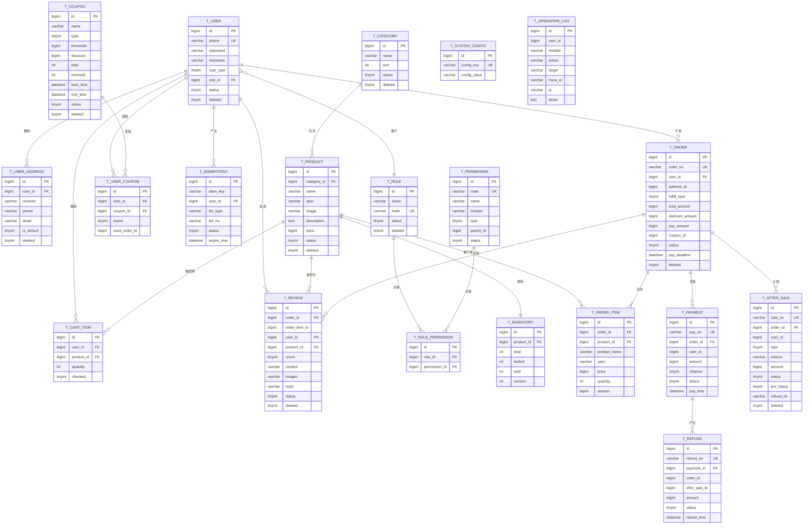

# 邻里鲜生社区超市商城系统 · 数据库设计文档

> 版本：v1.0
> 编写：数据库负责人
> 依据：《需求规格说明书》第 5 章、《设计文档》第 7 章
> 数据库：MySQL 8.0（InnoDB）
> 配套脚本：`docs/sql/schema.sql`（建表）、`docs/sql/init_data.sql`（初始化数据）

---

# 一、文档说明

## 1.1 目的与范围

本文档定义「邻里鲜生」商城系统的物理数据模型，包括命名规范、ER 关系、表结构、索引、枚举字典、初始化数据、迁移管理与一致性约束，作为建库、开发、测试与运维的统一依据。

**包含**：20 张业务表的结构、索引、状态字典、初始化数据、校验 SQL。
**不包含**：缓存键设计（见设计文档 7.x）、接口出入参（见需求文档第 6 章）。

## 1.2 设计依据

| 来源 | 采用内容 |
| --- | --- |
| 需求文档 5.x | 表清单、核心实体字段、金额以分存储、软删除、三态库存 |
| 需求文档 3.4 / 设计 5.5 | 订单状态机与合法流转 |
| 设计文档 6.2.6 | 幂等表与复合唯一键 |
| 设计文档 7.1~7.6 | 各模块补充字段（`pre_status`、`refund_no`、购物车物理删除等） |
| 设计文档 10.5 | 备份与恢复要求（RTO ≤ 30min、RPO ≤ 5min） |

## 1.3 数据库环境

| 项 | 取值 |
| --- | --- |
| 数据库 | MySQL 8.0.16+（需支持 CHECK 约束） |
| 存储引擎 | InnoDB |
| 字符集 / 排序规则 | `utf8mb4` / `utf8mb4_0900_ai_ci` |
| 时区 | `Asia/Shanghai`（连接串设置 `serverTimezone=Asia/Shanghai`） |
| 事务隔离级别 | `READ COMMITTED`（默认，配合条件更新与乐观锁） |
| 金额单位 | 分（`BIGINT`） |

---

# 二、设计规范

## 2.1 命名规范

| 对象 | 规范 | 示例 |
| --- | --- | --- |
| 表名 | `t_` + 业务名（小写下划线） | `t_order`、`t_order_item` |
| 字段名 | 小写下划线 | `pay_amount`、`create_time` |
| 主键 | 统一 `id` | `id BIGINT UNSIGNED` |
| 业务单号 | `业务_no` | `order_no`、`pay_no`、`refund_no`、`sale_no` |
| 唯一索引 | `uk_` + 字段 | `uk_order_no` |
| 普通索引 | `idx_` + 字段 | `idx_user_status` |
| 外键（逻辑） | 表名_id | `user_id`、`order_id` |

## 2.2 字段类型与精度

| 类型 | 用途 | 说明 |
| --- | --- | --- |
| `BIGINT UNSIGNED` | 主键、外键、金额、数量统计 | 金额单位为分 |
| `INT` | 库存、排序、数量 | 库存不超过 21 亿 |
| `TINYINT` | 状态、类型、布尔 | 0/1 或枚举值 |
| `VARCHAR(n)` | 名称、单号、描述 | 单号 32，名称 128 |
| `TEXT` | 长文本（商品描述、日志详情） | 不参与索引 |
| `DATETIME` | 时间 | 精确到秒；应用层统一时区 |

## 2.3 主键与业务单号

- 所有表使用 `BIGINT UNSIGNED AUTO_INCREMENT` 主键，避免业务字段作主键。
- 订单、支付、退款、售后另设**独立业务单号**（`order_no` 等），对外暴露单号而非自增主键，防止 ID 枚举与信息泄露。
- 业务单号规则建议：`前缀 + yyyyMMddHHmmss + 6 位随机/序列`，全局唯一由唯一索引兜底。

## 2.4 外键策略

**采用逻辑外键，不建物理 `FOREIGN KEY`**。理由：

1. 便于后续分库分表与数据归档，物理外键会成为迁移障碍。
2. 避免级联删除/更新带来的隐式行为与锁竞争。
3. 关联完整性由应用层与测试用例保证。

ER 图中的连线表示**逻辑关系**，不是数据库物理约束。

## 2.5 逻辑删除

- 需要保留历史的表统一使用 `deleted TINYINT NOT NULL DEFAULT 0`（0 正常，1 删除）。
- **例外（物理删除）**：`t_cart_item` 为个人临时数据、无审计价值，物理删除，且不设 `deleted`，避免逻辑删除与唯一键冲突。
- **金融与日志表不做删除**：`t_payment`、`t_refund`、`t_operation_log`、`t_idempotent` 不设 `deleted`。
- 逻辑删除表的唯一索引需评估冲突：`t_category` 不对 `(name, deleted)` 建唯一键，同名判断由应用层仅对 `deleted=0` 校验。

## 2.6 审计字段

| 字段 | 适用表 | 说明 |
| --- | --- | --- |
| `create_time` | 除日志外的全部表 | 创建时间，默认当前时间 |
| `update_time` | 需要更新的表 | 更新时间，`ON UPDATE CURRENT_TIMESTAMP` |
| `deleted` | 需保留历史的表 | 逻辑删除标记 |
| `t_operation_log` | 关键写操作 | 记录操作人、对象、traceId、变更详情 |

## 2.7 金额与时间

- 金额一律 `BIGINT`，单位**分**；禁止 `FLOAT/DOUBLE`。
- 时间字段使用 `DATETIME`，连接串固定时区；跨时区展示由前端转换。
- 支付截止时间 `pay_deadline` 是超时关单的唯一依据。

## 2.8 索引规范

- 每个表必须有主键；业务单号必须有唯一索引。
- 高频查询按「等值在前、范围在后」建立联合索引。
- 避免冗余索引；联合索引已覆盖的前缀不重复建单列索引。
- 模糊搜索先用 `LIKE '%kw%'`，数据量增大后再启用 ngram 全文索引（预留脚本见 5.6）。
- 索引命名统一 `uk_` / `idx_`。

## 2.9 字符集与引擎

- 统一 `ENGINE=InnoDB DEFAULT CHARSET=utf8mb4 COLLATE=utf8mb4_0900_ai_ci`。
- 每张表、每个字段必须有 `COMMENT`，便于生成数据字典。

---

# 三、ER 图



> 说明：`T_ORDER ↔ T_PAYMENT` 为 1:N（一笔订单可能存在多次支付尝试）；`T_PAYMENT ↔ T_REFUND` 为 1:N（一次支付可产生多次退款）；`T_ROLE_PERMISSION`、`T_USER_COUPON` 为 N:N 中间表。所有关系均为**逻辑外键**（见 2.4）。

---

# 四、表清单

| 序号 | 表名 | 中文名 | 所属模块 | 删除方式 |
| :-: | --- | --- | --- | --- |
| 1 | t_user | 用户表 | 用户 | 逻辑删除 |
| 2 | t_user_address | 收货地址表 | 用户 | 逻辑删除 |
| 3 | t_role | 角色表 | 权限 | 逻辑删除 |
| 4 | t_permission | 权限点表 | 权限 | 逻辑删除 |
| 5 | t_role_permission | 角色权限关联表 | 权限 | 物理删除 |
| 6 | t_category | 商品分类表 | 商品 | 逻辑删除 |
| 7 | t_product | 商品表 | 商品 | 逻辑删除 |
| 8 | t_inventory | 库存表 | 库存 | 不做删除 |
| 9 | t_cart_item | 购物车项表 | 购物车 | 物理删除 |
| 10 | t_order | 订单表 | 订单 | 逻辑删除 |
| 11 | t_order_item | 订单项表 | 订单 | 跟随订单 |
| 12 | t_payment | 支付单表 | 支付 | 不做删除 |
| 13 | t_refund | 退款单表 | 支付 | 不做删除 |
| 14 | t_after_sale | 售后单表 | 售后 | 逻辑删除 |
| 15 | t_coupon | 优惠券表 | 营销 | 逻辑删除 |
| 16 | t_user_coupon | 用户优惠券表 | 营销 | 不做删除 |
| 17 | t_review | 评价表 | 评价 | 逻辑删除 |
| 18 | t_system_config | 系统配置表 | 系统 | 不做删除 |
| 19 | t_operation_log | 操作日志表 | 系统 | 不做删除 |
| 20 | t_idempotent | 幂等记录表 | 系统 | 定期清理 |

---

# 五、表结构详细设计

> 字段说明中的「空」表示是否允许 NULL；未标注默认值的非空字段由应用写入。

## 5.1 t_user 用户表

前后台合用一张表，`user_type` 区分会员、运营、管理员；一个用户同一时刻只有一个主要角色。

| 字段 | 类型 | 空 | 默认 | 说明 |
| --- | --- | :-: | --- | --- |
| id | BIGINT UNSIGNED | 否 | 自增 | 主键 |
| phone | VARCHAR(20) | 否 | | 手机号，登录账号 |
| password | VARCHAR(100) | 否 | | BCrypt 密码哈希 |
| nickname | VARCHAR(50) | 否 | '' | 昵称 |
| user_type | TINYINT | 否 | | 1 会员、2 运营、3 管理员 |
| role_id | BIGINT UNSIGNED | 否 | | 角色 ID（逻辑外键 t_role.id） |
| status | TINYINT | 否 | 1 | 1 正常、0 禁用 |
| create_time | DATETIME | 否 | CURRENT_TIMESTAMP | 创建时间 |
| update_time | DATETIME | 否 | CURRENT_TIMESTAMP | 更新时间 |
| deleted | TINYINT | 否 | 0 | 0 正常、1 删除 |

**索引**：`PRIMARY KEY(id)`、`UNIQUE KEY uk_phone(phone)`、`KEY idx_role_id(role_id)`

```sql
CREATE TABLE t_user (
  id            BIGINT UNSIGNED NOT NULL AUTO_INCREMENT COMMENT '主键',
  phone         VARCHAR(20)     NOT NULL COMMENT '手机号（登录账号）',
  password      VARCHAR(100)    NOT NULL COMMENT 'BCrypt 密码哈希',
  nickname      VARCHAR(50)     NOT NULL DEFAULT '' COMMENT '昵称',
  user_type     TINYINT         NOT NULL COMMENT '1会员 2运营 3管理员',
  role_id       BIGINT UNSIGNED NOT NULL COMMENT '角色ID',
  status        TINYINT         NOT NULL DEFAULT 1 COMMENT '1正常 0禁用',
  create_time   DATETIME        NOT NULL DEFAULT CURRENT_TIMESTAMP COMMENT '创建时间',
  update_time   DATETIME        NOT NULL DEFAULT CURRENT_TIMESTAMP ON UPDATE CURRENT_TIMESTAMP COMMENT '更新时间',
  deleted       TINYINT         NOT NULL DEFAULT 0 COMMENT '逻辑删除 0否 1是',
  PRIMARY KEY (id),
  UNIQUE KEY uk_phone (phone),
  KEY idx_role_id (role_id)
) ENGINE=InnoDB DEFAULT CHARSET=utf8mb4 COLLATE=utf8mb4_0900_ai_ci COMMENT='用户表（前后台合用）';
```

## 5.2 t_user_address 收货地址表

| 字段 | 类型 | 空 | 默认 | 说明 |
| --- | --- | :-: | --- | --- |
| id | BIGINT UNSIGNED | 否 | 自增 | 主键 |
| user_id | BIGINT UNSIGNED | 否 | | 用户 ID |
| receiver | VARCHAR(50) | 否 | | 收货人 |
| phone | VARCHAR(20) | 否 | | 联系电话 |
| detail | VARCHAR(255) | 否 | | 详细地址 |
| is_default | TINYINT | 否 | 0 | 1 默认、0 非默认 |
| create_time | DATETIME | 否 | CURRENT_TIMESTAMP | 创建时间 |
| update_time | DATETIME | 否 | CURRENT_TIMESTAMP | 更新时间 |
| deleted | TINYINT | 否 | 0 | 逻辑删除 |

**索引**：`KEY idx_user_default(user_id, is_default, deleted)`。默认地址唯一性由应用在同一事务内「先清空再置默认」保证（MySQL 无部分唯一索引）。

```sql
CREATE TABLE t_user_address (
  id            BIGINT UNSIGNED NOT NULL AUTO_INCREMENT COMMENT '主键',
  user_id       BIGINT UNSIGNED NOT NULL COMMENT '用户ID',
  receiver      VARCHAR(50)     NOT NULL COMMENT '收货人',
  phone         VARCHAR(20)     NOT NULL COMMENT '联系电话',
  detail        VARCHAR(255)    NOT NULL COMMENT '详细地址',
  is_default    TINYINT         NOT NULL DEFAULT 0 COMMENT '1默认 0非默认',
  create_time   DATETIME        NOT NULL DEFAULT CURRENT_TIMESTAMP COMMENT '创建时间',
  update_time   DATETIME        NOT NULL DEFAULT CURRENT_TIMESTAMP ON UPDATE CURRENT_TIMESTAMP COMMENT '更新时间',
  deleted       TINYINT         NOT NULL DEFAULT 0 COMMENT '逻辑删除 0否 1是',
  PRIMARY KEY (id),
  KEY idx_user_default (user_id, is_default, deleted)
) ENGINE=InnoDB DEFAULT CHARSET=utf8mb4 COLLATE=utf8mb4_0900_ai_ci COMMENT='收货地址表';
```

## 5.3 t_role 角色表

| 字段 | 类型 | 空 | 默认 | 说明 |
| --- | --- | :-: | --- | --- |
| id | BIGINT UNSIGNED | 否 | 自增 | 主键 |
| name | VARCHAR(50) | 否 | | 角色名 |
| code | VARCHAR(50) | 否 | | 角色编码（MEMBER/OPERATOR/ADMIN） |
| remark | VARCHAR(255) | 是 | NULL | 备注 |
| status | TINYINT | 否 | 1 | 1 启用、0 停用 |
| create_time | DATETIME | 否 | CURRENT_TIMESTAMP | 创建时间 |
| update_time | DATETIME | 否 | CURRENT_TIMESTAMP | 更新时间 |
| deleted | TINYINT | 否 | 0 | 逻辑删除 |

**索引**：`UNIQUE KEY uk_code(code)`

```sql
CREATE TABLE t_role (
  id            BIGINT UNSIGNED NOT NULL AUTO_INCREMENT COMMENT '主键',
  name          VARCHAR(50)     NOT NULL COMMENT '角色名',
  code          VARCHAR(50)     NOT NULL COMMENT '角色编码',
  remark        VARCHAR(255)    NULL COMMENT '备注',
  status        TINYINT         NOT NULL DEFAULT 1 COMMENT '1启用 0停用',
  create_time   DATETIME        NOT NULL DEFAULT CURRENT_TIMESTAMP COMMENT '创建时间',
  update_time   DATETIME        NOT NULL DEFAULT CURRENT_TIMESTAMP ON UPDATE CURRENT_TIMESTAMP COMMENT '更新时间',
  deleted       TINYINT         NOT NULL DEFAULT 0 COMMENT '逻辑删除 0否 1是',
  PRIMARY KEY (id),
  UNIQUE KEY uk_code (code)
) ENGINE=InnoDB DEFAULT CHARSET=utf8mb4 COLLATE=utf8mb4_0900_ai_ci COMMENT='角色表';
```

## 5.4 t_permission 权限点表

| 字段 | 类型 | 空 | 默认 | 说明 |
| --- | --- | :-: | --- | --- |
| id | BIGINT UNSIGNED | 否 | 自增 | 主键 |
| code | VARCHAR(100) | 否 | | 权限点编码（模块:资源:操作） |
| name | VARCHAR(100) | 否 | | 权限点名称 |
| module | VARCHAR(50) | 否 | | 所属模块 |
| type | TINYINT | 否 | 3 | 1 菜单、2 按钮、3 接口 |
| parent_id | BIGINT UNSIGNED | 否 | 0 | 父权限点，0 为根 |
| sort | INT | 否 | 0 | 排序 |
| status | TINYINT | 否 | 1 | 1 启用、0 停用 |
| create_time | DATETIME | 否 | CURRENT_TIMESTAMP | 创建时间 |
| update_time | DATETIME | 否 | CURRENT_TIMESTAMP | 更新时间 |
| deleted | TINYINT | 否 | 0 | 逻辑删除 |

**索引**：`UNIQUE KEY uk_code(code)`、`KEY idx_module(module)`

```sql
CREATE TABLE t_permission (
  id            BIGINT UNSIGNED NOT NULL AUTO_INCREMENT COMMENT '主键',
  code          VARCHAR(100)    NOT NULL COMMENT '权限点编码（模块:资源:操作）',
  name          VARCHAR(100)    NOT NULL COMMENT '权限点名称',
  module        VARCHAR(50)     NOT NULL COMMENT '所属模块',
  type          TINYINT         NOT NULL DEFAULT 3 COMMENT '1菜单 2按钮 3接口',
  parent_id     BIGINT UNSIGNED NOT NULL DEFAULT 0 COMMENT '父权限点，0为根',
  sort          INT             NOT NULL DEFAULT 0 COMMENT '排序',
  status        TINYINT         NOT NULL DEFAULT 1 COMMENT '1启用 0停用',
  create_time   DATETIME        NOT NULL DEFAULT CURRENT_TIMESTAMP COMMENT '创建时间',
  update_time   DATETIME        NOT NULL DEFAULT CURRENT_TIMESTAMP ON UPDATE CURRENT_TIMESTAMP COMMENT '更新时间',
  deleted       TINYINT         NOT NULL DEFAULT 0 COMMENT '逻辑删除 0否 1是',
  PRIMARY KEY (id),
  UNIQUE KEY uk_code (code),
  KEY idx_module (module)
) ENGINE=InnoDB DEFAULT CHARSET=utf8mb4 COLLATE=utf8mb4_0900_ai_ci COMMENT='权限点表';
```

## 5.5 t_role_permission 角色权限关联表

| 字段 | 类型 | 空 | 默认 | 说明 |
| --- | --- | :-: | --- | --- |
| id | BIGINT UNSIGNED | 否 | 自增 | 主键 |
| role_id | BIGINT UNSIGNED | 否 | | 角色 ID |
| permission_id | BIGINT UNSIGNED | 否 | | 权限点 ID |
| create_time | DATETIME | 否 | CURRENT_TIMESTAMP | 创建时间 |

**索引**：`UNIQUE KEY uk_role_permission(role_id, permission_id)`、`KEY idx_permission_id(permission_id)`

```sql
CREATE TABLE t_role_permission (
  id            BIGINT UNSIGNED NOT NULL AUTO_INCREMENT COMMENT '主键',
  role_id       BIGINT UNSIGNED NOT NULL COMMENT '角色ID',
  permission_id BIGINT UNSIGNED NOT NULL COMMENT '权限点ID',
  create_time   DATETIME        NOT NULL DEFAULT CURRENT_TIMESTAMP COMMENT '创建时间',
  PRIMARY KEY (id),
  UNIQUE KEY uk_role_permission (role_id, permission_id),
  KEY idx_permission_id (permission_id)
) ENGINE=InnoDB DEFAULT CHARSET=utf8mb4 COLLATE=utf8mb4_0900_ai_ci COMMENT='角色权限关联表';
```

## 5.6 t_category 商品分类表

| 字段 | 类型 | 空 | 默认 | 说明 |
| --- | --- | :-: | --- | --- |
| id | BIGINT UNSIGNED | 否 | 自增 | 主键 |
| name | VARCHAR(50) | 否 | | 分类名 |
| sort | INT | 否 | 0 | 排序，越小越靠前 |
| status | TINYINT | 否 | 1 | 1 启用、0 停用 |
| create_time | DATETIME | 否 | CURRENT_TIMESTAMP | 创建时间 |
| update_time | DATETIME | 否 | CURRENT_TIMESTAMP | 更新时间 |
| deleted | TINYINT | 否 | 0 | 逻辑删除 |

**索引**：`KEY idx_name(name)`、`KEY idx_status_sort(status, sort)`。**不建 `(name, deleted)` 唯一键**：逻辑删除多条同名分类会冲突，同名校验由应用层仅对 `deleted=0` 执行。

```sql
CREATE TABLE t_category (
  id            BIGINT UNSIGNED NOT NULL AUTO_INCREMENT COMMENT '主键',
  name          VARCHAR(50)     NOT NULL COMMENT '分类名',
  sort          INT             NOT NULL DEFAULT 0 COMMENT '排序，越小越靠前',
  status        TINYINT         NOT NULL DEFAULT 1 COMMENT '1启用 0停用',
  create_time   DATETIME        NOT NULL DEFAULT CURRENT_TIMESTAMP COMMENT '创建时间',
  update_time   DATETIME        NOT NULL DEFAULT CURRENT_TIMESTAMP ON UPDATE CURRENT_TIMESTAMP COMMENT '更新时间',
  deleted       TINYINT         NOT NULL DEFAULT 0 COMMENT '逻辑删除 0否 1是',
  PRIMARY KEY (id),
  KEY idx_name (name),
  KEY idx_status_sort (status, sort)
) ENGINE=InnoDB DEFAULT CHARSET=utf8mb4 COLLATE=utf8mb4_0900_ai_ci COMMENT='商品分类表';
```

> 搜索量增大后可启用（本期不启用）：
> ```sql
> ALTER TABLE t_product ADD FULLTEXT INDEX ft_name (name) WITH PARSER ngram;
> ```

## 5.7 t_product 商品表（单层商品）

| 字段 | 类型 | 空 | 默认 | 说明 |
| --- | --- | :-: | --- | --- |
| id | BIGINT UNSIGNED | 否 | 自增 | 主键 |
| category_id | BIGINT UNSIGNED | 否 | | 分类 ID |
| name | VARCHAR(128) | 否 | | 商品名称 |
| spec | VARCHAR(128) | 是 | NULL | 规格（如 500g/瓶） |
| image | VARCHAR(255) | 是 | NULL | 主图 URL |
| description | TEXT | 是 | NULL | 商品描述 |
| price | BIGINT UNSIGNED | 否 | | 售价（分） |
| status | TINYINT | 否 | 1 | 1 上架、0 下架 |
| create_time | DATETIME | 否 | CURRENT_TIMESTAMP | 创建时间 |
| update_time | DATETIME | 否 | CURRENT_TIMESTAMP | 更新时间 |
| deleted | TINYINT | 否 | 0 | 逻辑删除 |

**索引**：`KEY idx_category_status_deleted(category_id, status, deleted)`、`KEY idx_status_update(status, update_time)`、`KEY idx_name(name)`

```sql
CREATE TABLE t_product (
  id            BIGINT UNSIGNED NOT NULL AUTO_INCREMENT COMMENT '主键',
  category_id   BIGINT UNSIGNED NOT NULL COMMENT '分类ID',
  name          VARCHAR(128)    NOT NULL COMMENT '商品名称',
  spec          VARCHAR(128)    NULL COMMENT '规格',
  image         VARCHAR(255)    NULL COMMENT '主图URL',
  description   TEXT            NULL COMMENT '商品描述',
  price         BIGINT UNSIGNED NOT NULL COMMENT '售价（分）',
  status        TINYINT         NOT NULL DEFAULT 1 COMMENT '1上架 0下架',
  create_time   DATETIME        NOT NULL DEFAULT CURRENT_TIMESTAMP COMMENT '创建时间',
  update_time   DATETIME        NOT NULL DEFAULT CURRENT_TIMESTAMP ON UPDATE CURRENT_TIMESTAMP COMMENT '更新时间',
  deleted       TINYINT         NOT NULL DEFAULT 0 COMMENT '逻辑删除 0否 1是',
  PRIMARY KEY (id),
  KEY idx_category_status_deleted (category_id, status, deleted),
  KEY idx_status_update (status, update_time),
  KEY idx_name (name)
) ENGINE=InnoDB DEFAULT CHARSET=utf8mb4 COLLATE=utf8mb4_0900_ai_ci COMMENT='商品表（单层商品）';
```

## 5.8 t_inventory 库存表（并发关键）

| 字段 | 类型 | 空 | 默认 | 说明 |
| --- | --- | :-: | --- | --- |
| id | BIGINT UNSIGNED | 否 | 自增 | 主键 |
| product_id | BIGINT UNSIGNED | 否 | | 商品 ID（一商品一库存） |
| total | INT | 否 | 0 | 总库存 |
| locked | INT | 否 | 0 | 锁定库存 |
| sold | INT | 否 | 0 | 已售库存 |
| version | INT | 否 | 0 | 乐观锁版本号 |
| update_time | DATETIME | 否 | CURRENT_TIMESTAMP | 更新时间 |

**可售库存 = total − locked − sold**（不落库）。**索引**：`UNIQUE KEY uk_product_id(product_id)`。
**CHECK**：`total >= 0 AND locked >= 0 AND sold >= 0 AND locked + sold <= total`（MySQL 8.0.16+ 强制执行）。

```sql
CREATE TABLE t_inventory (
  id            BIGINT UNSIGNED NOT NULL AUTO_INCREMENT COMMENT '主键',
  product_id    BIGINT UNSIGNED NOT NULL COMMENT '商品ID',
  total         INT             NOT NULL DEFAULT 0 COMMENT '总库存',
  locked        INT             NOT NULL DEFAULT 0 COMMENT '锁定库存',
  sold          INT             NOT NULL DEFAULT 0 COMMENT '已售库存',
  version       INT             NOT NULL DEFAULT 0 COMMENT '乐观锁版本号',
  update_time   DATETIME        NOT NULL DEFAULT CURRENT_TIMESTAMP ON UPDATE CURRENT_TIMESTAMP COMMENT '更新时间',
  PRIMARY KEY (id),
  UNIQUE KEY uk_product_id (product_id),
  CONSTRAINT chk_inventory_nonneg CHECK (total >= 0 AND locked >= 0 AND sold >= 0 AND locked + sold <= total)
) ENGINE=InnoDB DEFAULT CHARSET=utf8mb4 COLLATE=utf8mb4_0900_ai_ci COMMENT='库存表（三态库存）';
```

## 5.9 t_cart_item 购物车项表

| 字段 | 类型 | 空 | 默认 | 说明 |
| --- | --- | :-: | --- | --- |
| id | BIGINT UNSIGNED | 否 | 自增 | 主键 |
| user_id | BIGINT UNSIGNED | 否 | | 用户 ID |
| product_id | BIGINT UNSIGNED | 否 | | 商品 ID |
| quantity | INT | 否 | 1 | 数量（1~99） |
| checked | TINYINT | 否 | 1 | 1 勾选、0 未勾选 |
| create_time | DATETIME | 否 | CURRENT_TIMESTAMP | 创建时间 |
| update_time | DATETIME | 否 | CURRENT_TIMESTAMP | 更新时间 |

**索引**：`UNIQUE KEY uk_user_product(user_id, product_id)`、`KEY idx_user_id(user_id)`。**物理删除，无 `deleted`**。

```sql
CREATE TABLE t_cart_item (
  id            BIGINT UNSIGNED NOT NULL AUTO_INCREMENT COMMENT '主键',
  user_id       BIGINT UNSIGNED NOT NULL COMMENT '用户ID',
  product_id    BIGINT UNSIGNED NOT NULL COMMENT '商品ID',
  quantity      INT             NOT NULL DEFAULT 1 COMMENT '数量（1~99）',
  checked       TINYINT         NOT NULL DEFAULT 1 COMMENT '1勾选 0未勾选',
  create_time   DATETIME        NOT NULL DEFAULT CURRENT_TIMESTAMP COMMENT '创建时间',
  update_time   DATETIME        NOT NULL DEFAULT CURRENT_TIMESTAMP ON UPDATE CURRENT_TIMESTAMP COMMENT '更新时间',
  PRIMARY KEY (id),
  UNIQUE KEY uk_user_product (user_id, product_id),
  KEY idx_user_id (user_id)
) ENGINE=InnoDB DEFAULT CHARSET=utf8mb4 COLLATE=utf8mb4_0900_ai_ci COMMENT='购物车项表（物理删除）';
```

## 5.10 t_order 订单表

| 字段 | 类型 | 空 | 默认 | 说明 |
| --- | --- | :-: | --- | --- |
| id | BIGINT UNSIGNED | 否 | 自增 | 主键 |
| order_no | VARCHAR(32) | 否 | | 订单号（对外） |
| user_id | BIGINT UNSIGNED | 否 | | 会员 ID |
| address_id | BIGINT UNSIGNED | 是 | NULL | 收货地址 ID（自提为空） |
| fulfill_type | TINYINT | 否 | | 1 配送、2 自提 |
| total_amount | BIGINT UNSIGNED | 否 | | 商品总额（分） |
| discount_amount | BIGINT UNSIGNED | 否 | 0 | 优惠金额（分） |
| pay_amount | BIGINT UNSIGNED | 否 | | 实付金额（分） |
| coupon_id | BIGINT UNSIGNED | 是 | NULL | 使用的用户优惠券 ID |
| status | TINYINT | 否 | 0 | 订单状态（见 7.1） |
| pay_deadline | DATETIME | 是 | NULL | 支付截止时间 |
| remark | VARCHAR(255) | 是 | NULL | 备注 |
| create_time | DATETIME | 否 | CURRENT_TIMESTAMP | 创建时间 |
| update_time | DATETIME | 否 | CURRENT_TIMESTAMP | 更新时间 |
| deleted | TINYINT | 否 | 0 | 逻辑删除 |

**索引**：`UNIQUE KEY uk_order_no(order_no)`、`KEY idx_user_status(user_id, status, deleted)`、`KEY idx_status_deadline(status, pay_deadline)`、`KEY idx_create_time(create_time)`。
**CHECK**：`total_amount >= 0 AND discount_amount >= 0 AND pay_amount >= 0`。

```sql
CREATE TABLE t_order (
  id              BIGINT UNSIGNED NOT NULL AUTO_INCREMENT COMMENT '主键',
  order_no        VARCHAR(32)     NOT NULL COMMENT '订单号',
  user_id         BIGINT UNSIGNED NOT NULL COMMENT '会员ID',
  address_id      BIGINT UNSIGNED NULL COMMENT '收货地址ID（自提为空）',
  fulfill_type    TINYINT         NOT NULL COMMENT '1配送 2自提',
  total_amount    BIGINT UNSIGNED NOT NULL COMMENT '商品总额（分）',
  discount_amount BIGINT UNSIGNED NOT NULL DEFAULT 0 COMMENT '优惠金额（分）',
  pay_amount      BIGINT UNSIGNED NOT NULL COMMENT '实付金额（分）',
  coupon_id       BIGINT UNSIGNED NULL COMMENT '用户优惠券ID',
  status          TINYINT         NOT NULL DEFAULT 0 COMMENT '0待支付 1待发货 2待收货 3已完成 4已取消 5售后中 6已退款',
  pay_deadline    DATETIME        NULL COMMENT '支付截止时间',
  remark          VARCHAR(255)    NULL COMMENT '备注',
  create_time     DATETIME        NOT NULL DEFAULT CURRENT_TIMESTAMP COMMENT '创建时间',
  update_time     DATETIME        NOT NULL DEFAULT CURRENT_TIMESTAMP ON UPDATE CURRENT_TIMESTAMP COMMENT '更新时间',
  deleted         TINYINT         NOT NULL DEFAULT 0 COMMENT '逻辑删除 0否 1是',
  PRIMARY KEY (id),
  UNIQUE KEY uk_order_no (order_no),
  KEY idx_user_status (user_id, status, deleted),
  KEY idx_status_deadline (status, pay_deadline),
  KEY idx_create_time (create_time),
  CONSTRAINT chk_order_amount CHECK (total_amount >= 0 AND discount_amount >= 0 AND pay_amount >= 0)
) ENGINE=InnoDB DEFAULT CHARSET=utf8mb4 COLLATE=utf8mb4_0900_ai_ci COMMENT='订单表';
```

## 5.11 t_order_item 订单项表

保存商品快照，商品改价/下架不影响历史订单。

| 字段 | 类型 | 空 | 默认 | 说明 |
| --- | --- | :-: | --- | --- |
| id | BIGINT UNSIGNED | 否 | 自增 | 主键 |
| order_id | BIGINT UNSIGNED | 否 | | 订单 ID |
| product_id | BIGINT UNSIGNED | 否 | | 商品 ID |
| product_name | VARCHAR(128) | 否 | | 商品名快照 |
| spec | VARCHAR(128) | 是 | NULL | 规格快照 |
| price | BIGINT UNSIGNED | 否 | | 成交单价（分，快照） |
| quantity | INT | 否 | | 数量 |
| amount | BIGINT UNSIGNED | 否 | | 小计（分） |
| create_time | DATETIME | 否 | CURRENT_TIMESTAMP | 创建时间 |

**索引**：`KEY idx_order_id(order_id)`、`KEY idx_product_id(product_id)`

```sql
CREATE TABLE t_order_item (
  id            BIGINT UNSIGNED NOT NULL AUTO_INCREMENT COMMENT '主键',
  order_id      BIGINT UNSIGNED NOT NULL COMMENT '订单ID',
  product_id    BIGINT UNSIGNED NOT NULL COMMENT '商品ID',
  product_name  VARCHAR(128)    NOT NULL COMMENT '商品名快照',
  spec          VARCHAR(128)    NULL COMMENT '规格快照',
  price         BIGINT UNSIGNED NOT NULL COMMENT '成交单价（分，快照）',
  quantity      INT             NOT NULL COMMENT '数量',
  amount        BIGINT UNSIGNED NOT NULL COMMENT '小计（分）',
  create_time   DATETIME        NOT NULL DEFAULT CURRENT_TIMESTAMP COMMENT '创建时间',
  PRIMARY KEY (id),
  KEY idx_order_id (order_id),
  KEY idx_product_id (product_id)
) ENGINE=InnoDB DEFAULT CHARSET=utf8mb4 COLLATE=utf8mb4_0900_ai_ci COMMENT='订单项表（商品快照）';
```

## 5.12 t_payment 支付单表

| 字段 | 类型 | 空 | 默认 | 说明 |
| --- | --- | :-: | --- | --- |
| id | BIGINT UNSIGNED | 否 | 自增 | 主键 |
| pay_no | VARCHAR(32) | 否 | | 支付单号（幂等键） |
| order_id | BIGINT UNSIGNED | 否 | | 订单 ID |
| user_id | BIGINT UNSIGNED | 否 | | 用户 ID |
| amount | BIGINT UNSIGNED | 否 | | 支付金额（分） |
| channel | TINYINT | 否 | 1 | 支付渠道：1 沙箱 |
| status | TINYINT | 否 | 0 | 0 待支付、1 支付中、2 成功、3 失败、4 已关闭 |
| pay_time | DATETIME | 是 | NULL | 支付成功时间 |
| create_time | DATETIME | 否 | CURRENT_TIMESTAMP | 创建时间 |
| update_time | DATETIME | 否 | CURRENT_TIMESTAMP | 更新时间 |

**索引**：`UNIQUE KEY uk_pay_no(pay_no)`、`KEY idx_order_id(order_id)`、`KEY idx_user_id(user_id)`、`KEY idx_status_create(status, create_time)`

```sql
CREATE TABLE t_payment (
  id            BIGINT UNSIGNED NOT NULL AUTO_INCREMENT COMMENT '主键',
  pay_no        VARCHAR(32)     NOT NULL COMMENT '支付单号（幂等键）',
  order_id      BIGINT UNSIGNED NOT NULL COMMENT '订单ID',
  user_id       BIGINT UNSIGNED NOT NULL COMMENT '用户ID',
  amount        BIGINT UNSIGNED NOT NULL COMMENT '支付金额（分）',
  channel       TINYINT         NOT NULL DEFAULT 1 COMMENT '支付渠道：1沙箱',
  status        TINYINT         NOT NULL DEFAULT 0 COMMENT '0待支付 1支付中 2成功 3失败 4已关闭',
  pay_time      DATETIME        NULL COMMENT '支付成功时间',
  create_time   DATETIME        NOT NULL DEFAULT CURRENT_TIMESTAMP COMMENT '创建时间',
  update_time   DATETIME        NOT NULL DEFAULT CURRENT_TIMESTAMP ON UPDATE CURRENT_TIMESTAMP COMMENT '更新时间',
  PRIMARY KEY (id),
  UNIQUE KEY uk_pay_no (pay_no),
  KEY idx_order_id (order_id),
  KEY idx_user_id (user_id),
  KEY idx_status_create (status, create_time)
) ENGINE=InnoDB DEFAULT CHARSET=utf8mb4 COLLATE=utf8mb4_0900_ai_ci COMMENT='支付单表';
```

## 5.13 t_refund 退款单表

| 字段 | 类型 | 空 | 默认 | 说明 |
| --- | --- | :-: | --- | --- |
| id | BIGINT UNSIGNED | 否 | 自增 | 主键 |
| refund_no | VARCHAR(32) | 否 | | 退款单号（幂等键） |
| payment_id | BIGINT UNSIGNED | 否 | | 支付单 ID |
| order_id | BIGINT UNSIGNED | 否 | | 订单 ID |
| after_sale_id | BIGINT UNSIGNED | 是 | NULL | 关联售后单 ID（竞态补偿退款可为空） |
| amount | BIGINT UNSIGNED | 否 | | 退款金额（分） |
| status | TINYINT | 否 | 0 | 0 退款中、1 成功、2 失败 |
| refund_time | DATETIME | 是 | NULL | 退款成功时间 |
| create_time | DATETIME | 否 | CURRENT_TIMESTAMP | 创建时间 |
| update_time | DATETIME | 否 | CURRENT_TIMESTAMP | 更新时间 |

**索引**：`UNIQUE KEY uk_refund_no(refund_no)`、`KEY idx_payment_id(payment_id)`、`KEY idx_order_id(order_id)`、`KEY idx_after_sale_id(after_sale_id)`、`KEY idx_status_create(status, create_time)`

```sql
CREATE TABLE t_refund (
  id            BIGINT UNSIGNED NOT NULL AUTO_INCREMENT COMMENT '主键',
  refund_no     VARCHAR(32)     NOT NULL COMMENT '退款单号（幂等键）',
  payment_id    BIGINT UNSIGNED NOT NULL COMMENT '支付单ID',
  order_id      BIGINT UNSIGNED NOT NULL COMMENT '订单ID',
  after_sale_id BIGINT UNSIGNED NULL COMMENT '关联售后单ID',
  amount        BIGINT UNSIGNED NOT NULL COMMENT '退款金额（分）',
  status        TINYINT         NOT NULL DEFAULT 0 COMMENT '0退款中 1成功 2失败',
  refund_time   DATETIME        NULL COMMENT '退款成功时间',
  create_time   DATETIME        NOT NULL DEFAULT CURRENT_TIMESTAMP COMMENT '创建时间',
  update_time   DATETIME        NOT NULL DEFAULT CURRENT_TIMESTAMP ON UPDATE CURRENT_TIMESTAMP COMMENT '更新时间',
  PRIMARY KEY (id),
  UNIQUE KEY uk_refund_no (refund_no),
  KEY idx_payment_id (payment_id),
  KEY idx_order_id (order_id),
  KEY idx_after_sale_id (after_sale_id),
  KEY idx_status_create (status, create_time)
) ENGINE=InnoDB DEFAULT CHARSET=utf8mb4 COLLATE=utf8mb4_0900_ai_ci COMMENT='退款单表';
```

## 5.14 t_after_sale 售后单表

| 字段 | 类型 | 空 | 默认 | 说明 |
| --- | --- | :-: | --- | --- |
| id | BIGINT UNSIGNED | 否 | 自增 | 主键 |
| sale_no | VARCHAR(32) | 否 | | 售后单号 |
| order_id | BIGINT UNSIGNED | 否 | | 订单 ID |
| user_id | BIGINT UNSIGNED | 否 | | 会员 ID |
| type | TINYINT | 否 | | 1 退款、2 退货退款 |
| reason | VARCHAR(255) | 否 | | 申请原因 |
| amount | BIGINT UNSIGNED | 否 | | 申请退款金额（分） |
| status | TINYINT | 否 | 0 | 0 待审核、1 已同意、2 已驳回、3 退款中、4 已完成 |
| pre_status | TINYINT | 否 | | 申请前订单状态（驳回回退依据） |
| refund_no | VARCHAR(32) | 是 | NULL | 关联退款单号（防重复退款） |
| audit_time | DATETIME | 是 | NULL | 审核时间 |
| remark | VARCHAR(255) | 是 | NULL | 处理备注 |
| create_time | DATETIME | 否 | CURRENT_TIMESTAMP | 创建时间 |
| update_time | DATETIME | 否 | CURRENT_TIMESTAMP | 更新时间 |
| deleted | TINYINT | 否 | 0 | 逻辑删除 |

**索引**：`UNIQUE KEY uk_sale_no(sale_no)`、`KEY idx_order_id(order_id)`、`KEY idx_user_status(user_id, status)`、`KEY idx_status_update(status, update_time)`

```sql
CREATE TABLE t_after_sale (
  id            BIGINT UNSIGNED NOT NULL AUTO_INCREMENT COMMENT '主键',
  sale_no       VARCHAR(32)     NOT NULL COMMENT '售后单号',
  order_id      BIGINT UNSIGNED NOT NULL COMMENT '订单ID',
  user_id       BIGINT UNSIGNED NOT NULL COMMENT '会员ID',
  type          TINYINT         NOT NULL COMMENT '1退款 2退货退款',
  reason        VARCHAR(255)    NOT NULL COMMENT '申请原因',
  amount        BIGINT UNSIGNED NOT NULL COMMENT '申请退款金额（分）',
  status        TINYINT         NOT NULL DEFAULT 0 COMMENT '0待审核 1已同意 2已驳回 3退款中 4已完成',
  pre_status    TINYINT         NOT NULL COMMENT '申请前订单状态',
  refund_no     VARCHAR(32)     NULL COMMENT '关联退款单号',
  audit_time    DATETIME        NULL COMMENT '审核时间',
  remark        VARCHAR(255)    NULL COMMENT '处理备注',
  create_time   DATETIME        NOT NULL DEFAULT CURRENT_TIMESTAMP COMMENT '创建时间',
  update_time   DATETIME        NOT NULL DEFAULT CURRENT_TIMESTAMP ON UPDATE CURRENT_TIMESTAMP COMMENT '更新时间',
  deleted       TINYINT         NOT NULL DEFAULT 0 COMMENT '逻辑删除 0否 1是',
  PRIMARY KEY (id),
  UNIQUE KEY uk_sale_no (sale_no),
  KEY idx_order_id (order_id),
  KEY idx_user_status (user_id, status),
  KEY idx_status_update (status, update_time)
) ENGINE=InnoDB DEFAULT CHARSET=utf8mb4 COLLATE=utf8mb4_0900_ai_ci COMMENT='售后单表';
```

## 5.15 t_coupon 优惠券表

| 字段 | 类型 | 空 | 默认 | 说明 |
| --- | --- | :-: | --- | --- |
| id | BIGINT UNSIGNED | 否 | 自增 | 主键 |
| name | VARCHAR(100) | 否 | | 券名称 |
| type | TINYINT | 否 | 1 | 1 满减 |
| threshold | BIGINT UNSIGNED | 否 | | 使用门槛（分） |
| discount | BIGINT UNSIGNED | 否 | | 优惠面额（分），不得大于门槛 |
| total | INT | 否 | | 发放总量 |
| received | INT | 否 | 0 | 已领取数量 |
| start_time | DATETIME | 否 | | 生效时间 |
| end_time | DATETIME | 否 | | 失效时间 |
| status | TINYINT | 否 | 1 | 1 可领、0 停用 |
| create_time | DATETIME | 否 | CURRENT_TIMESTAMP | 创建时间 |
| update_time | DATETIME | 否 | CURRENT_TIMESTAMP | 更新时间 |
| deleted | TINYINT | 否 | 0 | 逻辑删除 |

**索引**：`KEY idx_status_time(status, start_time, end_time)`、`KEY idx_name(name)`

```sql
CREATE TABLE t_coupon (
  id            BIGINT UNSIGNED NOT NULL AUTO_INCREMENT COMMENT '主键',
  name          VARCHAR(100)    NOT NULL COMMENT '券名称',
  type          TINYINT         NOT NULL DEFAULT 1 COMMENT '1满减',
  threshold     BIGINT UNSIGNED NOT NULL COMMENT '使用门槛（分）',
  discount      BIGINT UNSIGNED NOT NULL COMMENT '优惠面额（分）',
  total         INT             NOT NULL COMMENT '发放总量',
  received      INT             NOT NULL DEFAULT 0 COMMENT '已领取数量',
  start_time    DATETIME        NOT NULL COMMENT '生效时间',
  end_time      DATETIME        NOT NULL COMMENT '失效时间',
  status        TINYINT         NOT NULL DEFAULT 1 COMMENT '1可领 0停用',
  create_time   DATETIME        NOT NULL DEFAULT CURRENT_TIMESTAMP COMMENT '创建时间',
  update_time   DATETIME        NOT NULL DEFAULT CURRENT_TIMESTAMP ON UPDATE CURRENT_TIMESTAMP COMMENT '更新时间',
  deleted       TINYINT         NOT NULL DEFAULT 0 COMMENT '逻辑删除 0否 1是',
  PRIMARY KEY (id),
  KEY idx_status_time (status, start_time, end_time),
  KEY idx_name (name),
  CONSTRAINT chk_coupon_amount CHECK (discount <= threshold AND total >= 0 AND received >= 0)
) ENGINE=InnoDB DEFAULT CHARSET=utf8mb4 COLLATE=utf8mb4_0900_ai_ci COMMENT='优惠券表';
```

## 5.16 t_user_coupon 用户优惠券表

| 字段 | 类型 | 空 | 默认 | 说明 |
| --- | --- | :-: | --- | --- |
| id | BIGINT UNSIGNED | 否 | 自增 | 主键 |
| user_id | BIGINT UNSIGNED | 否 | | 用户 ID |
| coupon_id | BIGINT UNSIGNED | 否 | | 优惠券 ID |
| status | TINYINT | 否 | 0 | 0 未使用、1 已使用、2 已过期 |
| used_order_id | BIGINT UNSIGNED | 是 | NULL | 使用的订单 ID |
| receive_time | DATETIME | 否 | CURRENT_TIMESTAMP | 领取时间 |
| use_time | DATETIME | 是 | NULL | 使用时间 |
| create_time | DATETIME | 否 | CURRENT_TIMESTAMP | 创建时间 |

**索引**：`UNIQUE KEY uk_user_coupon(user_id, coupon_id)`（同一用户同一券只能领一次）、`KEY idx_user_status(user_id, status)`、`KEY idx_used_order(used_order_id)`

```sql
CREATE TABLE t_user_coupon (
  id            BIGINT UNSIGNED NOT NULL AUTO_INCREMENT COMMENT '主键',
  user_id       BIGINT UNSIGNED NOT NULL COMMENT '用户ID',
  coupon_id     BIGINT UNSIGNED NOT NULL COMMENT '优惠券ID',
  status        TINYINT         NOT NULL DEFAULT 0 COMMENT '0未使用 1已使用 2已过期',
  used_order_id BIGINT UNSIGNED NULL COMMENT '使用的订单ID',
  receive_time  DATETIME        NOT NULL DEFAULT CURRENT_TIMESTAMP COMMENT '领取时间',
  use_time      DATETIME        NULL COMMENT '使用时间',
  create_time   DATETIME        NOT NULL DEFAULT CURRENT_TIMESTAMP COMMENT '创建时间',
  PRIMARY KEY (id),
  UNIQUE KEY uk_user_coupon (user_id, coupon_id),
  KEY idx_user_status (user_id, status),
  KEY idx_used_order (used_order_id)
) ENGINE=InnoDB DEFAULT CHARSET=utf8mb4 COLLATE=utf8mb4_0900_ai_ci COMMENT='用户优惠券表';
```

## 5.17 t_review 评价表

| 字段 | 类型 | 空 | 默认 | 说明 |
| --- | --- | :-: | --- | --- |
| id | BIGINT UNSIGNED | 否 | 自增 | 主键 |
| order_id | BIGINT UNSIGNED | 否 | | 订单 ID |
| order_item_id | BIGINT UNSIGNED | 否 | | 订单项 ID（唯一，防重复评价） |
| user_id | BIGINT UNSIGNED | 否 | | 用户 ID |
| product_id | BIGINT UNSIGNED | 否 | | 商品 ID |
| score | TINYINT | 否 | | 评分 1~5 |
| content | VARCHAR(1000) | 是 | NULL | 评价内容 |
| images | VARCHAR(1000) | 是 | NULL | 图片 URL 数组（JSON 字符串） |
| reply | VARCHAR(1000) | 是 | NULL | 运营回复 |
| reply_time | DATETIME | 是 | NULL | 回复时间 |
| status | TINYINT | 否 | 1 | 1 正常、0 隐藏 |
| create_time | DATETIME | 否 | CURRENT_TIMESTAMP | 创建时间 |
| update_time | DATETIME | 否 | CURRENT_TIMESTAMP | 更新时间 |
| deleted | TINYINT | 否 | 0 | 逻辑删除 |

**索引**：`UNIQUE KEY uk_order_item(order_item_id)`、`KEY idx_product_status_time(product_id, status, create_time)`、`KEY idx_user_id(user_id)`
**CHECK**：`score BETWEEN 1 AND 5`

```sql
CREATE TABLE t_review (
  id            BIGINT UNSIGNED NOT NULL AUTO_INCREMENT COMMENT '主键',
  order_id      BIGINT UNSIGNED NOT NULL COMMENT '订单ID',
  order_item_id BIGINT UNSIGNED NOT NULL COMMENT '订单项ID',
  user_id       BIGINT UNSIGNED NOT NULL COMMENT '用户ID',
  product_id    BIGINT UNSIGNED NOT NULL COMMENT '商品ID',
  score         TINYINT         NOT NULL COMMENT '评分1~5',
  content       VARCHAR(1000)   NULL COMMENT '评价内容',
  images        VARCHAR(1000)   NULL COMMENT '图片URL数组（JSON字符串）',
  reply         VARCHAR(1000)   NULL COMMENT '运营回复',
  reply_time    DATETIME        NULL COMMENT '回复时间',
  status        TINYINT         NOT NULL DEFAULT 1 COMMENT '1正常 0隐藏',
  create_time   DATETIME        NOT NULL DEFAULT CURRENT_TIMESTAMP COMMENT '创建时间',
  update_time   DATETIME        NOT NULL DEFAULT CURRENT_TIMESTAMP ON UPDATE CURRENT_TIMESTAMP COMMENT '更新时间',
  deleted       TINYINT         NOT NULL DEFAULT 0 COMMENT '逻辑删除 0否 1是',
  PRIMARY KEY (id),
  UNIQUE KEY uk_order_item (order_item_id),
  KEY idx_product_status_time (product_id, status, create_time),
  KEY idx_user_id (user_id),
  CONSTRAINT chk_review_score CHECK (score BETWEEN 1 AND 5)
) ENGINE=InnoDB DEFAULT CHARSET=utf8mb4 COLLATE=utf8mb4_0900_ai_ci COMMENT='评价表';
```

## 5.18 t_system_config 系统配置表

| 字段 | 类型 | 空 | 默认 | 说明 |
| --- | --- | :-: | --- | --- |
| id | BIGINT UNSIGNED | 否 | 自增 | 主键 |
| config_key | VARCHAR(100) | 否 | | 配置键 |
| config_value | VARCHAR(1000) | 否 | | 配置值 |
| description | VARCHAR(255) | 是 | NULL | 说明 |
| create_time | DATETIME | 否 | CURRENT_TIMESTAMP | 创建时间 |
| update_time | DATETIME | 否 | CURRENT_TIMESTAMP | 更新时间 |

**索引**：`UNIQUE KEY uk_config_key(config_key)`

```sql
CREATE TABLE t_system_config (
  id            BIGINT UNSIGNED NOT NULL AUTO_INCREMENT COMMENT '主键',
  config_key    VARCHAR(100)    NOT NULL COMMENT '配置键',
  config_value  VARCHAR(1000)   NOT NULL COMMENT '配置值',
  description   VARCHAR(255)    NULL COMMENT '说明',
  create_time   DATETIME        NOT NULL DEFAULT CURRENT_TIMESTAMP COMMENT '创建时间',
  update_time   DATETIME        NOT NULL DEFAULT CURRENT_TIMESTAMP ON UPDATE CURRENT_TIMESTAMP COMMENT '更新时间',
  PRIMARY KEY (id),
  UNIQUE KEY uk_config_key (config_key)
) ENGINE=InnoDB DEFAULT CHARSET=utf8mb4 COLLATE=utf8mb4_0900_ai_ci COMMENT='系统配置表';
```

## 5.19 t_operation_log 操作日志表

| 字段 | 类型 | 空 | 默认 | 说明 |
| --- | --- | :-: | --- | --- |
| id | BIGINT UNSIGNED | 否 | 自增 | 主键 |
| user_id | BIGINT UNSIGNED | 是 | NULL | 操作人（系统操作为空） |
| module | VARCHAR(50) | 否 | | 模块 |
| action | VARCHAR(50) | 否 | | 动作 |
| target | VARCHAR(100) | 是 | NULL | 目标对象（订单号等） |
| trace_id | VARCHAR(64) | 是 | NULL | 链路 ID |
| ip | VARCHAR(64) | 是 | NULL | 客户端 IP |
| detail | TEXT | 是 | NULL | 变更详情（JSON） |
| create_time | DATETIME | 否 | CURRENT_TIMESTAMP | 创建时间 |

**索引**：`KEY idx_user_time(user_id, create_time)`、`KEY idx_trace_id(trace_id)`、`KEY idx_create_time(create_time)`

```sql
CREATE TABLE t_operation_log (
  id            BIGINT UNSIGNED NOT NULL AUTO_INCREMENT COMMENT '主键',
  user_id       BIGINT UNSIGNED NULL COMMENT '操作人ID',
  module        VARCHAR(50)     NOT NULL COMMENT '模块',
  action        VARCHAR(50)     NOT NULL COMMENT '动作',
  target        VARCHAR(100)    NULL COMMENT '目标对象',
  trace_id      VARCHAR(64)     NULL COMMENT '链路ID',
  ip            VARCHAR(64)     NULL COMMENT '客户端IP',
  detail        TEXT            NULL COMMENT '变更详情（JSON）',
  create_time   DATETIME        NOT NULL DEFAULT CURRENT_TIMESTAMP COMMENT '创建时间',
  PRIMARY KEY (id),
  KEY idx_user_time (user_id, create_time),
  KEY idx_trace_id (trace_id),
  KEY idx_create_time (create_time)
) ENGINE=InnoDB DEFAULT CHARSET=utf8mb4 COLLATE=utf8mb4_0900_ai_ci COMMENT='操作日志表';
```

## 5.20 t_idempotent 幂等记录表

| 字段 | 类型 | 空 | 默认 | 说明 |
| --- | --- | :-: | --- | --- |
| id | BIGINT UNSIGNED | 否 | 自增 | 主键 |
| idem_key | VARCHAR(64) | 否 | | 客户端幂等键 |
| user_id | BIGINT UNSIGNED | 否 | | 用户 ID |
| biz_type | VARCHAR(32) | 否 | | 业务类型（下单/支付/退款等） |
| biz_no | VARCHAR(32) | 是 | NULL | 生成的业务单号 |
| status | TINYINT | 否 | 0 | 0 处理中、1 成功、2 失败 |
| create_time | DATETIME | 否 | CURRENT_TIMESTAMP | 创建时间 |
| update_time | DATETIME | 否 | CURRENT_TIMESTAMP | 更新时间 |
| expire_time | DATETIME | 否 | | 过期时间（用于清理） |

**索引**：`UNIQUE KEY uk_user_biz_key(user_id, biz_type, idem_key)`、`KEY idx_expire_time(expire_time)`

```sql
CREATE TABLE t_idempotent (
  id            BIGINT UNSIGNED NOT NULL AUTO_INCREMENT COMMENT '主键',
  idem_key      VARCHAR(64)     NOT NULL COMMENT '客户端幂等键',
  user_id       BIGINT UNSIGNED NOT NULL COMMENT '用户ID',
  biz_type      VARCHAR(32)     NOT NULL COMMENT '业务类型',
  biz_no        VARCHAR(32)     NULL COMMENT '生成的业务单号',
  status        TINYINT         NOT NULL DEFAULT 0 COMMENT '0处理中 1成功 2失败',
  create_time   DATETIME        NOT NULL DEFAULT CURRENT_TIMESTAMP COMMENT '创建时间',
  update_time   DATETIME        NOT NULL DEFAULT CURRENT_TIMESTAMP ON UPDATE CURRENT_TIMESTAMP COMMENT '更新时间',
  expire_time   DATETIME        NOT NULL COMMENT '过期时间',
  PRIMARY KEY (id),
  UNIQUE KEY uk_user_biz_key (user_id, biz_type, idem_key),
  KEY idx_expire_time (expire_time)
) ENGINE=InnoDB DEFAULT CHARSET=utf8mb4 COLLATE=utf8mb4_0900_ai_ci COMMENT='幂等记录表';
```

---

# 六、状态与枚举字典

## 6.1 订单状态 `t_order.status`

| 值 | 枚举 | 含义 | 可流转到 |
| :-: | --- | --- | --- |
| 0 | PENDING_PAYMENT | 待支付 | 1 待发货、4 已取消 |
| 1 | PAID | 待发货 | 2 待收货、5 售后中 |
| 2 | DELIVERING | 待收货 | 3 已完成、5 售后中 |
| 3 | COMPLETED | 已完成 | 5 售后中 |
| 4 | CANCELLED | 已取消 | 终态 |
| 5 | AFTER_SALE | 售后中 | 6 已退款、回退至申请前状态 |
| 6 | REFUNDED | 已退款 | 终态 |

> 状态流转必须通过条件更新 `WHERE status = 前置状态` 落库，禁止跨状态跳转。

## 6.2 其他枚举

| 表.字段 | 取值 |
| --- | --- |
| t_user.user_type | 1 会员、2 运营、3 管理员 |
| t_user.status | 1 正常、0 禁用 |
| t_order.fulfill_type | 1 配送、2 自提 |
| t_payment.channel | 1 沙箱 |
| t_payment.status | 0 待支付、1 支付中、2 成功、3 失败、4 已关闭 |
| t_refund.status | 0 退款中、1 成功、2 失败 |
| t_after_sale.type | 1 退款、2 退货退款 |
| t_after_sale.status | 0 待审核、1 已同意、2 已驳回、3 退款中、4 已完成 |
| t_product.status | 1 上架、0 下架 |
| t_category.status | 1 启用、0 停用 |
| t_coupon.type | 1 满减 |
| t_coupon.status | 1 可领、0 停用 |
| t_user_coupon.status | 0 未使用、1 已使用、2 已过期 |
| t_review.status | 1 正常、0 隐藏 |
| t_permission.type | 1 菜单、2 按钮、3 接口 |
| t_idempotent.status | 0 处理中、1 成功、2 失败 |

---

# 七、索引设计说明

| 表 | 索引 | 支撑查询 |
| --- | --- | --- |
| t_user | uk_phone | 登录、注册查重 |
| t_user | idx_role_id | 按角色查用户 |
| t_user_address | idx_user_default | 地址列表、默认地址 |
| t_order | uk_order_no | 按单号查详情、幂等 |
| t_order | idx_user_status | 会员订单列表 |
| t_order | idx_status_deadline | **超时关单扫描** |
| t_order | idx_create_time | 后台按时间筛选、统计 |
| t_order_item | idx_order_id | 订单详情 |
| t_order_item | idx_product_id | 商品销量统计 |
| t_payment | uk_pay_no | 支付回调幂等 |
| t_payment | idx_order_id / idx_user_id | 订单支付记录、用户支付查询 |
| t_refund | uk_refund_no | 退款幂等 |
| t_after_sale | uk_sale_no | 售后详情、幂等 |
| t_after_sale | idx_user_status | 我的售后列表 |
| t_after_sale | idx_status_update | 待审核/退款中扫描 |
| t_inventory | uk_product_id | 一商品一库存、条件更新定位 |
| t_cart_item | uk_user_product | 加购合并、防重复 |
| t_coupon | idx_status_time | 可领券列表 |
| t_user_coupon | uk_user_coupon | 防重复领取 |
| t_user_coupon | idx_used_order | 取消/关单退券 |
| t_review | uk_order_item | 防重复评价 |
| t_review | idx_product_status_time | 商品评价列表 |
| t_product | idx_category_status_deleted | 前台分类商品列表 |
| t_product | idx_status_update | 新上架排序 |
| t_idempotent | uk_user_biz_key | 幂等去重 |
| t_operation_log | idx_trace_id | 按 traceId 排查 |

---

# 八、一致性与并发约束

## 8.1 库存恒等式

```text
total = available + locked + sold
available = total - locked - sold >= 0
```

- `available` 不落库，实时计算。
- 数据库 `CHECK` 约束 `locked + sold <= total` 兜底。
- 所有库存变更使用**原子条件更新**，禁止「先查后改」。

**锁定**：

```sql
UPDATE t_inventory
SET locked = locked + #{n}, version = version + 1, update_time = NOW()
WHERE product_id = #{productId}
  AND total - locked - sold >= #{n};
```

**确认扣减**：

```sql
UPDATE t_inventory
SET locked = locked - #{n}, sold = sold + #{n}, update_time = NOW()
WHERE product_id = #{productId} AND locked >= #{n};
```

**释放回滚**：

```sql
UPDATE t_inventory
SET locked = locked - #{n}, update_time = NOW()
WHERE product_id = #{productId} AND locked >= #{n};
```

## 8.2 幂等唯一键

- 下单：`t_idempotent` 唯一键 `(user_id, biz_type, idem_key)`。
- 支付回调：`t_payment.uk_pay_no`。
- 退款：`t_refund.uk_refund_no`。
- 订单/支付/售后业务单号均为唯一索引。

## 8.3 状态机条件更新

所有状态变更必须带前置状态条件，例如关单：

```sql
UPDATE t_order
SET status = 4, update_time = NOW()
WHERE order_no = #{orderNo} AND status = 0;
```

`affected = 1` 才继续释放库存/退券；`affected = 0` 表示已被支付回调抢先，跳过。

## 8.4 退款与售后

- 售后新增 `pre_status` 记录申请前订单状态，驳回时据此回退。
- 售后新增 `refund_no` 关联退款单，配合 `uk_refund_no` 防重复退款。
- 退款单允许 `after_sale_id` 为空，用于「支付成功 vs 超时关单」竞态补偿。

## 8.5 优惠券

- 领取：`WHERE received < total` 条件更新防超发；`uk_user_coupon` 防重复领取。
- 核销：`WHERE status = 0` 条件更新；下单事务内按**最终订单金额**复验门槛与有效期。
- 退回：`WHERE used_order_id = ? AND status = 1`，重复执行 `affected = 0`。

---

# 九、初始化数据

> 完整脚本见 `docs/sql/init_data.sql`。测试账号口令均为 `123456`。

## 9.1 角色

| id | name | code |
| :-: | --- | --- |
| 1 | 会员 | MEMBER |
| 2 | 商家运营 | OPERATOR |
| 3 | 平台管理员 | ADMIN |

## 9.2 权限点（28 个）

前台：`user:account:register`、`user:account:login`（公开接口，不分配角色）、`user:profile:update`、`address:info:manage`、`product:goods:view`、`cart:item:manage`、`trade:order:create`、`trade:payment:pay`、`trade:order:query`、`trade:order:cancel`、`after:sale:apply`、`review:goods:create`、`marketing:coupon:receive`。

后台：`product:category:manage`、`product:goods:manage`、`stock:info:view`、`stock:info:adjust`、`trade:order:query`（与前台共用）、`trade:order:ship`、`trade:order:close`、`after:sale:audit`、`review:goods:reply`、`marketing:coupon:manage`、`statistics:dashboard:view`、`user:member:manage`、`system:role:manage`、`system:account:manage`、`system:config:manage`、`system:log:audit`。

> 去重后共 28 个权限点（13 个前台 + 15 个后台，`trade:order:query` 前后台共用）。注册/登录仅作为权限目录登记，不参与角色分配。

## 9.3 角色权限

- **MEMBER**：前台功能权限。
- **OPERATOR**：商品、库存、订单、售后、评价、营销、看板等业务权限。
- **ADMIN**：全部权限（含运营业务权限 + 会员管理 + 系统管理）。

## 9.4 系统参数

| config_key | config_value | 说明 |
| --- | --- | --- |
| order.pay.timeout.minutes | 30 | 待支付超时时长（分钟） |
| order.auto.confirm.days | 7 | 发货后自动确认收货天数 |
| payment.sandbox.enabled | true | 支付沙箱开关 |
| stock.warn.threshold | 10 | 库存预警阈值 |
| system.name | 邻里鲜生 | 系统名称 |

## 9.5 测试账号

| 账号 | 手机号 | 口令 | user_type | role_id |
| --- | --- | :-: | :-: | :-: |
| admin | 13800000001 | 123456 | 3 管理员 | 3 |
| operator | 13800000002 | 123456 | 2 运营 | 2 |
| member | 13800000003 | 123456 | 1 会员 | 1 |

> 口令为 BCrypt 哈希（`$2b$`，Spring Security 5+ 可校验）。生产环境必须替换。

## 9.6 演示基础数据

- 4 个分类：水果、蔬菜、粮油、日用。
- 6 个商品及对应库存（含 1 个低库存商品用于预警演示）。

---

# 十、迁移与版本管理

## 10.1 脚本组织

```text
docs/sql/
├── schema.sql        # 全量建表（V1）
├── init_data.sql     # 初始化数据（V2）
└── migrations/       # 后续增量脚本（建议）
    ├── V3__add_xxx.sql
    └── V4__add_yyy.sql
```

## 10.2 迁移规范

- 采用**前向迁移**（forward-only），已发布脚本不得修改，只能追加新版本。
- 版本号连续：`V1__init_schema.sql`、`V2__init_data.sql`……
- 结构变更遵循「扩展 → 双写 → 迁移 → 收缩」：先加列/加表（向后兼容），再迁移数据，最后删除旧结构。
- 上线顺序：**先结构、后代码**；回滚只回代码，数据结构用修正脚本补偿，不回退表结构。
- 若使用 Flyway（与 Java 栈匹配），将脚本放入 `src/main/resources/db/migration`，由应用启动时校验并执行。

## 10.3 环境隔离

- dev：每次重建后执行 `schema.sql` + `init_data.sql`。
- test：按周重置，压测前重建基线数据。
- prod：只执行增量迁移脚本，上线前备份（见第十一章）。

---

# 十一、备份、恢复与运维

对齐设计文档 10.5：**RTO ≤ 30min、RPO ≤ 5min**。

| 对象 | 方式 | 频率 | 保留 |
| --- | --- | --- | --- |
| MySQL 全量 | `mysqldump --single-transaction` | 每日 03:00 | 7 天 |
| MySQL 增量 | binlog（ROW） | 持续 | 7 天 |
| 备份存放 | 独立卷/对象存储 | — | 与应用容器隔离 |

**恢复核对**：恢复后先执行 12.1 的库存恒等式与 12.2 的重复退款检查，再恢复对外服务。

---

# 十二、数据校验 SQL

## 12.1 库存恒等式校验

```sql
-- 不应返回任何行
SELECT product_id, total, locked, sold
FROM t_inventory
WHERE locked < 0 OR sold < 0 OR total < 0
   OR locked + sold > total;
```

## 12.2 重复退款检查

```sql
-- 同一售后单出现多条成功退款
SELECT after_sale_id, COUNT(*) AS cnt
FROM t_refund
WHERE status = 1 AND after_sale_id IS NOT NULL
GROUP BY after_sale_id
HAVING cnt > 1;
```

## 12.3 长期滞留订单

```sql
-- 超时仍未关单的待支付订单
SELECT order_no, create_time, pay_deadline
FROM t_order
WHERE status = 0 AND pay_deadline < NOW() - INTERVAL 5 MINUTE AND deleted = 0;
```

## 12.4 幂等表清理

```sql
DELETE FROM t_idempotent WHERE expire_time < NOW() - INTERVAL 1 DAY LIMIT 1000;
```

## 12.5 商品缺库存记录

```sql
-- 已上架但无库存记录的商品
SELECT p.id, p.name
FROM t_product p
LEFT JOIN t_inventory i ON i.product_id = p.id
WHERE p.status = 1 AND p.deleted = 0 AND i.id IS NULL;
```

---

# 十三、安全与权限

- **数据库账号分离**：应用使用 `app_rw`（仅业务库 DML），报表/排查使用 `app_ro`（只读）；禁止应用使用 root。
- **敏感字段**：`t_user.password` 仅存 BCrypt 哈希；手机号在应用层脱敏展示，数据库不存明文以外的敏感信息。
- **日志脱敏**：`t_operation_log.detail` 不得写入密码、Token、完整支付凭证。
- **最小权限**：`app_rw` 仅授予 `SELECT/INSERT/UPDATE/DELETE`，不授予 `DROP/ALTER`；DDL 由迁移账号执行。
- **连接安全**：生产启用 TLS 连接，口令通过环境变量注入，不入代码库。

---

# 十四、分片与扩展预留

本期单库单表，以下为演进预留，**不提前实现**：

- **订单**：可按 `user_id` 哈希或 `create_time` 月分片；`order_no` 内含时间信息便于路由。
- **日志与幂等表**：按 `create_time`/`expire_time` 定期归档或分区。
- **库存**：热点商品可引入 Redis 预扣，但 MySQL 仍为权威数据源。
- **读写分离**：报表与统计走从库，交易写主库。
- **搜索**：商品量超过约 1 万条或搜索 P95 超 500ms 时，启用 `t_product.name` 的 ngram 全文索引（脚本见 5.6）。

> 分片前必须保证：业务单号全局唯一、跨分片查询有明确路由键、分布式 ID 方案确定。

---

# 十五、验收清单

- [ ] `schema.sql` 在 MySQL 8.0.16+ 执行无报错。
- [ ] 20 张表、主键、唯一键、索引与本文档一致。
- [ ] `init_data.sql` 可重复执行（幂等或先清空）。
- [ ] 三个测试账号可登录，权限点与角色匹配。
- [ ] 库存恒等式校验 SQL 返回空。
- [ ] 超时关单扫描命中 `idx_status_deadline`。
- [ ] 幂等表唯一键 `(user_id, biz_type, idem_key)` 生效。
- [ ] 备份脚本与恢复演练记录归档。
