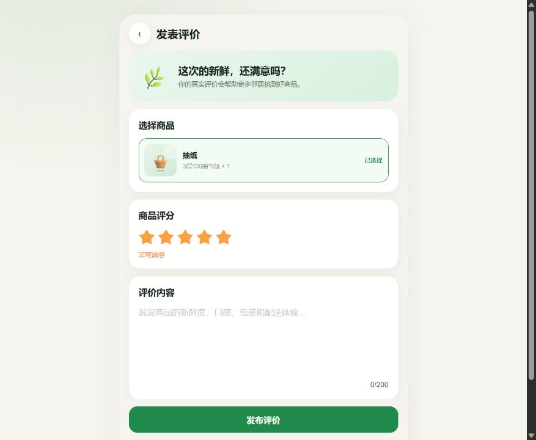
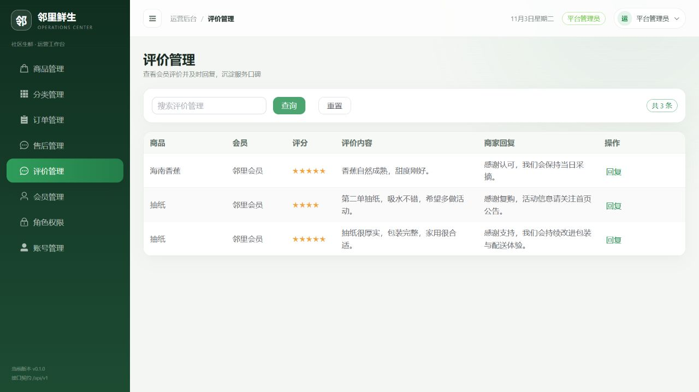
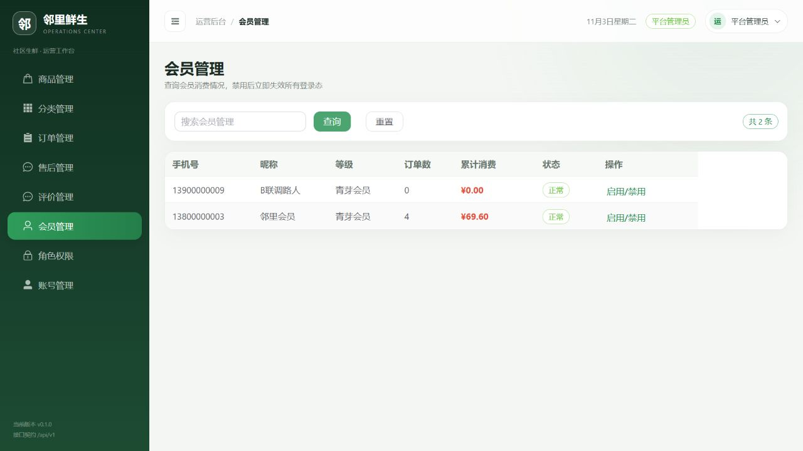
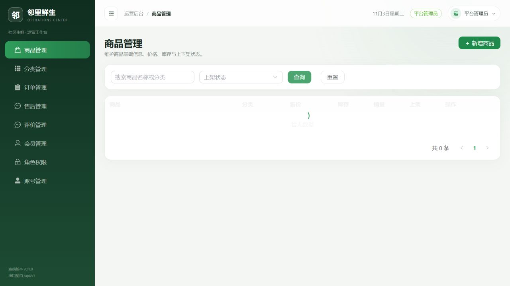
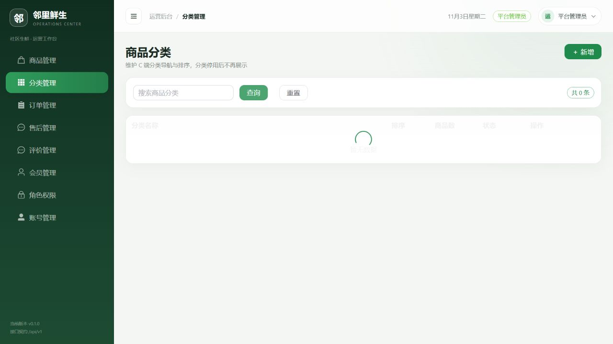
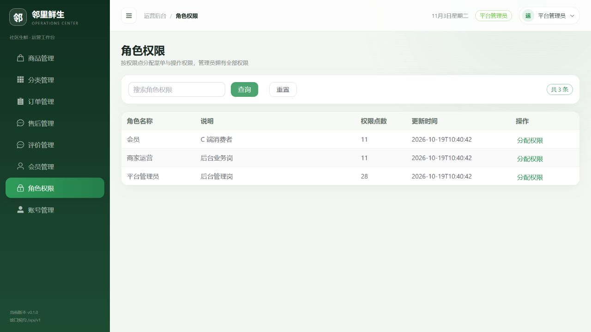
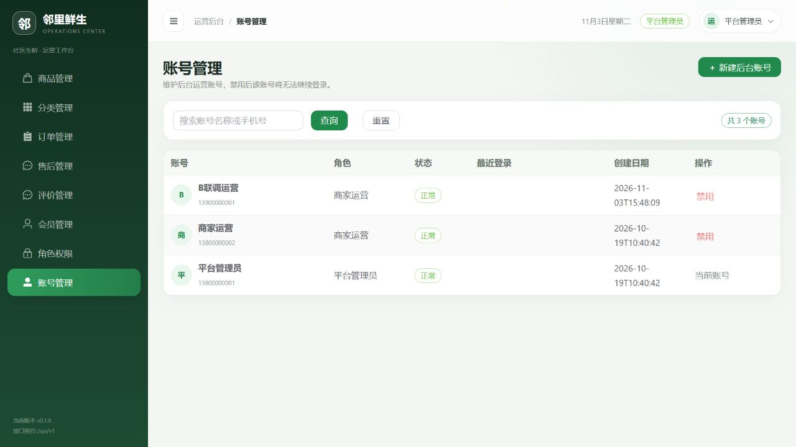

# 邻里鲜生社区超市商城系统 · 测试报告

> 版本：v2.0（最终版）
> 编写：角色 D（测试 + 运维 + 文档）
> 日期：2026-11-04
> 依据：《需求规格说明书》第 5、7 章，《设计文档》第十、十一、十二章，《项目分工与进度计划》

## 1. 测试范围与环境

### 1.1 测试范围

覆盖核心交易闭环（浏览 → 加购 → 下单 → 支付 → 履约 → 售后 → 评价）、后台运营与权限、部署与运维能力。不在范围内：真实支付通道、真实物流、多商家分账、小程序/App 原生端，与《需求文档》1.7 的边界一致。

### 1.2 测试环境

本项目存在两套验证环境，数据不可混用：

| 项 | D 本机（Windows / WSL2） | 共享 staging |
| --- | --- | --- |
| 用途 | 全栈部署、压测、备份回滚演练 | B/C 的真实业务联调与验收 |
| 操作系统 | Windows 11 26200 + Ubuntu 24.04（WSL2） | Linux |
| 后端 | Spring Boot 3.3.5，main | Spring Boot 3.3.5，main@3715d7b |
| JDK / Maven | Temurin 17.0.20.1 / 3.9.16 | JDK 17 |
| Node.js | 20（CI）/ 24（本机） | 20 |
| Docker | Engine 29.1.3 + Compose 2.40.3 | — |
| MySQL | 8.0.46（容器） | MySQL 8.0 |
| Redis | 7（容器） | 7.4.11 |
| k6 | v2.3.0（GHCR 镜像 + 本机） | — |
| 访问方式 | http://localhost:8080/8081/8082 | Cloudflare 临时隧道（Issue #20） |

> 说明：D 的压测与备份回滚在本机 WSL2 环境完成；B 的 60 步真实联调与 C 的 E2E 单据在共享 staging 完成。报告中涉及业务单号的数据均来自 staging。

### 1.3 测试数据

| 账号 | 手机号 | 口令 | 角色 |
| --- | --- | --- | --- |
| 平台管理员 | 13800000001 | 123456 | 管理员 |
| 商家运营 | 13800000002 | 123456 | 运营 |
| 会员 | 13800000003 | 123456 | 会员 |

staging 最终数据：评价 9/10/11；商品 6 公开评价累计 6 条且全部有回复；会员 3、账号 17 均为启用状态；角色权限分别为管理员 28、运营 11、会员 11。

## 2. 测试分层与执行结果

| 层次 | 用例数 | 通过 | 失败 | 结论 |
| --- | --- | --- | --- | --- |
| 后端单元 / 集成测试 | 69 | 69 | 0 | ✅ 通过 |
| 前端构建（C 端 / B 端） | 2 | 2 | 0 | ✅ 通过 |
| 接口冒烟（后端 + 两个前端 + 反代） | 9 | 9 | 0 | ✅ 通过 |
| E2E 主链路（C 提供单据） | 1 | 1 | 0 | ✅ 通过 |
| 性能压测 | 3 | 3 | 0 | ✅ 执行完成（200 TPS 见 6.2 说明） |

### 2.1 后端测试

```bash
cd backend
mvn -B test
```

结果：`Tests run: 69, Failures: 0, Errors: 0, Skipped: 0`。

测试类共 15 个：`UserServiceTest`、`AccountServiceTest`、`MemberServiceTest`、`RoleAdminServiceTest`、`AddressServiceTest`、`CategoryServiceTest`、`CartServiceTest`、`InventoryServiceTest`、`OrderServiceTest`、`OrderPreviewTest`、`OrderManagementTest`、`PaymentServiceTest`、`AfterSaleServiceTest`、`ReviewServiceTest`、`IdempotencyServiceTest`。

### 2.2 前端构建

```bash
cd frontend/linli-mall-web && npm ci && npm run build
cd frontend/linli-admin-web && npm ci && npm run build
```

两个工程均产出 `dist/`；GitHub Actions 以 Node 20 矩阵并行执行，两条检查均为 success。

### 2.3 E2E 主链路（C 提供）

| 环节 | 单据号 | 结果 |
| --- | --- | --- |
| 订单 | `ORD20261102110906226035` | 创建成功 |
| 支付 | `PAY20261102110920836407` | 沙箱支付成功 |
| 售后 | `AS20261102111349264013` | 审核通过 |
| 退款 | `RF20261102111411690822` | 退款成功 |
| 最终状态 | 订单 `REFUNDED` / 售后 `COMPLETED` | ✅ 与设计一致 |

C 的最终验收截图见 [docs/screenshots/frontend-real-e2e](screenshots/frontend-real-e2e/README.md)：评价表单、后台评价、会员、商品、分类、角色、账号共 7 张。

## 3. 核心交易一致性测试

### 3.1 用例与结论

| 编号 | 场景 | 覆盖方式 | 结论 |
| --- | --- | --- | --- |
| TC-STOCK-01 | 并发下单零超卖 | 实测：k6 恒定 200 TPS + 两轮斜坡压测 | ✅ 成功单数 = 初始库存 100，0 超卖 |
| TC-STOCK-02 | 多商品部分失败整单回滚 | `OrderServiceTest` | ✅ 69 项回归通过 |
| TC-STOCK-03 | 支付确认扣减 | `InventoryServiceTest` + `PaymentServiceTest` | ✅ 69 项回归通过 |
| TC-IDEM-01 | 同 Idempotency-Key 重复下单 | `OrderServiceTest` + `IdempotencyServiceTest` | ✅ 69 项回归通过 |
| TC-IDEM-02 | 支付回调重复 | `PaymentServiceTest` | ✅ 69 项回归通过 |
| TC-TIME-01 | 超时关单并回滚库存 | 实测：100 个待支付订单截止时间置为过去 | ✅ 100 单自动关闭，locked 100→0，available 0→100 |
| TC-TIME-02 | 关单与支付回调竞态 | `OrderManagementTest` + `PaymentServiceTest` | ✅ 69 项回归通过（未做人工抢时序实测） |

### 3.2 测试覆盖说明

| 模块 | 测试类 | 覆盖重点 |
| --- | --- | --- |
| 用户 / 鉴权 | `UserServiceTest`、`AccountServiceTest` | 登录、注销、禁用、账号生命周期 |
| 会员 / 角色 | `MemberServiceTest`、`RoleAdminServiceTest` | 会员状态、角色权限边界、管理员保护 |
| 商品 / 购物车 | `CategoryServiceTest`、`CartServiceTest` | 分类约束、加购合并与上限 |
| 库存 | `InventoryServiceTest` | 锁定、扣减、释放、库存不足 |
| 订单 | `OrderServiceTest`、`OrderPreviewTest`、`OrderManagementTest` | 下单、预览、取消、发货、收货、超时关单 |
| 支付 / 售后 | `PaymentServiceTest`、`AfterSaleServiceTest` | 回调、退款、售后审核与回退 |
| 评价 | `ReviewServiceTest` | 发表、重复、越权、参数校验 |
| 幂等 | `IdempotencyServiceTest` | 请求级幂等与并发冲突 |

### 3.3 库存恒等式

判定依据：`总库存 = 可用 + 锁定 + 已售`，且三项均非负。

```sql
SELECT product_id, total, locked, sold, (total - locked - sold) AS available
FROM t_inventory
WHERE total < 0 OR locked < 0 OR sold < 0 OR (total - locked - sold) < 0;
```

执行 `test/k6/check-stock.sql`：压测后与超时关单后各执行一次，两次均返回**空结果集**。

压测结束若立即核对，locked 仍为 100（待支付预占），恒等式依然成立；本次另将 100 单支付截止时间改到过去，等待定时任务后 locked 归零、available 回到 100。

## 4. 评价链路证据（B 提供）

| 用例 | 请求 | HTTP | 业务码 | 结果 |
| --- | --- | --- | --- | --- |
| 商品 6 发表评价 | `POST /api/v1/reviews`，订单 `ORD20261104134543707140` | 200 | 0 | 评价 ID **9** |
| 运营回复评价 | `POST /api/v1/admin/reviews/9/reply` | 200 | 0 | 公开列表可见 reply |
| 公开评价列表 | `GET /api/v1/products/6/reviews` | 200 | 0 | **6 条，全部带回复** |
| 重复评价同一订单项 | `POST /api/v1/reviews` | 200 | **60002** | 被唯一键拦截 |
| 评价已退款订单 | `POST /api/v1/reviews`，订单 `ORD20261104134558014142` | 200 | **60003** | 订单不可评价 |
| 评价他人订单 | 路人账号评价会员 3 的订单 | 200 | **60003** | 越权被拒 |
| 空内容 | `content="   "` | 200 | **10001** | `content: 评价内容不能为空` |
| 缺评分 | 不传 `rating/score` | 200 | **10001** | `评分不能为空` |
| 图片地址超长 | 单张 520+ 字符 | 200 | **10001** | `images[0]: 图片地址过长` |

演示数据：评价 ID 9（商品 6，评分 5）、10（商品 6，评分 4）、11（商品 2，评分 5），三条均有回复；商品 6 累计 6 条评价且全部回复。

> 业务异常统一返回 HTTP 200 + 业务码，这是设计约定，不是接口故障。

## 5. 后台写操作与权限（B 提供）

| 用例 | 步骤 | HTTP | 业务码 | 结果 |
| --- | --- | --- | --- | --- |
| 新建 / 复用运营账号 | 手机号 `13900000001` | 200 | 10006 / 0 | 账号 ID **17** |
| 运营账号登录 | `POST /api/v1/auth/login` | 200 | 0 | 获得 Token |
| 禁用账号 | `PUT /api/v1/admin/accounts/17/status {status:0}` | 200 | 0 | 禁用成功 |
| 禁用后旧 Token | `GET /api/v1/admin/reviews` | 200 | **10002** | 立即失效 |
| 禁用后登录 | `POST /api/v1/auth/login` | 200 | **10005** | 账号已被禁用 |
| 重新启用 | `PUT .../status {status:1}` + 登录 | 200 | 0 / 0 | 恢复可用 |
| 运营权限备份 | `GET /api/v1/admin/roles` | 200 | 0 | 11 个权限点 |
| 去掉评价回复权限 | `PUT /roles/2/permissions` | 200 | 0 | 剩余 10 个 |
| 下一次请求立即生效 | 运营访问后台评价 | 200 | **10003** | 无操作权限 |
| 恢复运营权限 | `PUT /roles/2/permissions` | 200 | 0 | 恢复 11 个，请求恢复 0 |
| 管理员不被降权 | `PUT /roles/3/permissions {permissions:[]}` | 200 | 0 | 仍为 **28** 个权限点 |
| 会员访问后台 | `GET /api/v1/admin/members` | 200 | **10003** | 拒绝 |
| 禁用当前管理员 | `PUT /api/v1/admin/accounts/1/status` | 200 | **10001** | 拒绝 |
| 禁用会员 3 | `PUT /api/v1/admin/members/3/status` | 200 | 0 | 禁用成功 |
| 会员旧 Token | `GET /api/v1/orders` | 200 | **10002** | 立即失效 |
| 恢复会员 3 | `PUT /api/v1/admin/members/3/status` | 200 | 0 | 恢复启用 |

「最后一个管理员不能被禁用」在 API 层由「不能禁用当前账号」+「至少保留一个启用管理员」双重保护；由于禁用他人必须由另一名管理员操作，HTTP 层无法构造该路径，该分支由 `AccountServiceTest` 覆盖。

## 6. 性能压测

### 6.1 冒烟压测

脚本：`test/k6/smoke.js`（Docker k6，20 VU × 20s）。

| 指标 | 实测 | 阈值 | 结论 |
| --- | --- | --- | --- |
| 请求数 | 1200 | — | — |
| 请求失败率 | 0.00% | < 1% | ✅ |
| 业务错误率 | 0.00% | < 1% | ✅ |
| 健康检查 P95 | 4.36ms | ≤ 300ms | ✅ |
| HTTP P95 | 4.71ms | ≤ 500ms | ✅ |
| 吞吐 | 59.44 req/s | — | — |

```bash
docker run --rm --network host -i ghcr.io/grafana/k6 run - < test/k6/smoke.js
```

### 6.2 下单并发压测

脚本：`test/k6/order-concurrency.js`，通过 `SHAPE=constant` 恒定速率、`SHAPE=ramp`（默认）斜坡速率。

三轮实测（Docker k6 + `--network host`）：

| 轮次 | 场景 | 请求数 | 实测吞吐 | 成功 / 库存拒绝 | P95 | 丢弃迭代 |
| --- | --- | --- | --- | --- | --- | --- |
| 1（10-26） | 斜坡 10→200 TPS，30s 爬坡 + 20s 保持 | 8150 | 135.44 req/s | 100 / 8049 | 12.08ms | 0 |
| 2（11-03） | 恒定 200 TPS，20s | 3990 | 198.87 req/s | 100 / 3889 | 118.27ms | 12 |
| 3（11-04） | 恒定 200 TPS，20s（库存重置后复测） | 3955 | 195.26 req/s | 100 / 3854 | 368.98ms | 46 |

两轮之间的库存重置方式：第一轮结束后通过 SQL 将待支付订单置为已取消（`status=4`）、`locked` 置 0，并用 `check-stock.sql` 确认 `total=100 / locked=0 / sold=0 / available=100`，再进行第二轮。

**结论：200 TPS 未严格达标。** 实测吞吐 195.26–198.87 req/s，为目标的 97.6%–99.4%，k6 分别丢弃 12 与 46 次迭代。需要如实说明的是：

- 下单 P95 为 118–369ms，远低于需求 800ms；
- 三轮均 0 请求失败、0 业务错误；
- 成功下单数始终等于初始库存 100，**零超卖**；
- 瓶颈位于单实例吞吐而非库存一致性，扩实例或调优连接池后可继续提升。

不复述或取整为「200 TPS 达标」，验收时以本节实测值为准。

## 7. 部署验证

### 7.1 服务与端口

| 服务 | 容器 | 端口 |
| --- | --- | --- |
| MySQL | linli-mysql | 内部 3306 |
| Redis | linli-redis | 内部 6379 |
| 后端 API | linli-api | 8080 |
| C 端商城 | linli-web-mall | 8081 |
| B 端后台 | linli-web-admin | 8082 |

### 7.2 一键启动与冒烟

```bash
cp deploy/.env.example deploy/.env
docker compose -f deploy/docker-compose.yml up -d --build
bash deploy/smoke-test.sh
```

实测（2026-11-03）：五个容器全部 healthy；冒烟 9/9 PASS；通过 8081 反代登录会员（code=0，token 43 位），通过 8082 反代登录运营（code=0，11 个权限点）。

### 7.3 备份与恢复

执行命令：

```bash
docker exec linli-mysql mysqldump --single-transaction -uroot -proot123456 \
  linli_fresh > linli_backup.sql
docker exec -i linli-mysql mysql -uroot -proot123456 linli_fresh < linli_backup.sql
```

演练记录（2026-11-04）：

| 步骤 | 结果 |
| --- | --- |
| 基线 | users=3、products=6、orders=300、reviews=0 |
| 备份耗时 / 文件大小 | **0.5s / 143,414 字节（约 140KB）** |
| 模拟数据丢失 | 删除前 10 个订单，orders 300 → 290 |
| 恢复耗时 | **2.9s**，orders 恢复为 300 |
| 恢复后一致性 | 库存恒等式违规行数 = **0** |

RTO 实测远小于 30 分钟。需要说明：RPO ≤ 5 分钟依赖 binlog，本次为全量 dump 演练，未启用 binlog 增量恢复。

### 7.4 镜像回滚

```bash
docker tag linli-mall-api:local linli-mall-api:prev
# deploy/.env 设置 IMAGE_TAG=prev
docker compose -f deploy/docker-compose.yml up -d api
bash deploy/smoke-test.sh
```

演练记录：切换并重建 api 容器耗时 **2.1s**，`docker inspect` 显示运行镜像为 `linli-mall-api:prev`，冒烟 **9/9 PASS**。回滚不触碰数据卷。

## 8. 安全用例

| 用例 | 期望 | 结果 |
| --- | --- | --- |
| 未登录访问受保护接口 | 10002 | ✅ B 复跑覆盖 |
| 会员访问后台接口 | 10003 | ✅ 实测 10003 |
| 评价他人订单 | 60003 | ✅ 实测 60003 |
| 禁用账号 / 会员后旧 Token | 10002 | ✅ 实测 10002 |
| 禁用后重新登录 | 10005 | ✅ 实测 10005 |
| 管理员不被降权 | 保持 28 个权限点 | ✅ 实测 28 |
| 禁用当前管理员 | 10001 | ✅ 实测 10001 |
| 越权访问本人以外订单/地址 | 40401 | 未覆盖（评价越权已实测 60003） |
| 登录失败次数限制 | 连续 5 次后锁定 | 未覆盖 |
| 日志敏感信息抽查 | 不含密码、Token、完整手机号 | 未覆盖 |

## 9. 可观测性

| 端点 | 用途 | 实测 |
| --- | --- | --- |
| `/actuator/health` | 存活与依赖健康 | UP（db/redis/ping） |
| `/actuator/metrics` | JVM、HTTP、连接池指标 | 可访问 |
| `/actuator/info` | 应用信息 | 可访问 |

链路追踪：`X-Trace-Id` 由入口生成或透传，写入 MDC 并回填 `Result.traceId`：

```text
X-Trace-Id: 3f9a1c7b2d4e5f60
{"code":0,"message":"OK","traceId":"3f9a1c7b2d4e5f60",...}
```

日志为单行结构化输出；密码、Token、密钥不得写入。Prometheus / Grafana 为可选项，本期未部署，与设计 12.2 的裁剪理由一致。

## 10. 遗留问题与风险

| 编号 | 问题 | 影响 | 处理 |
| --- | --- | --- | --- |
| R-01 | 支付为沙箱模拟 | 与真实支付时序有差异 | 文档说明假设，演示强调沙箱 |
| R-02 | 匿名评价开关 | 后端无 anonymous 列，不持久化 | ✅ 已由 C 的 PR #21 移除开关；本期不承诺匿名 |
| R-03 | `AccountView.lastLoginAt` 返回 null | 页面显示 `-` | 接受，后续补登录时间字段 |
| R-04 | 后台列表默认 pageSize=10 | 数据超过 10 条需翻页 | 前端已支持传参，演示数据量小 |
| R-05 | 评价内容为空 | 可绕过前端提交空内容 | ✅ 已由 PR #17 加 `@NotBlank` 修复 |
| R-06 | 跨流程最终一致依赖定时任务 | 极端时序短暂不一致 | 对账补偿 + 超时关单测试覆盖 |
| R-07 | 200 TPS 未严格达标 | 峰值 195–199 req/s | 如实记录；扩实例或调优连接池 |

## 11. 结论

- 后端 **69/69** 测试通过；前端两个工程构建通过；CI 四项检查全绿。
- 全栈五个容器一键启动成功，冒烟 **9/9**，两个前端均能通过反代完成真实登录。
- E2E 主链路（订单→支付→售后→退款）单据完整，最终状态与设计一致。
- 评价与后台权限链路证据齐全：错误码 60002/60003/10001/10002/10003/10005 均按预期返回，角色权限 11/11/28 恢复正确。
- 并发一致性：**零超卖**，库存恒等式成立；超时关单可回滚 100 单库存。
- 性能：读接口 P95 4.71ms；下单 P95 118–369ms；峰值吞吐 195.26–198.87 req/s，**200 TPS 未严格达标**，已如实记录。
- 备份 0.5s / 恢复 2.9s / 回滚 2.1s，均完成实测。

除演示视频外，D 负责的测试与运维交付项均已完成；200 TPS 差距与未覆盖的安全项已在第 8、10 节明确列出。

## 附录：前端最终验收截图














