# 邻里鲜生社区超市商城系统 · 架构设计说明书
> 版本：v0.6
> 编写：项目经理 / 后端负责人
> 状态：v0.6（全部章节与关键决策已定稿，无待决项）

## 阅读说明
本文档区分两类章节：
- 【主干】：由项目经理 / 后端负责人完成，体现系统架构与核心交易设计。
- 【骨架】：由对应组员填充。骨架已给出写作要点与填写模板，组员按模板补充即可。

| 章节 | 类型 | 负责人 |
| --- | --- | --- |
| 一、文档说明 | 主干 | 项目经理 |
| 二、技术选型 | 已定稿 | 全员评审 |
| 三、总体架构设计 | 主干 | 后端负责人 |
| 四、关键设计决策记录（ADR） | 主干 | 后端负责人 |
| 五、核心交易详细设计 | 主干 | 后端负责人 |
| 六、横切设计 | 主干 | 后端负责人 |
| 七、模块详细设计 | 已填充（7.1~7.6） | 各模块组员 |
| 八、前端架构设计 | 已定稿 | 前端负责人 |
| 九、数据库设计 | 已定稿 | 数据库负责人 |
| 十、部署与运维设计 | 已填充 | 运维负责人 |
| 十一、测试策略 | 已填充 | 测试负责人 |
| 十二、可观测性设计 | 已填充 | 运维 / 后端 |
| 十三、开发计划与分工 | 主干 | 项目经理 |
| 十四、风险与演进 | 主干 | 后端负责人 |
| 十五、审阅记录与修订 | 主干 | 后端负责人 |

---

# 一、文档说明【主干】

## 1.1 编写目的
本文档将《需求规格说明书》转化为可施工的技术方案，回答「用什么技术、系统如何分层分区、关键流程如何实现、为什么这样选」，作为开发、测试与验收的技术依据。

## 1.2 范围
- 包含：技术选型、总体架构、关键决策、核心交易详细设计、横切设计、模块设计、前端架构、部署、测试、可观测性。
- 不包含：具体业务功能点（见需求文档）、界面视觉稿、真实支付/物流对接。

## 1.3 与需求文档的对应

| 需求文档 | 本文档落点 |
| --- | --- |
| 4.3 模块划分 | 3.4 模块划分与依赖 |
| 3.x 核心业务闭环、3.4 订单状态流转 | 五、核心交易详细设计 |
| 5.x 数据模型 | 九、数据库设计 |
| 6.x 接口规范 | 六、横切设计 |
| 7.x 非功能需求 | 各章约束与技术选型依据 |

## 1.4 术语
沿用《需求规格说明书》附录术语表（三态库存、幂等、聚合、补偿、traceId）。

## 1.5 架构原则
- 前后端分离：前端独立工程，仅通过 JSON 接口交互。
- 模块化单体：按业务域分模块，模块内分层，为将来拆分预留边界；当前不引入微服务。
- 依赖单向：上层编排下层，禁止循环依赖。
- 横切下沉：鉴权、返回、异常、分页、日志、幂等由统一组件提供。
- 数据一致性优先：核心交易链路以强一致为默认，跨流程用补偿实现最终一致。
- 务实克制：不引入与规模不匹配的技术（如无秒杀则不引入 MQ）。
---

# 二、技术选型【已定稿】

> 状态：已由小组确认。选型遵循「与团队能力匹配、够用即可、不过度堆技术」原则，关键结论见 ADR-009。

## 2.1 选型决策表

| 类别 | 最终选择 | 理由 | 替代方案 | 风险 |
| --- | --- | --- | --- | --- |
| 后端语言/框架 | Java 17 + Spring Boot 3 | 教材与企业实践主流；Spring 事务、AOP、校验、拦截器完整，契合分层与幂等切面设计；团队可上手 | Node.js（NestJS）、Go（Gin） | 启动与内存开销高于 Go；需团队具备 Java 基础 |
| 前端框架 | Vue 3 + Vite + Pinia；C 端 Vant 4、B 端 Element Plus | 学习曲线平缓、组件生态完善，移动端与后台各有成熟组件库 | React + Ant Design | 生态与招聘面略窄；两套 UI 库需统一主题规范 |
| 持久层 | MyBatis-Plus | SQL 可控，便于库存条件更新、索引优化与分页；贴近教材 | Spring Data JPA、MyBatis 原生 | 需防止 SQL 拼接注入；复杂查询需手写 SQL |
| 数据库 | MySQL 8 | InnoDB 事务与行级锁成熟，满足条件更新与并发控制；团队熟悉 | PostgreSQL | 复杂分析能力弱于 PG；需注意字符集与时区 |
| 缓存 | Redis 7 | 承载会话、权限缓存、商品缓存；支持 Set/TTL/持久化 | 本地 Caffeine（无法共享会话） | 成为登录态强依赖，需持久化与高可用 |
| 消息队列 | 暂不引入 | 无秒杀/削峰场景，定时任务 + 进程内事件足够（ADR-007） | RabbitMQ、RocketMQ | 异步解耦能力有限，后续按需引入 |
| 网关/反向代理 | Nginx | 静态资源、TLS、反向代理、限流一次搞定 | Spring Cloud Gateway | 动态路由/服务发现能力弱（当前单体不需要） |
| 容器 | Docker + Docker Compose | 一键启动、环境一致、结果可复现 | 直接部署、Kubernetes | 单机 Compose 无编排级高可用 |
| CI/CD | GitHub Actions（或 GitLab CI） | 与代码托管集成、配置简单、免费额度足够 | Jenkins | 依赖网络与托管平台；需保护密钥 |
| 监控 | Actuator + Micrometer + Prometheus + Grafana | 与 Spring Boot 原生集成，指标与健康检查开箱即用 | ELK + 自建监控 | 增加部署组件；课程环境可只启用 Actuator |
| 接口文档 | SpringDoc OpenAPI | 与 Spring Boot 3 集成，注解生成文档 | 手写文档 | 注解需与代码同步维护 |

## 2.2 选型原则

- 每项技术均给出「理由 / 替代方案 / 风险」，不盲目堆技术。
- 与团队能力、部署条件匹配，够用即可；不引入与规模不匹配的中间件。
- 选型结论同步至第四章 ADR（ADR-009）。

## 2.3 统一技术基线

- **后端**：JDK 17、Spring Boot 3.x、Maven；MySQL 8.0、Redis 7。
- **前端**：Node 18 LTS、Vue 3、Vite、Pinia；C 端 Vant 4、B 端 Element Plus。
- **测试**：JUnit 5 + Mockito、Spring Boot Test + Testcontainers、Vitest、Playwright；压测 JMeter/k6。
- **部署**：Docker 多阶段构建（运行阶段 `eclipse-temurin:17-jre`）、Docker Compose、Nginx。
---

# 三、总体架构设计【主干】

## 3.1 架构风格
采用 前后端分离 + 模块化单体（Modular Monolith）：单一可部署单元，内部按业务域划分模块、模块内分层。该风格在单商家规模下兼顾开发效率与架构清晰度，并保留向微服务演进的边界（见 ADR-001）。

## 3.2 逻辑架构

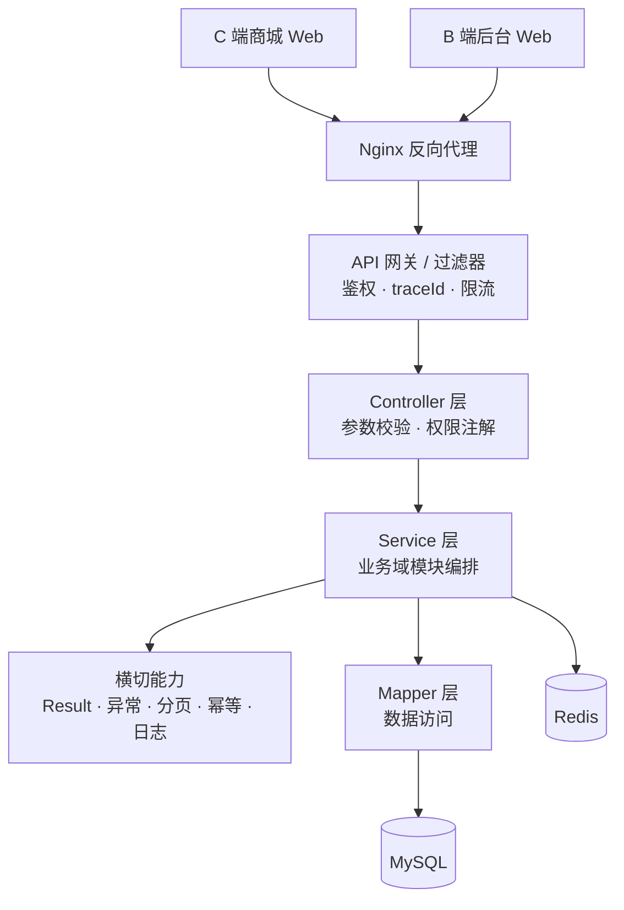

## 3.3 分层设计

| 层 | 职责 | 约束 |
| --- | --- | --- |
| Controller | 收参、校验、权限注解、组装返回 | 不写业务逻辑 |
| Service | 业务编排、事务边界、领域规则 | 核心交易事务在此层 |
| Mapper | 数据访问 | 不含业务判断 |
| Model | DO / DTO / VO 分离 | DO 不出 Service 层 |

请求处理链路：`Nginx → 过滤器(鉴权/traceId) → Controller → Service → Mapper → MySQL/Redis`。

## 3.4 模块划分与依赖
模块划分与依赖沿用《需求规格说明书》4.3：用户、商品、购物车、库存、订单、支付、售后、营销、评价、系统、统计。订单模块为核心编排者，向下调用库存、支付、购物车、商品、营销；库存与支付不反向依赖订单（回调统一由订单/支付编排）。

## 3.5 部署拓扑（概念）

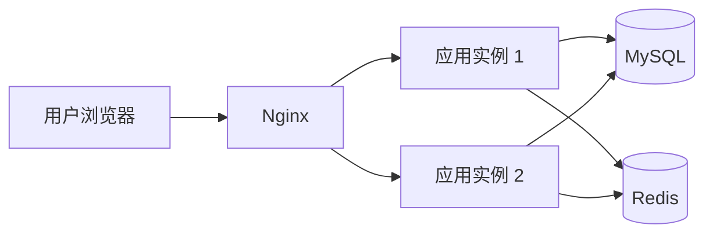

多实例无单点，登录态与缓存共享 Redis（具体见第十、十二章）。
---

# 四、关键设计决策记录（ADR）【主干】
> 格式：**背景 → 决策 → 理由与替代方案 → 后果**。选型类 ADR 待技术选型确定后补充。

## ADR-001 采用模块化单体，不引入微服务
- 背景：单商家自营、团队为课程小组，业务规模与并发有限。
- 决策：采用模块化单体，按业务域分模块，模块内分层。
- 理由/替代：微服务带来注册中心、配置中心、分布式事务等额外复杂度，收益与成本不匹配；模块化单体能以单一部署单元获得清晰边界，后续可拆分。
- 后果：需自律维护模块边界与单向依赖；跨模块调用为进程内调用（非远程）。

## ADR-002 鉴权采用「Token 存 Redis」（方案 B）
- 背景：需要支持注销、管理员禁用会员的即时失效。
- 决策：登录生成随机 Token 存 Redis，请求带 `Authorization: Bearer`，注销/禁用删除 Token。
- 理由/替代：纯 JWT 无法即时失效；有状态方案可撤销、实现简单，且已有 Redis。替代：JWT + 黑名单（复杂）。
- 后果：每次请求查一次 Redis；多实例需共享 Redis。

## ADR-003 库存采用「三态模型 + 原子条件更新」
- 背景：需防超卖、支持下单预占与超时回滚。
- 决策：库存分 available/locked/sold，锁定用「带可用量条件的原子 UPDATE」，`version` 用于读改写重试检测。
- 理由/替代：条件更新天然原子，避免「先查后扣」竞态；相比 Redis 预扣无需额外一致性同步。替代：悲观锁 `SELECT FOR UPDATE`（吞吐低）、Redis+Lua（复杂）。
- 后果：单一库存行在热点商品上可能成为竞争点，可接受。

## ADR-004 下单一致性：订单与库存放同一本地事务
- 背景：下单需同时「锁定库存」与「创建订单」。
- 决策：两者置于同一本地数据库事务，任一失败整体回滚。
- 理由/替代：单库下本地事务可靠且简单；严格 DDD「一次事务只改一个聚合」会引入事件/补偿复杂度，与本规模不匹配。替代：领域事件 + 最终一致（复杂）。
- 后果：有意突破聚合边界，换取下单链路强一致；已记录为取舍。

## ADR-005 超时关单采用「定时任务轮询」
- 背景：需对超时未支付订单自动关单并回滚库存。
- 决策：定时任务（每分钟）扫描 `status=待支付 AND pay_deadline < now`，以条件更新关单、释放库存。
- 理由/替代：实现简单、可靠、易演示；索引 `idx(status, pay_deadline)` 保证效率。替代：Redis ZSet 延迟队列（高效但需处理可靠性）、MQ 延迟消息（引入新中间件）。
- 后果：关单存在分钟级延迟，可接受。

## ADR-006 幂等：Idempotency-Key + 幂等表 + 唯一键
- 背景：下单/支付/退款等写接口需防重复提交与重复回调。
- 决策：请求级用 `Idempotency-Key` + `t_idempotent`，业务级用唯一键（order_no/pay_no/refund_no），并叠加状态机条件更新作为最终防线。
- 理由/替代：三重保障覆盖不同粒度的重复；纯 Redis 幂等可能因故障丢键。
- 后果：幂等表需定期清理过期记录。

## ADR-007 暂不引入消息队列
- 背景：无秒杀/拼团等削峰场景。
- 决策：本期不引入 MQ，异步处理用「定时任务 + 进程内事件」。
- 理由/替代：单商家规模下 MQ 收益有限、运维成本高；务实克制优于为用而用。
- 后果：异步能力受限，未来若有削峰/解耦需求再引入。

## ADR-008 金额以「分」存 BIGINT
- 背景：金额计算需避免浮点误差。
- 决策：所有金额以分为单位，类型 `BIGINT`。
- 理由/替代：整型无精度问题；`DECIMAL` 可读性更好但计算需谨慎。
- 后果：接口与前端展示需做分↔元转换。

## ADR-009 技术栈采用 Java 17 + Spring Boot 3 + MySQL 8 + Redis 7 + Vue 3

- **背景**：小组需在开发前确定技术栈；设计文档的部署、测试、可观测性章节需与之匹配。
- **决策**：后端 Java 17 + Spring Boot 3 + MyBatis-Plus + MySQL 8 + Redis 7；前端 Vue 3 + Vite + Pinia + Element Plus；Nginx + Docker Compose；测试 JUnit 5/Testcontainers/Playwright；监控 Actuator + Micrometer + Prometheus + Grafana。
- **理由/替代**：Spring 的事务、AOP、拦截器与校验体系与本文档的分层、幂等切面、统一鉴权高度契合；教材与企业实践成熟，团队可上手。替代方案：Node.js（NestJS）、Go（Gin），但需重写部署、测试与可观测性章节，收益与成本不匹配。
- **后果**：应用启动与内存开销高于 Go；团队需具备 Java 基础；后续如需换栈，第八、十、十一、十二章需同步改写。
---

# 五、核心交易详细设计【主干 · 重点】
本章对应需求文档第 3 章，聚焦订单、支付、库存、事务、幂等。

## 5.1 下单与库存锁定
目标：下单即预占库存，支付成功后确认扣减，取消/超时释放；并发下不超卖。
库存原子操作 SQL（以锁定为例）：

```sql
UPDATE t_inventory
SET locked = locked + #{n}, version = version + 1, update_time = NOW()
WHERE product_id = #{productId}
  AND total - locked - sold >= #{n};
```

- `affected = 1` 表示锁定成功；`affected = 0` 表示可用量不足（返回 `20003 库存不足`）。
- `total - locked - sold >= n` 由数据库在 UPDATE 时原子求值，天然防超卖。
- `version` 用于需要「读-改-写」的场景做乐观锁重试检测。
下单本地事务（ADR-004）：

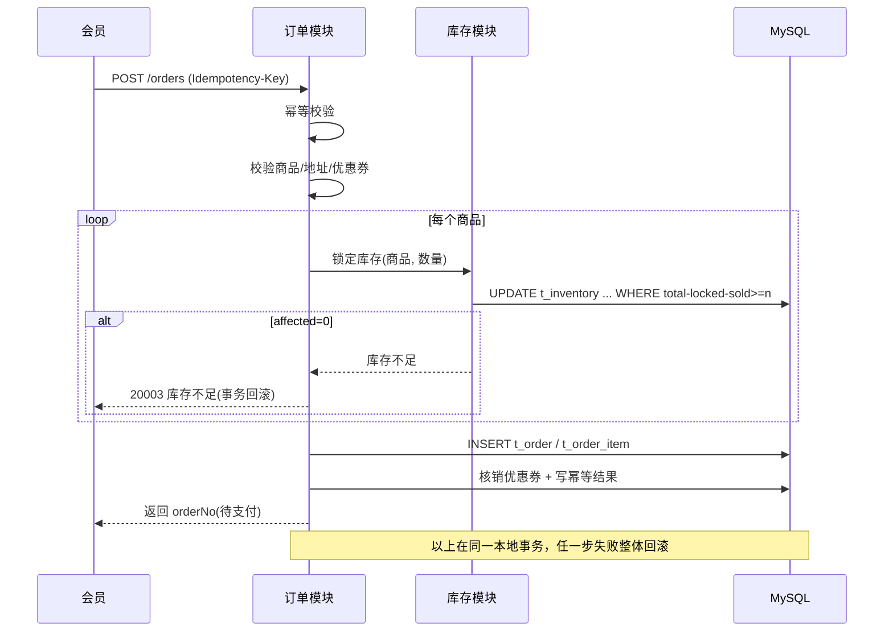

事务边界：锁库存 + 建订单 + 核销券 + 写幂等结果，同一事务；任一失败全部回滚，不产生「锁了库存却没订单」的脏数据。

## 5.2 支付与回调
发起支付：校验订单为「待支付」且在有效期内 → 创建支付单（`pay_no` 唯一）→ 调用沙箱获取支付参数。
支付回调（以 `pay_no` 幂等）：

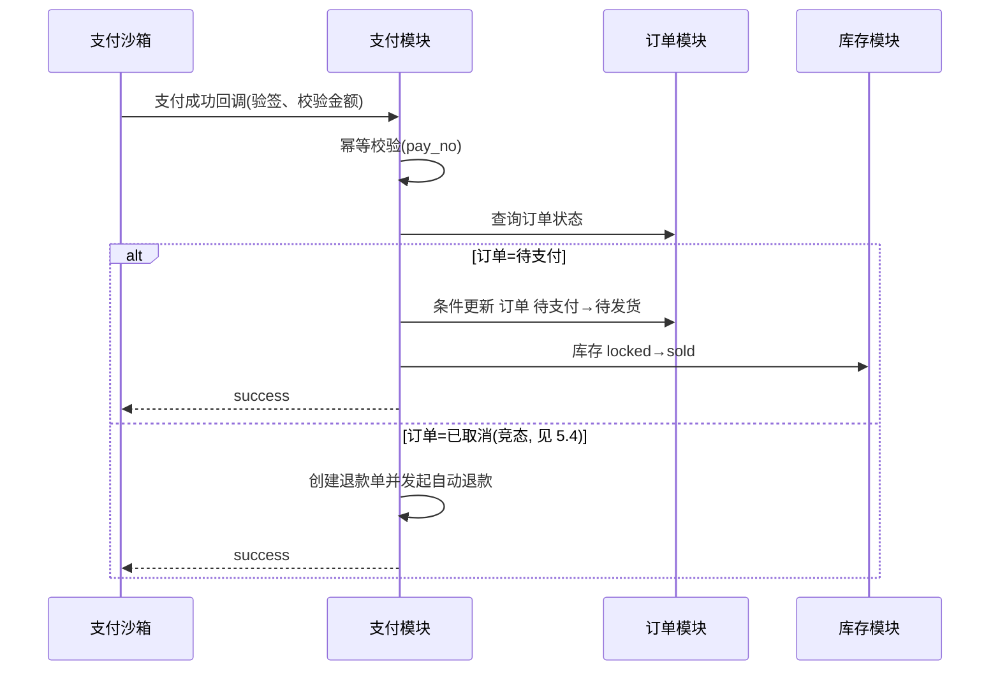

确认扣减 SQL：

```sql
UPDATE t_inventory
SET locked = locked - #{n}, sold = sold + #{n}, update_time = NOW()
WHERE product_id = #{productId} AND locked >= #{n};
```

## 5.3 超时关单
流程（ADR-005）：

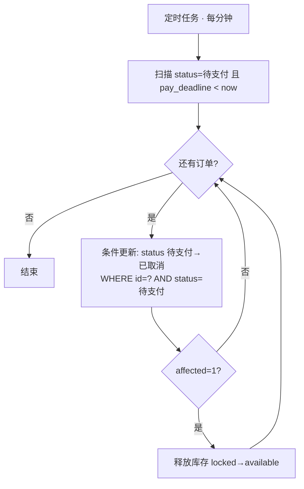

- 并发安全：关单与支付回调都通过条件更新（`WHERE status=待支付`）竞争，只有一个成功——关单成功后回调进入竞态分支（5.4）；回调先成功则关单 `affected=0` 自动跳过。
- 释放库存 SQL：

```sql
UPDATE t_inventory
SET locked = locked - #{n}, update_time = NOW()
WHERE product_id = #{productId} AND locked >= #{n};
```

- 多实例：条件更新天然幂等，无需额外分布式锁；必要时对扫描加分布式锁避免重复扫描。
- 索引：`idx(status, pay_deadline)`。

## 5.4 支付成功 与 超时关单 竞态 → 退款补偿
- 场景：订单已被关单（库存已释放），随后收到支付成功回调。
- 处理：回调发现订单非「待支付」→ 不复活订单 → 创建退款单 `refund_no` → 调沙箱退款 → 记录补偿日志。
- 保证：以支付单为一致性锚点，最终结果二选一——「订单有效且库存已扣减」或「订单关闭且资金已退回」，绝不「既关单又扣款」。

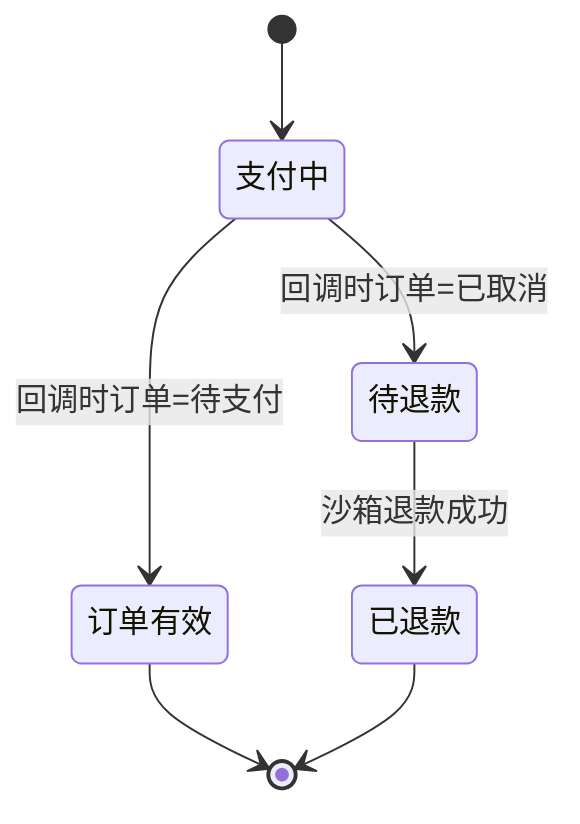

## 5.5 订单状态机实现
- 状态枚举：`PENDING_PAYMENT / PAID / DELIVERING / COMPLETED / CANCELLED / AFTER_SALE / REFUNDED`（对应需求 3.4）。
- 合法流转表：以 `Map<OrderStatus, Set<OrderStatus>>` 定义允许的迁移，集中校验。

| 当前状态 | 允许迁移到 |
| --- | --- |
| 待支付 | 待发货、已取消 |
| 待发货 | 待收货、售后中 |
| 待收货 | 已完成、售后中 |
| 已完成 | 售后中 |
| 售后中 | 已退款、回退(待发货/待收货/已完成) |
| 已取消 / 已退款 | —（终态） |

- 统一入口：`transition(orderId, from, to)`：先校验迁移合法，再以条件更新落库，`affected=1` 才继续后续动作；非法迁移抛 `30002`。
- 留痕：每次变更写状态流转日志（含 traceId）。

## 5.6 幂等设计（三重保障）
- 请求级：`Idempotency-Key` + `t_idempotent`（唯一键 `(user_id, biz_type, idem_key)`）。
- 业务级：`order_no` / `pay_no` / `refund_no` 唯一键防重复落库。
- 状态机级：条件更新（`WHERE status=...`）作为最终防线。

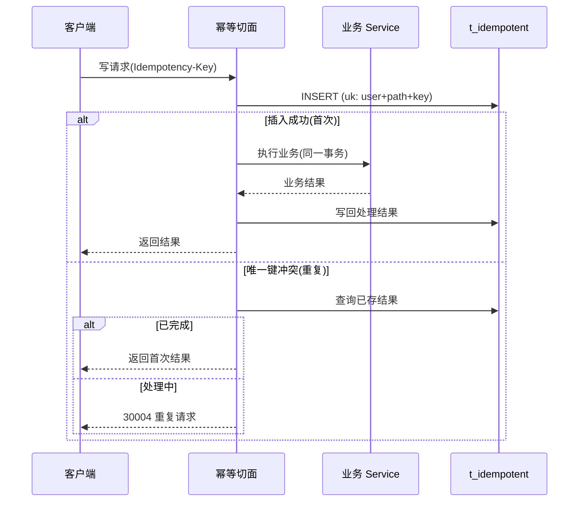

## 5.7 事务边界与最终一致

| 业务流程 | 事务范围 | 一致性策略 |
| --- | --- | --- |
| 下单 | 锁库存 + 建订单 + 核销券 + 幂等记录（本地事务） | 强一致 |
| 支付回调 | 支付单成功 + 订单转待发货 + 库存扣减（本地事务） | 强一致 |
| 超时关单 | 订单取消 + 库存释放（本地事务） | 强一致 |
| 下单 → 支付/关单 | 跨时段 | 最终一致：定时任务补偿 |
| 支付 vs 关单竞态 | 跨事件 | 最终一致：退款补偿 + 对账 |

- 不使用分布式事务：单库场景本地事务已足够。
- 兜底对账：定时任务扫描「支付成功后订单仍异常」「关单后仍扣款」等，触发补偿，保证最终一致。
---

# 六、横切设计【主干】

## 6.1 统一返回与异常
- 所有 Controller 返回 `Result<T>`：`{ code, message, data, traceId, timestamp }`，`code=0` 成功。
- 全局异常处理器捕获业务异常与系统异常，统一转为 `Result`；业务异常携带错误码（分段规则见需求 6.2.4）。

## 6.2 统一分页
- 入参 `pageNum` / `pageSize`（上限 100），出参 `PageResult<T>{ list, total, pageNum, pageSize }`。
- 分页参数与结果封装由统一组件处理，Service 只关注查询条件。

## 6.3 统一鉴权
- 登录态：Token 存 Redis，过滤器校验，失效返回 `10002`。
- 权限点：方法注解 `@RequirePermission("trade:order:create")`，切面校验；权限点走缓存。
- 数据权限：Service 层强制按当前用户过滤（会员仅本人数据）。

## 6.4 traceId 与日志
- 请求头 `X-Trace-Id` 由网关生成/透传，注入 MDC，贯穿日志与 `Result.traceId`。
- 关键状态变更（订单/支付/库存/售后）记录操作日志。

## 6.5 幂等切面
- 对标注幂等的接口，切面自动完成 `Idempotency-Key` 校验、幂等表读写（见 5.6），业务代码无侵入。
---

# 七、模块详细设计【已填充 · 组员】
> 每个模块按统一模板填写：**职责 / 主要接口 / 核心流程 / 依赖 / 关键表 / 时序图 / 异常处理**。

## 7.1 用户与鉴权

### 7.1.1 职责
账号生命周期：注册、登录、注销，以及管理员对会员账号的禁用与启用。
身份认证：生成与校验不透明会话令牌（随机串），会话登记于 Redis，实现令牌即时失效。
功能授权：解析当前用户角色，校验其是否拥有接口所需的权限点。
数据权限：向各业务模块提供当前登录用户上下文（userId、userType、roleId）。
个人信息与收货地址：会员资料维护，地址增删改查与默认地址唯一性维护。
不负责：密码找回与短信验证码通道（本期不做）、会员等级与积分体系（不在需求范围内）。

### 7.1.2 主要接口

| 编号 | 接口 | 权限点 | 幂等 |
| --- | --- | --- | --- |
| AUTH-01 | POST /auth/register | user:account:register（公开） | 否 |
| AUTH-02 | POST /auth/login | user:account:login（公开） | 否 |
| AUTH-03 | POST /auth/logout | 登录即可 | 是 |
| USER-01 | GET /users/me | 登录即可 | 否 |
| USER-02 | PUT /users/me | user:profile:update | 否 |
| USER-03 | GET /users/me/addresses | address:info:manage | 否 |
| USER-04 | POST /users/me/addresses | address:info:manage | 否 |
| USER-05 | PUT /users/me/addresses/{id} | address:info:manage | 否 |
| USER-06 | DELETE /users/me/addresses/{id} | address:info:manage | 否 |
| AD-USER-01 | GET /admin/members | user:member:manage | 否 |
| AD-USER-02 | PUT /admin/members/{id}/status | user:member:manage | 是 |

### 7.1.3 核心流程（注册 / 登录 / 注销 / 地址）
注册：校验手机号未被占用与密码强度（8 位以上且含字母与数字）→ 写入 t_user（password 存 BCrypt 哈希，user_type=1，role_id 指向会员角色，status=1）。注册不签发令牌，前端跳转登录页，避免出现与登录风控不一致的第二套入口。
登录：读取 Redis 登录失败计数 → 按手机号查用户 → BCrypt 校验 → 校验 user_type 与入口匹配、status 正常 → 生成**随机不透明 Token**（安全随机源）→ 写 `auth:session:{token} → {userId, userType, roleId}`（TTL 2 小时，滑动续期）并登记到 `auth:user:{userId}:sessions` → 清除失败计数 → 返回令牌、用户信息与权限点集合。C 端入口只接受会员，后台入口只接受运营与管理员，从源头隔离两端账号。
鉴权：请求进入统一拦截器后依次为「取 Authorization 头 → 查 Redis 会话 `auth:session:{token}` → 写入用户上下文 → 校验方法上的权限点」。公开接口需显式标注放行，业务代码不感知鉴权。
注销与踢下线：注销删除 `auth:session:{token}` 并从用户会话集合移除，令牌立即失效；禁用会员、密码变更、管理员踢下线时，按 `auth:user:{userId}:sessions` 批量清除该用户全部会话，做到即时生效。
收货地址：设置默认地址时在同一事务内完成「清除该用户既有默认 + 置新默认」，保证默认地址唯一；删除默认地址不自动指定新默认，由用户显式设置，避免静默改变用户预期。

### 7.1.4 依赖

| 依赖 | 用途 | 缺失时的影响 |
| --- | --- | --- |
| Redis | 会话登记、登录失败计数、权限点缓存 | 鉴权不可用（Token 不落库，无法降级查库）；通过主从与持久化降低风险 |
| Result / 全局异常处理 | 统一返回体与错误码 | 接口返回格式不统一，前端需特殊处理 |
| traceId 注入组件 | 日志链路追踪 | 排查登录与越权问题时缺少链路标识 |
| 会员角色记录（t_role） | 注册时绑定 role_id | 注册不可用 |

### 7.1.5 关键表

| 表 | 关键字段 | 约束与索引 |
| --- | --- | --- |
| t_user | id、phone、password、nickname、user_type、role_id、status、deleted | UK(phone)；KEY(role_id)；password 存 BCrypt 哈希 |
| t_user_address | id、user_id、receiver、phone、detail、is_default、deleted | KEY(user_id, deleted) |
| t_role | id、name、code、remark、status、deleted | UK(code) |
| t_permission | id、code、name、module、type、parent_id、sort、status | UK(code)；KEY(module) |
| t_role_permission | id、role_id、permission_id | UK(role_id, permission_id) |
| t_operation_log | id、user_id、module、action、target、trace_id、ip、create_time | KEY(user_id, create_time)、KEY(trace_id) |

### 7.1.6 时序图

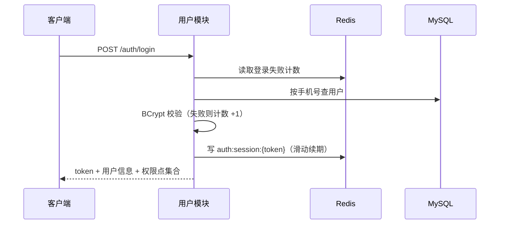

### 7.1.7 异常处理

| 错误码 | 场景 | 处理方式 |
| --- | --- | --- |
| 10002 | 令牌缺失、无效、已过期或会话已注销 | 返回 10002；前端跳转登录页并清除本地令牌 |
| 10003 | 已登录但角色不具备该权限点 | 返回 10003 |
| 10005 | 账号 status=0 或已被禁用 | 返回 10005，同时清除该用户全部会话 |
| 10006 | 注册时手机号已存在 | 返回 10006，提示改用登录 |
| 10007 | 凭据错误 | 统一提示，不区分手机号不存在与密码错误，避免账号枚举 |
| 10008 | 登录失败次数超限（连续 5 次） | 返回 10008，15 分钟内拒绝校验密码 |
| 99001 | 私有资源不存在或不属于当前用户 | 统一返回 99001，服务端日志区分（防资源枚举） |

### 7.1.8 RBAC 权限点设计
模型沿用《需求文档》2.1：用户 → 角色 → 权限点。一个用户在同一时刻只有一个主要角色（会员与后台岗位不混用账号），因此 t_user 直接持有 role_id，不设用户角色关联表。
管理员继承运营的全部业务权限，实现方式是在 t_role_permission 中为管理员角色显式授予运营的权限点并在其之上叠加系统管理类权限点；不使用隐式继承规则，保证权限来源可审计。
权限点编码采用「模块:资源:操作」格式，与《需求文档》2.2 权限矩阵逐条对应，清单以初始化脚本落库，不在代码中硬编码角色判断。
校验落点：注解 @RequirePermission("product:goods:manage") 声明在 Controller 方法上，由统一拦截器在方法执行前校验；角色到权限点的集合缓存于 auth:perm:{roleId}（TTL 30 分钟兜底）。**角色权限分配、角色删除、权限点停用时主动删除该缓存键，变更即时生效**，TTL 仅用于防止缓存长期不失效，不再以「放宽 30 分钟生效」表述。
前端依据登录返回的权限点集合做菜单与按钮级隐藏，后端独立校验，两者不互为前提。
前台（C 端）权限点：

| 权限点 | 说明 | 游客 | 会员 |
| --- | --- | --- | --- |
| user:account:register | 注册 | 允许 | — |
| user:account:login | 登录 | 允许 | — |
| user:profile:update | 修改个人信息 | 禁止 | 仅本人 |
| address:info:manage | 收货地址管理 | 禁止 | 仅本人 |
| product:goods:view | 浏览与搜索商品 | 允许 | 允许 |
| cart:item:manage | 购物车增删改查 | 禁止 | 仅本人 |
| trade:order:create | 下单 | 禁止 | 仅本人 |
| trade:payment:pay | 支付（沙箱） | 禁止 | 仅本人 |
| trade:order:query | 查询订单 | 禁止 | 仅本人 |
| trade:order:cancel | 取消订单 | 禁止 | 仅本人 |
| after:sale:apply | 申请售后 | 禁止 | 仅本人 |
| review:goods:create | 评价商品 | 禁止 | 仅本人 |
| marketing:coupon:receive | 领取优惠券 | 禁止 | 允许 |

后台（B 端）权限点：

| 权限点 | 说明 | 运营 | 管理员 |
| --- | --- | --- | --- |
| product:category:manage | 商品分类管理 | 允许 | 允许 |
| product:goods:manage | 商品管理（增删改、上下架） | 允许 | 允许 |
| stock:info:view | 库存查看 | 允许 | 允许 |
| stock:info:adjust | 库存调整与补货 | 允许 | 允许 |
| trade:order:query | 订单查询（全量） | 允许 | 允许 |
| trade:order:ship | 订单发货 | 允许 | 允许 |
| trade:order:close | 订单关闭与异常处理 | 允许 | 允许 |
| after:sale:audit | 售后审核与退款处理 | 允许 | 允许 |
| review:goods:reply | 评价查看与回复 | 允许 | 允许 |
| marketing:coupon:manage | 优惠券管理 | 允许 | 允许 |
| statistics:dashboard:view | 数据看板 | 允许 | 允许 |
| user:member:manage | 会员管理（查询、禁用） | 禁止 | 允许 |
| system:role:manage | 角色与权限管理 | 禁止 | 允许 |
| system:account:manage | 后台账号管理 | 禁止 | 允许 |
| system:config:manage | 系统参数配置 | 禁止 | 允许 |
| system:log:audit | 日志审计 | 禁止 | 允许 |

### 7.1.9 Token 会话设计（方案 B）

- **令牌构成**：登录成功后生成**不透明随机 Token**（安全随机源 + Base64URL 编码，长度不少于 256 bit），令牌本身不携带任何用户信息；服务端以 `auth:session:{token} → {userId, userType, roleId}` 存于 Redis。
- **会话登记**：登录写入会话 key（TTL 2 小时，滑动续期），同时把该 Token 加入 `auth:user:{userId}:sessions`（Set），用于按用户批量撤销。
- **请求校验**：取 `Authorization: Bearer <token>` → 查 `auth:session:{token}` → 不存在或过期返回 `10002` → 写入用户上下文。**不验签、无 claims、无刷新令牌**，实现简单。
- **即时失效**：注销删除单个会话；禁用会员、密码变更、管理员踢下线时，删除该用户在 Set 中的全部 Token 及 Set 本身，即时生效。
- **权限校验**：解析出 roleId 后按 7.1.8 权限点校验；权限点缓存 `auth:perm:{roleId}`（TTL 30 分钟，变更主动删），**权限不写入 Token**。
- **安全要求**：
  - 仅通过 HTTPS 传输；Token 只放 Authorization 请求头，不使用 Cookie 携带凭证，从设计上规避 CSRF。
  - 使用安全随机源且长度足够，防猜测；登录失败计数 + 限流防暴力破解。
  - Token 不落库明文、不写日志、不进审计表；Redis 开启持久化（AOF/RDB），降低重启导致的全员会话丢失。
  - **前端存储**：本期将 Token 存于 localStorage 以支持刷新保持登录（见 8.4）；需配合 XSS 防护（输入转义、CSP），生产环境建议改为内存态 + HttpOnly Cookie 会话。
- **与需求对齐**：完全采用《需求文档》6.2.5 的**方案 B**，不引入 JWT、刷新令牌、签名密钥与算法轮换，降低实现与运维复杂度。
- **已知代价**：Redis 是登录态的强依赖（每请求一次查询，毫秒级）；Redis 故障时鉴权不可用，可通过主从与持久化降低风险；会话可重建（用户重新登录）。

## 7.2 商品与搜索

### 7.2.1 职责
分类：分类的增删改查与排序，供前台导航与后台维护。
商品：商品新增、编辑、上下架、删除（逻辑删除），维护分类、名称、规格、图片与售价。
前台查询：分类列表、商品列表（分类与关键词筛选、分页）、商品详情。
缓存：分类列表与商品详情缓存到 Redis，写操作主动失效。
不负责：库存数量展示与调整（库存模块）、评价内容展示（评价模块，前台详情页由前端分别请求）。

### 7.2.2 主要接口

| 编号 | 接口 | 权限点 |
| --- | --- | --- |
| PROD-01 | GET /categories | 公开 |
| PROD-02 | GET /products | 公开 |
| PROD-03 | GET /products/{id} | 公开 |
| AD-PROD-01 | GET /admin/categories | product:category:manage |
| AD-PROD-02 | POST /admin/categories | product:category:manage |
| AD-PROD-03 | PUT /admin/categories/{id} | product:category:manage |
| AD-PROD-04 | DELETE /admin/categories/{id} | product:category:manage |
| AD-PROD-05 | GET /admin/products | product:goods:manage |
| AD-PROD-06 | POST /admin/products | product:goods:manage |
| AD-PROD-07 | PUT /admin/products/{id} | product:goods:manage |
| AD-PROD-08 | PUT /admin/products/{id}/status | product:goods:manage |
| AD-PROD-09 | DELETE /admin/products/{id} | product:goods:manage |

### 7.2.3 核心流程
商品列表：前台查询强制过滤 status=1（上架）与 deleted=0，条件为分类与关键词的组合；关键词为空时仅按分类分页，避免无条件全表扫描。默认按 update_time 倒序，保证新上架商品可见。分页沿用统一约定（pageNum 从 1 开始，pageSize 默认 10、上限 100，超限截断为 100）。
上下架：使用条件更新，不读后写（UPDATE t_product SET status=? WHERE id=? AND deleted=0）。下架后商品详情对前台返回 20002，后台仍可查询以便运营复核；下架不清理购物车中已存在的记录，由购物车侧标记失效并提供移除入口。
删除分类：分类下存在未删除商品时禁止删除（20005），避免出现悬空引用；商品与分类均为逻辑删除，已删除商品不阻塞分类删除。
缓存策略：cache:categories（分类增删改后删除该键，TTL 1 小时兜底）、cache:product:{id}（商品修改、上下架、删除后删除该键，TTL 10 分钟兜底）；商品列表条件组合多、命中率低，不缓存。不存在的商品 ID 缓存空值 60 秒防穿透；写操作先改库再删缓存，避免并发写导致缓存与库不一致。
搜索实现与演进：本期用 name LIKE CONCAT('%', #{kw}, '%') 叠加分类与上架条件分页，关键词去首尾空格并限制 1 至 32 字符。当商品量级超过约 1 万条，或压测中搜索 P95 超过 500ms 时，启用 t_product.name 的 ngram 全文索引，届时只替换查询语句，接口契约不变。

### 7.2.4 依赖
文件上传服务：提供商品主图 URL（本期采用本地目录 + Nginx 静态资源，与部署方案一致）。
统一分页组件：分页参数校验与 PageResult 组装。

### 7.2.5 关键表

| 表 | 关键字段 | 索引与说明 |
| --- | --- | --- |
| t_category | id、name、sort、status、create_time、update_time、deleted | KEY(name)；**不建 (name, deleted) 唯一键**（逻辑删除多条同名时会冲突），同名校验在应用层仅对 `deleted=0` 生效 |
| t_product | id、category_id、name、spec、image、description、price、status、deleted | KEY(category_id, status, deleted)；KEY(status, update_time)；price 以分存 BIGINT |

搜索演进预留脚本（本期不启用）：

## -- 搜索演进预留，本期不启用

## ALTER TABLE t_product
  ADD FULLTEXT INDEX ft_name (name) WITH PARSER ngram;

### 7.2.6 时序图

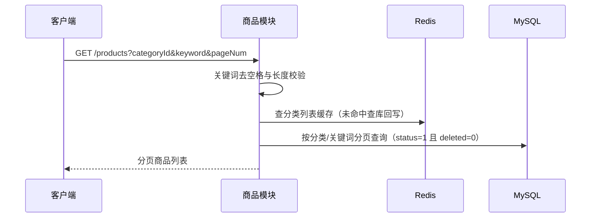

### 7.2.7 异常处理

| 错误码 | 场景 | 处理方式 |
| --- | --- | --- |
| 20002 | 商品不存在、已下架或已删除（前台查询） | 返回 20002；后台查询不受影响 |
| 20004 | 商品不存在（后台按 ID 操作） | 返回 20004 |
| 20005 | 分类下存在商品，禁止删除 | 返回 20005，提示先迁移或删除商品 |
| 20006 | 分类名称重复 | 返回 20006 |
| 20007 | 商品参数非法（如售价为负） | 返回 20007，由统一参数校验拦截 |

## 7.3 购物车

### 7.3.1 职责
加购：把商品加入当前用户购物车；同一商品重复加购时按唯一键合并、累加数量。
维护：修改数量、勾选与取消勾选、删除单项、清空购物车。
展示：返回购物车清单与小计，价格实时取商品当前售价，并标记已下架商品。
结算入口：按勾选项返回可结算清单，供订单模块的结算预览与提交订单使用。
不负责：库存校验与占用（下单时由库存模块原子锁定）、优惠券计算（由订单模块在结算预览中计算）。

### 7.3.2 主要接口

| 编号 | 接口 | 权限点 | 说明 |
| --- | --- | --- | --- |
| CART-01 | GET /cart | cart:item:manage | 仅本人；含实时单价与小计 |
| CART-02 | POST /cart/items | cart:item:manage | 请求体含 productId 与 quantity |
| CART-03 | PUT /cart/items/{id} | cart:item:manage | 仅本人；越权返回 99001 |
| CART-04 | DELETE /cart/items/{id} | cart:item:manage | 仅本人；物理删除 |
| CART-05 | DELETE /cart/items | cart:item:manage | 仅本人；清空全部 |

### 7.3.3 核心流程
加购：校验商品存在且为上架状态（否则 20002）→ 校验数量在 1 至 99 之间 → 按唯一键 uk_user_product(user_id, product_id) 合并写入（INSERT ... ON DUPLICATE KEY UPDATE quantity = quantity + n）→ 合并后数量超过 99 时截断为 99 并提示。
价格口径：t_cart_item 不存价格，购物车列表与结算预览实时读取商品当前售价；下单时由订单模块把成交价写入订单项快照（t_order_item.price）。价格的权威来源只有商品表一处，避免购物车价、商品价、订单价三者互相矛盾。
结算衔接：提交订单成功后，由订单模块在下单事务内调用购物车清理接口，移除已下单的勾选项，保证「下单成功即购物车已清」；购物车不参与金额计算，避免出现第二套优惠计算逻辑。
删除语义：购物车是个人临时数据，无审计与留痕价值，采用物理删除并保留唯一键，避免逻辑删除与唯一键冲突（该例外与核心交易表保留 deleted 的惯例不同，需在数据库设计中注明）。

### 7.3.4 依赖
商品模块只读查询（ProductQueryService）：校验上架状态、读取当前售价。
订单模块：提交订单成功后回调购物车清理接口。

### 7.3.5 关键表

| 表 | 关键字段 | 约束与索引 |
| --- | --- | --- |
| t_cart_item | id、user_id、product_id、quantity、checked、create_time、update_time | UK(user_id, product_id)；无 deleted 字段（物理删除） |

### 7.3.6 时序图

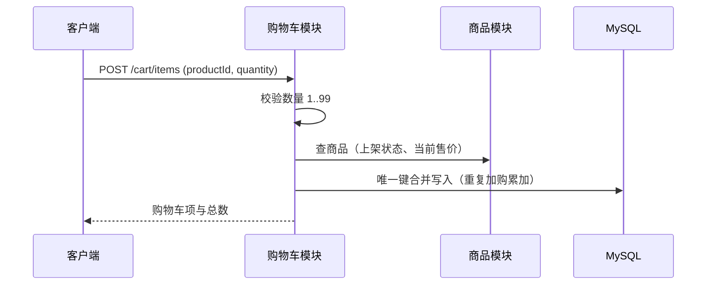

### 7.3.7 异常处理

| 错误码 | 场景 | 处理方式 |
| --- | --- | --- |
| 20002 | 商品不存在或已下架 | 拒绝加购，返回 20002；购物车列表中该商品标记失效 |
| 20010 | 数量非法或超过单商品上限 99 | 返回 20010 并提示上限值 |
| 20011 | 购物车条目数达到上限 100 | 返回 20011，提示先清理购物车 |
| 99001 | 购物车项不存在或不属于当前用户 | 统一返回 99001 |

## 7.4 营销（优惠券）

### 7.4.1 职责
券定义管理（运营）：创建、修改、删除优惠券，维护类型、门槛、面额、发放总量与有效期。
领券（会员）：可领优惠券列表、领取优惠券、我的优惠券查询。
优惠试算：结算预览时按券归属、状态、有效期与门槛计算优惠金额，试算不改变券状态。
券核销与退回：下单时核销、订单取消或超时关单时退回，均由订单模块编排调用。
不负责：订单金额与订单状态的最终计算与写入（订单模块）、支付与退款（支付模块）；营销模块不直接写 t_order。

### 7.4.2 主要接口

| 编号 | 接口 | 权限点 | 幂等 |
| --- | --- | --- | --- |
| MKT-01 | GET /coupons | marketing:coupon:receive | 否 |
| MKT-02 | POST /coupons/{id}/receive | marketing:coupon:receive | 是 |
| MKT-03 | GET /users/me/coupons | 登录即可（仅本人） | 否 |
| AD-MKT-01 | GET /admin/coupons | marketing:coupon:manage | 否 |
| AD-MKT-02 | POST /admin/coupons | marketing:coupon:manage | 否 |
| AD-MKT-03 | PUT /admin/coupons/{id} | marketing:coupon:manage | 否 |
| AD-MKT-04 | DELETE /admin/coupons/{id} | marketing:coupon:manage | 否 |

供订单模块调用的内部接口（不对外暴露，由订单模块单向调用）：
calcDiscount(userId, couponId, goodsAmount)：优惠试算，返回优惠金额，不改变券状态。
use(userCouponId, userId, orderNo)：下单核销，条件更新「未使用 → 已使用」，返回核销金额。
release(orderNo)：按订单号退回券，条件更新「已使用 → 未使用」。

### 7.4.3 核心流程（含与下单的券核销衔接）
发券：运营创建优惠券（name、type、threshold 门槛、discount 面额、total 发放总量、start_time、end_time），status 控制是否可领。本期 type 仅支持满减（type=1），面额不得大于门槛，总量必须为正，参数非法返回 50006。
领取：校验券可领（status 正常、当前时间在有效期内、received < total）→ 唯一键 uk_user_coupon(user_id, coupon_id) 防重复领取（冲突返回 50004）→ 写入 t_user_coupon（status=未使用）并对发放数做条件更新计数。
并发防超发：发放数采用条件更新 UPDATE t_coupon SET received = received + 1 WHERE id=? AND received < total，affected=0 表示已领完，返回 50002；与库存锁定同一思路，不做「先查后扣」。
我的优惠券：user_id 一律取自登录令牌，仅查本人数据（数据权限）。过期按 end_time 实时判定，另有定时任务把已到期且未使用的券置为已过期，避免列表长期显示为未使用。
结算试算：订单模块在结算预览（ORDER-01）时调用 calcDiscount，校验券属于本人、状态未使用、在有效期内、订单商品总额达到 threshold，返回优惠金额；试算无副作用，可重复调用。
下单核销：提交订单（ORDER-02）时由订单模块在下单本地事务内调用 use，**必须按最终订单金额重新校验**（券属于本人、状态为未使用、在有效期内、订单商品总额达到 threshold），再条件更新 t_user_coupon SET status=已使用, used_order_id=?, use_time=NOW() WHERE id=? AND user_id=? AND status=未使用。affected=1 才继续建单；affected=0 则整单回滚并返回 50005。**结算预览的试算结果不作为核销依据**，防止「预览后券过期 / 购物车金额变化」导致超门槛用券。核销与锁定库存、创建订单、写幂等结果同属一个本地事务（对齐本文档 5.7 事务边界），不会出现「券已占用但订单未创建」。
取消与关单退回：订单取消或超时关单时，在释放库存的同一事务内调用 release，条件更新 SET status=未使用, used_order_id=NULL, use_time=NULL WHERE used_order_id=? AND status=已使用；重复执行 affected=0，天然幂等，不会重复退券。
对《需求文档》的三点补充（需求只写到释放库存，未涉及券）：
补充一：订单取消与超时关单需同时退回优惠券，否则用户券被扣而订单已失效；退回与库存释放同事务，保证「订单关闭即券已退回」。
补充二：本期一个订单最多使用一张券（t_order.coupon_id 为单值），不支持多券叠加与优惠分摊。
补充三：售后退款不退回优惠券，退款金额为订单实付金额（pay_amount）；券随退款返还超出本期范围。

### 7.4.4 依赖

| 依赖 | 用途 | 缺失时的影响 |
| --- | --- | --- |
| 订单模块（调用方） | 结算试算、下单核销、取消/关单退回 | 券无法在交易链路生效 |
| 统一幂等切面 | 领取接口的 Idempotency-Key 去重 | 重复点击可能重复领取 |
| Redis（可选） | 可领券列表缓存 cache:coupons | 仅影响性能，不影响正确性 |

依赖方向：沿用《需求文档》4.3.3，订单模块单向调用营销模块；营销模块提供试算、核销、退回三个服务方法，不反向依赖订单，也不直接写 t_order。核销与退回均为同库本地事务的参与型方法，不使用异步事件，保证与下单链路强一致。

### 7.4.5 关键表

| 表 | 关键字段 | 约束与索引 |
| --- | --- | --- |
| t_coupon | id、name、type、threshold、discount、total、received、start_time、end_time、status、deleted | KEY(status, start_time, end_time)；threshold 与 discount 以分存 BIGINT |
| t_user_coupon | id、user_id、coupon_id、status、used_order_id、receive_time、use_time | UK(user_id, coupon_id)；KEY(user_id, status)；KEY(used_order_id) |

说明：uk_user_coupon 表示同一用户对同一张券只能领取一次，重复领取返回 50004；KEY(used_order_id) 用于订单取消与超时关单时按订单号快速退回券。优惠券状态建议取值：0 未使用、1 已使用、2 已过期。

### 7.4.6 时序图

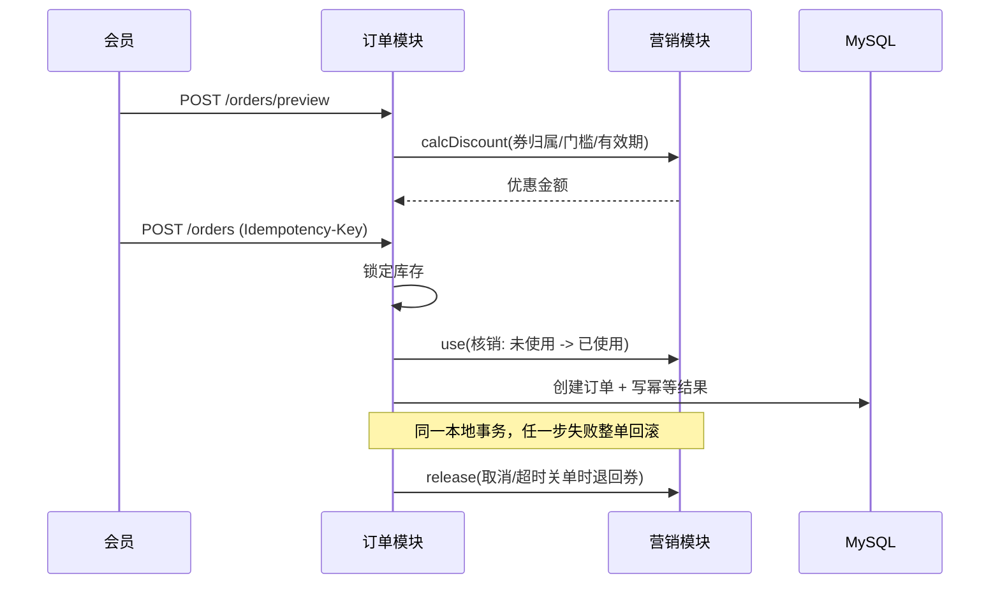

### 7.4.7 异常处理

| 错误码 | 场景 | 处理方式 |
| --- | --- | --- |
| 50002 | 优惠券不存在、已过期或已领完 | 返回 50002；可领列表只展示有效且未领完的券 |
| 50003 | 不满足使用门槛（商品总额低于 threshold） | 返回 50003 并回显门槛金额 |
| 50004 | 重复领取（唯一键冲突） | 返回 50004，不产生第二条领取记录 |
| 50005 | 券状态不允许该操作（已使用、已过期或非本人券的核销） | 返回 50005；下单核销失败即整单回滚 |
| 50006 | 券参数非法（面额大于门槛、时间区间非法、总量非正） | 返回 50006，由统一参数校验拦截 |
| 99001 | 优惠券记录不存在或不属于当前用户 | 统一返回 99001，服务端日志区分 |

说明：50xxx 为本文新增的错误码区段（营销），《需求文档》6.2.4 只定义了 10xxx、20xxx、30xxx、40xxx、90xxx 五段，需回填至团队错误码字典后再实施。

## 7.5 售后

### 7.5.1 职责
受理会员的退款与退货退款申请，校验订单归属、订单状态与申请金额。
承载售后进度查询，向会员展示审核结果与退款状态。
提供运营审核入口：同意则编排退款（调用支付模块），驳回则回退订单状态。
不负责：退款资金的执行（支付模块）、订单状态的直接写入（订单模块状态机）。

### 7.5.2 主要接口

| 编号 | 接口 | 权限点 | 幂等 |
| --- | --- | --- | --- |
| AS-01 | POST /after-sales | after:sale:apply | 是 |
| AS-02 | GET /after-sales | after:sale:apply | 否 |
| AS-03 | GET /after-sales/{saleNo} | after:sale:apply | 否 |
| AD-AS-01 | GET /admin/after-sales | after:sale:audit | 否 |
| AD-AS-02 | POST /admin/after-sales/{saleNo}/audit | after:sale:audit | 是 |

### 7.5.3 核心流程
申请：先做幂等校验（Idempotency-Key）→ 通过订单模块查询订单归属与状态（仅待发货 / 待收货 / 已完成可申请）→ 调用订单模块状态迁移把订单置为「售后中」→ 落库售后单（status=待审核，pre_status 记录申请前的订单状态）。订单迁移失败或被并发占先则返回 40002，不产生售后单。

**审核同意（同步发起 + 异步兜底）**：

1. 条件更新「待审核 → 已同意」（`affected=0` 即返回 `40002`），提交事务。
2. **同步**调用支付模块发起退款（`refund_no` 幂等，超时 3 秒）；**远程调用不放在数据库事务内**。
3. **成功**：独立事务回写退款单成功、售后单置「已完成」、订单迁移「已退款」。
4. **超时/失败/结果未知**：售后单置「退款中」，审核接口返回「退款处理中」；由定时任务查询退款结果或重试，成功后回写；超过阈值转人工处理，不重复退款。

审核驳回：条件更新「待审核 → 已驳回」→ 按 pre_status 将订单回退至申请前状态。

状态机：待审核 → 已同意 / 已驳回；已同意 → 退款中 / 已完成（同步退款成功直接完成）；退款中 → 已完成（对账成功）；退款中 → 待处理（超过重试阈值转人工）。已驳回与已完成为终态。审核动作以条件更新实现，重复审核不会重复退款。

事务边界与一致性：申请与驳回为本地事务，售后单与订单状态一并完成（强一致）；审核同意的「改状态」与「远程退款调用」分离，退款调用不在事务内，成功/失败回写各用独立本地事务，整体为**最终一致**。

幂等与对账：`refund_no` 唯一 + 售后单状态条件更新 + 支付模块退款幂等，三重防重复退款。定时任务扫描「退款中超过 N 分钟」的售后单，向支付模块查询退款结果并回写；扫描「已同意但无退款单」补发退款；扫描「订单为售后中但售后单已终态」的异常组合并修正；失败超过阈值标记待人工，不再无限重试。

依赖方向：售后 → 订单、售后 → 支付 为单向调用，售后模块不直接写 t_order，订单状态机的合法性校验始终只有一处。

金额约束：申请金额不得大于订单实付金额（pay_amount）；本期仅支持整单退款，不做部分退款的分摊，该限制需与订单模块达成一致。

### 7.5.4 依赖

| 依赖 | 用途 | 缺失时的影响 |
| --- | --- | --- |
| 订单模块 | 订单归属与状态查询、订单状态迁移与回退 | 售后不可受理 |
| 支付模块 | 沙箱退款（按 refundNo 幂等） | 审核同意后无法退款 |

### 7.5.5 关键表

| 表 | 关键字段 | 约束与索引 |
| --- | --- | --- |
| t_after_sale | id、sale_no、order_id、user_id、type、reason、amount、status、pre_status、refund_no、audit_time、remark、deleted | UK(sale_no)；KEY(order_id)、KEY(user_id, status)、KEY(status, update_time) |
| t_refund | refund_no、order_id、payment_id、after_sale_id、amount、status | 支付模块写入，售后只读关联 |
| t_operation_log | user_id、module、action、target、trace_id、create_time | 售后审核留痕 |

说明：pre_status（申请前订单状态）与 refund_no（关联退款单号）为对《需求文档》5.3.5 表结构的补充，分别用于「驳回回退至申请前状态」与「重复退款判定」，需同步至《数据库设计文档》并由数据库文档维护人登记。

### 7.5.6 时序图

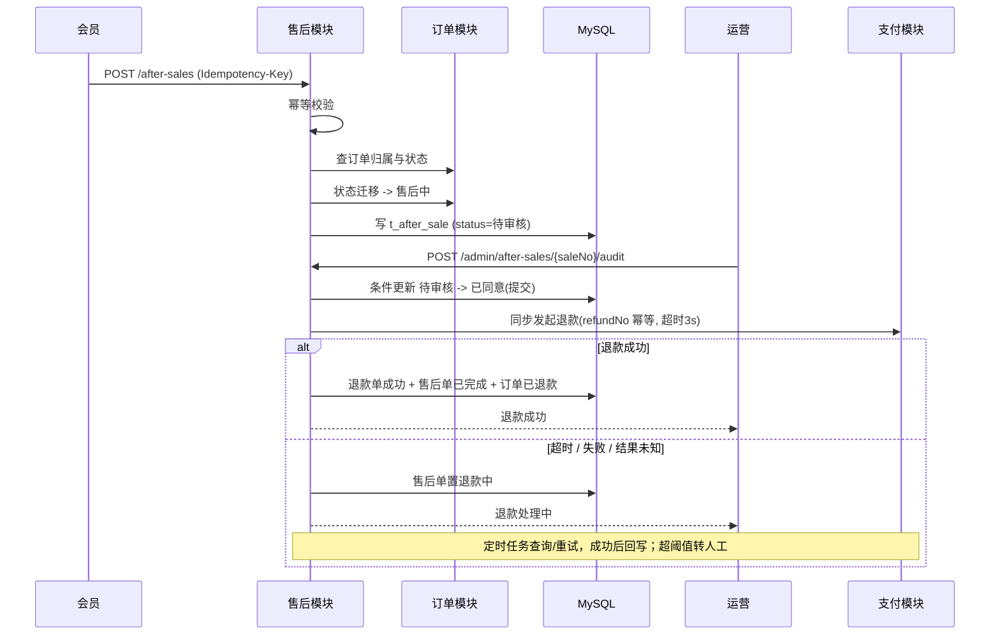

### 7.5.7 异常处理

| 错误码 | 场景 | 处理方式 |
| --- | --- | --- |
| 40002 | 订单状态不允许发起售后，或售后单状态不允许该审核动作 | 返回 40002；条件更新失败统一映射为该码 |
| 40003 | 不满足售后条件（如申请金额大于实付金额） | 返回 40003 并回显约束 |
| 40004 | 重复退款（同一售后单已存在成功退款） | 返回 40004，不再发起退款 |
| 40005 | 退款失败 | 售后单置待处理并记录原因，进入重试与对账 |
| 99001 | 售后单不存在或不属于当前用户 | 统一返回 99001 |

## 7.6 评价

### 7.6.1 职责

- 发表评价：会员对「已完成」订单中的商品发表评分、文字与图片评价。
- 查看评价：前台按商品查看评价列表；后台查看与回复评价。
- 不负责：订单状态流转（订单模块）、退款与售后（售后/支付模块）；评价不改变订单与资金状态。

### 7.6.2 主要接口

| 编号 | 接口 | 权限点 | 幂等 |
| --- | --- | --- | --- |
| REV-01 | POST /reviews | review:goods:create（仅本人） | 否 |
| REV-02 | GET /products/{id}/reviews | 公开 | 否 |
| AD-REV-01 | GET /admin/reviews | review:goods:reply | 否 |
| AD-REV-02 | POST /admin/reviews/{id}/reply | review:goods:reply | 否 |

### 7.6.3 核心流程

- **发表评价**：校验订单归属当前用户且状态为「已完成」→ 校验订单项属于该订单 → 以唯一键 `uk_order_item(order_item_id)` 防重复评价（冲突返回 `60002`）→ 写入 `t_review`。评价不改变订单状态。
- **查看评价**：按 `product_id` 分页查询，仅返回 `status=1` 且 `deleted=0` 的记录，按 `create_time` 倒序；评分与内容做长度与取值校验（1~5 分）。
- **回复评价**：运营对评价写入 `reply` 与 `reply_time`，条件更新 `WHERE id=? AND deleted=0`；评价本身不可被运营删除。
- **数据权限**：会员只能对自己订单中的商品发表评价，`user_id` 一律取自登录态，禁止由请求体传入。

### 7.6.4 依赖

| 依赖 | 用途 | 缺失时的影响 |
| --- | --- | --- |
| 订单模块 | 校验订单归属、状态与订单项 | 无法判断是否可评价 |
| 统一分页 / 鉴权 / traceId | 列表分页、权限点与链路追踪 | 返回格式与定位能力下降 |

### 7.6.5 关键表

| 表 | 关键字段 | 约束与索引 |
| --- | --- | --- |
| t_review | id、order_id、order_item_id、user_id、product_id、score、content、images、reply、reply_time、status、create_time、deleted | UK(order_item_id) 防重复评价；KEY(product_id, status, create_time)；KEY(user_id) |

### 7.6.6 时序图

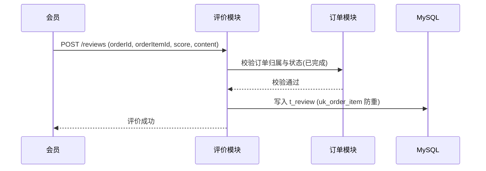

### 7.6.7 异常处理

| 错误码 | 场景 | 处理方式 |
| --- | --- | --- |
| 60001 | 评价不存在或不属于当前用户 | 统一返回 60001 |
| 60002 | 同一订单项重复评价 | 返回 60002，不产生第二条记录 |
| 60003 | 订单未完成、订单不属于当前用户或订单项不匹配 | 返回 60003，拒绝评价 |
| 99001 | 资源不存在或无权访问（通用） | 统一返回 99001，服务端日志区分 |

---

# 八、前端架构设计【已定稿 · 前端负责人】

## 8.1 工程结构（目录划分 / 多端组织：C 端与 B 端）

前端拆为两个独立工程，均只通过 JSON 接口与后端交互，工程内不做 JSP/模板渲染：

- **linli-mall-web**：C 端会员商城，移动端优先（以 375px 宽为设计基准），面向游客与会员。
- **linli-admin-web**：B 端运营与管理后台，PC 优先，面向商家运营与平台管理员。

两个工程共用同一套目录约定与工具函数，仅 UI 组件库与布局不同，避免组内维护两套写法。

| 目录 | 职责 | 约定 |
| --- | --- | --- |
| `src/api` | 按后端业务域拆分的接口方法（user.js、product.js、cart.js、order.js、afterSale.js 等），页面只调用这一层 | 文件名与需求第 6 章模块一一对应 |
| `src/views` | 页面组件，C 端按购买流程组织，B 端按后台模块组织 | 文件名 kebab-case |
| `src/components` | 基础组件（分页、图片上传、状态标签、空态）与业务组件（商品卡片、购物车条目、订单状态步骤条） | 组件内不直接发起请求 |
| `src/composables` | 可复用逻辑：`useSubmit`（防重复提交）、`usePagination`、`useCart` | 与视图解耦，便于测试 |
| `src/stores` | Pinia 状态：user、cart、dict、app | 只放跨页面共享数据 |
| `src/router` | 路由表与路由守卫，B 端由权限点动态生成菜单 | `meta.perm` 标注权限点 |
| `src/directives` | 按钮级权限指令 `v-perm` | 与后端权限点同名 |
| `src/utils` | `request.js`（axios 实例）、`format.js`（分转元、时间格式化）、`dict.js`（状态字典） | 全站唯一实现，禁止各页面重复写 |
| `src/styles` | 全局样式、主题变量与移动端适配 | C 端移动端优先 |

## 8.2 技术栈

前端技术栈与第二章已定稿一致（见 2.1 选型表与 ADR-009）：

| 类别 | 选型 | 理由 | 替代方案与风险 |
| --- | --- | --- | --- |
| 核心框架 | Vue 3 + 组合式 API | 两端统一一套写法（`<script setup>`）；与课程案例、主流组件库生态一致，上手成本低 | React 18；组员需先熟悉组合式 API |
| 构建工具 | Vite 5 | 冷启动与热更新快；与 Node 18+ 原生兼容，规避 webpack 4 在新版 Node 上的兼容问题 | Vue CLI（webpack）；部分老插件缺少 Vite 版本 |
| C 端 UI | Vant 4 | 面向移动端的组件库，覆盖商城列表、结算、地址等常用交互 | NutUI、自研组件；定制样式需覆盖默认主题变量 |
| B 端 UI | Element Plus | 表格、表单、弹窗等后台组件完善，适合大量管理页 | Ant Design Vue；需统一设计规范与主题变量 |
| 路由 / 状态 | Vue Router 4 + Pinia 2 | Vue 3 官方配套；Pinia 取代 Vuex，写法更简洁 | Vuex 4；动态菜单需与后端权限点严格对齐 |
| 网络请求 | Axios 1.x | 拦截器机制成熟，便于统一注入 token 与解包 Result | 原生 fetch 二次封装；需自行处理超时与重试 |
| 图表 | ECharts 5 | 后台经营看板需要，生态成熟、示例丰富 | Chart.js；包体积较大，按需引入 |
| 开发语言 | JavaScript（关键数据结构用 JSDoc 标注） | 以交付速度优先，降低组员学习成本 | TypeScript；缺少编译期类型检查，接口字段变更靠联调暴露 |
| 工程规范 | ESLint + Prettier | 统一代码风格，便于 Code Review 与多人协作 | 无；需在提交前统一格式化 |
| 测试 | Vitest（单元）+ Playwright（E2E） | Vite 同源、配置成本低；E2E 覆盖核心流程 | Jest；前端测试以关键页面为主而非全覆盖 |
| 运行环境 | Node.js 18 LTS + npm | 满足 Vite 与主流依赖；避开新版 Node 与旧构建链的兼容问题 | Node 20 LTS；组员本地版本需统一，避免「在我机器上能跑」 |

## 8.3 路由与权限（路由守卫、按钮级权限）

路由按访问控制分为四组，守卫统一在 `router/index.js` 中实现，页面内不重复判断登录态：

| 路由分组 | 示例路径 | 守卫策略 | 失败处理 |
| --- | --- | --- | --- |
| 公开（C 端） | `/`、`/search`、`/products/:id` | 直接放行，不校验登录态 | — |
| 需登录（C 端） | `/cart`、`/checkout`、`/orders`、`/orders/:orderNo`、`/after-sales`、`/me` | 校验 token；首次进入时拉取用户信息与权限点并写入 user store | 跳转登录页并记录 redirect，登录后回到原页面 |
| 后台（B 端） | `/admin/**` | 校验 token，并校验路由 `meta.perm` 对应的权限点 | 无权限跳 403 页并提示「无操作权限」 |
| 兜底 | `/:pathMatch(.*)` | 未匹配任何路由 | 跳 404 页 |

- **动态菜单**：B 端菜单由后端按当前账号的权限点返回，前端据此注册路由并渲染侧边栏；权限点命名沿用需求文档第 2 章（`模块:资源:操作`），例如 `trade:order:ship`、`product:goods:manage`。
- **按钮级权限**：关键操作按钮使用 `v-perm` 指令，无权限时不渲染；前端隐藏仅是体验优化，**真正的拦截在后端权限切面**，演示时以直接调用接口返回 `10003` 作为证据。
- **登录态失效**：统一由请求拦截器处理 `10002`（清除本地 token 并跳登录页），避免各页面各自判断。

## 8.4 状态管理（用户态、购物车、全局配置）

| store | 内容 | 持久化 | 说明 |
| --- | --- | --- | --- |
| user | token、用户信息、角色、权限点集合 | token 存 localStorage，其余内存态 | 登录、注销、拉取用户信息与权限点的方法集中在此 |
| cart | 购物车条目数（角标）、勾选状态 | 内存态，进入页面时从服务端拉取 | 以服务端为唯一数据源，本地仅做展示与乐观更新 |
| dict | 订单状态、履约方式、售后状态、优惠券状态等枚举字典 | localStorage 缓存 | 页面统一从字典取文案与颜色，禁止在模板里硬编码状态判断 |
| app | 系统配置：支付有效时长、包邮门槛等 | localStorage 缓存 | 来源于后台系统配置接口 `AD-SYS-08`，避免前后端各写一份常量 |

**边界约定**：涉及金额、库存、订单状态的业务判断一律以后端返回为准，前端只做展示与交互；页面私有状态留在组件内部，不进 store。

## 8.5 请求封装（统一 Result 解析、token 注入、traceId、错误提示）

全站只有一个 axios 实例（`src/utils/request.js`），页面通过 `src/api/*.js` 调用，禁止在页面里直接写 axios。核心行为：

- **请求拦截**：注入 `Authorization: Bearer <token>`；对下单、支付、取消、售后退款等写接口自动附加 `Idempotency-Key`（前端生成 UUID），与后端幂等表配合防重复提交。
- **响应解包**：`code === 0` 时直接把 `data` 交给页面；业务失败仍为 HTTP 200，由业务码判定，避免页面逐层判断。
- **错误分流**：`10002` 清 token 跳登录；`10003` 提示无操作权限；`20003` 库存不足、`30002` 状态不允许、`30004` 重复请求等按业务码给出友好文案；其余错误提示 `message` 与 `traceId`。
- **traceId 透传**：响应中的 `traceId` 在报错提示中展示并写入前端错误日志，便于与后端日志对齐。
- **分页适配**：统一按 `PageResult`（list/total/pageNum/pageSize）解包，列表页只关心当前页数据。

响应拦截器核心逻辑（示意）：

```js
service.interceptors.response.use((res) => {
  const { code, message, data, traceId } = res.data
  if (code === 0) return data
  if (code === 10002) {
    userStore.logout()
    router.push('/login')
  } else {
    notify(message, traceId)
  }
  return Promise.reject(res.data)
})
```

**防重复提交**：写操作统一走 `useSubmit`，提交期间按钮禁用并显示 loading，同时复用同一幂等键，保证用户连点与网络重试都不会产生重复订单或重复支付。

## 8.6 页面与接口映射（关联需求 6.1 API 清单）

C 端页面与接口对应关系如下，接口编号沿用需求文档 6.1；除商品浏览外，其余页面均要求会员登录：

| 页面 | 关联功能编号 | 主要接口（需求 6.1） |
| --- | --- | --- |
| 登录 / 注册 | AUTH-01、AUTH-02、AUTH-03 | `AUTH-01 POST /auth/register`；`AUTH-02 POST /auth/login`；`AUTH-03 POST /auth/logout` |
| 首页（分类 + 推荐） | PROD-01、PROD-02 | `PROD-01 GET /categories`；`PROD-02 GET /products` |
| 商品列表与搜索 | PROD-02 | `PROD-02 GET /products`（支持分类、关键词、分页） |
| 商品详情 | PROD-03、REV-02 | `PROD-03 GET /products/{id}`；`REV-02 GET /products/{id}/reviews` |
| 购物车 | CART-01 ~ CART-05 | `CART-01` ~ `CART-05`（购物车增删改查、清空） |
| 结算页 | ORDER-01、ORDER-02、USER-03、MKT-03 | `ORDER-01 POST /orders/preview`；`USER-03 GET /users/me/addresses`；`MKT-03 GET /users/me/coupons` |
| 支付页（沙箱） | PAY-01、PAY-02 | `PAY-01 POST /payments`；`PAY-02 GET /payments/{payNo}` |
| 我的订单 | ORDER-03 | `ORDER-03 GET /orders`（按状态筛选、分页） |
| 订单详情 | ORDER-03、ORDER-04、ORDER-07 | `ORDER-04 GET /orders/{orderNo}`（含状态流转与自提核销码） |
| 订单操作 | ORDER-05、ORDER-06、ORDER-07 | `ORDER-05 POST /orders/{orderNo}/cancel`；`ORDER-06 POST /orders/{orderNo}/confirm`；`ORDER-07 POST /orders/{orderNo}/pickup` |
| 申请售后与进度 | AS-01、AS-02、AS-03 | `AS-01 POST /after-sales`；`AS-02 GET /after-sales`；`AS-03 GET /after-sales/{saleNo}` |
| 商品评价 | REV-01 | `REV-01 POST /reviews`（仅已完成订单可评价） |
| 个人中心 | USER-01、USER-02、USER-03 ~ USER-06 | `USER-01 GET /users/me`；`USER-02 PUT /users/me`；`USER-03` ~ `USER-06` 地址增删改查 |
| 领券中心 | MKT-01、MKT-02 | `MKT-01 GET /coupons`；`MKT-02 POST /coupons/{id}/receive` |

B 端后台模块与接口对应关系如下，访问权限沿用需求文档第 2 章权限矩阵：

| 模块 | 关联功能编号 | 主要接口（需求 6.1） |
| --- | --- | --- |
| 商品分类管理 | PROD-04 | `AD-PROD-01` ~ `AD-PROD-04 /admin/categories` |
| 商品管理 | PROD-05 | `AD-PROD-05` ~ `AD-PROD-09 /admin/products`（含上下架 `AD-PROD-08`） |
| 库存管理 | STOCK-01、STOCK-02 | `AD-STOCK-01 GET /admin/inventories`；`AD-STOCK-02 PUT /admin/inventories/{productId}` |
| 订单管理 | ORDER-03、ORDER-06、ORDER-07 | `AD-ORDER-01` ~ `AD-ORDER-04`（列表、详情、发货、关闭） |
| 售后审核与退款 | AS-03、PAY-05 | `AD-AS-01 GET /admin/after-sales`；`AD-AS-02 POST /admin/after-sales/{saleNo}/audit`（同意后触发沙箱退款） |
| 优惠券管理 | MKT-01 | `AD-MKT-01` ~ `AD-MKT-04 /admin/coupons` |
| 评价管理 | REV-03 | `AD-REV-01 GET /admin/reviews`；`AD-REV-02 POST /admin/reviews/{id}/reply` |
| 会员管理 | USER-06 | `AD-USER-01 GET /admin/members`；`AD-USER-02 PUT /admin/members/{id}/status` |
| 经营看板 | STAT-01 | `AD-STAT-01 GET /admin/statistics/dashboard` |
| 系统管理 | SYS-01 ~ SYS-05 | `AD-SYS-01` ~ `AD-SYS-07`（账号、角色、权限）；`AD-SYS-08/09`（系统配置）；`AD-SYS-10 GET /admin/logs` |

> **约定**：接口以需求文档 6.1 为唯一契约；新增或调整接口先更新需求文档再开发，前端不按「后端当前实现」临时改字段。

## 8.7 构建与部署（环境变量、打包产物）

| 文件 / 项 | 内容 | 用途 |
| --- | --- | --- |
| `.env.development` | `VITE_API_BASE_URL=/api/v1`（走 Vite 代理） | 本地开发，代理指向本机后端端口，规避跨域 |
| `.env.staging` | `VITE_API_BASE_URL=/api/v1`（部署域名） | 测试环境联调与演示环境 |
| `.env.production` | `VITE_API_BASE_URL=/api/v1`（同源反向代理） | 生产构建，前端只请求同源 `/api/v1` |
| 构建命令 | `npm run build:prod`（C 端与 B 端各一份产物） | 产出 `dist/` 静态文件，带内容 hash |
| Nginx 配置要点 | 静态资源目录 + `/api/v1` 反向代理 + history 模式回退 `index.html` | 与第十章部署设计衔接，域名不写死在代码里 |
| 发布与回滚 | 按版本号保留上一份 `dist` 目录，Nginx 切换目录即回滚 | 配合第十章的部署与回滚方案 |
| 错误上报 | `window.onerror` 与接口错误统一记录，附带 traceId | 与第十二章可观测性衔接 |

**构建约束**：Node.js 统一为 18 LTS（在 `package.json` 的 `engines` 中声明），组员本地版本需一致，避免「在我机器上能跑」。
---

# 九、数据库设计【已定稿 · 引用】

> 完整表结构、索引、枚举字典、初始化数据、迁移与校验 SQL 见 **《数据库设计文档》**（`docs/数据库设计文档.md`）。本章仅做索引与交付说明。

- **数据库**：MySQL 8.0.16+ / InnoDB / utf8mb4 / 金额以分存 `BIGINT`。
- **表数量**：20 张，覆盖用户、权限、商品、库存、购物车、订单、支付、退款、售后、营销、评价、系统与幂等。
- **建表脚本**：`docs/sql/schema.sql`。
- **初始化数据**：`docs/sql/init_data.sql`（3 个角色、28 个权限点、5 项系统参数、3 个测试账号、4 个分类与 6 个商品/库存）。
- **索引清单与理由**：见《数据库设计文档》第七章；核心为 `idx_status_deadline`（超时关单）、`uk_pay_no`/`uk_refund_no`（幂等）、`uk_product_id`（库存定位）。
- **关键约束**：库存恒等式 `locked + sold <= total`、幂等复合唯一键 `(user_id, biz_type, idem_key)`、状态机条件更新。
- **迁移管理**：前向迁移，脚本版本化；建议 Flyway（与 Java 栈匹配）。
- **分片预留**：订单按 `user_id`/时间分片，日志与幂等表按时间归档；本期不实现。
---

# 十、部署与运维设计【已填充 · 运维负责人】
本章对齐《需求文档》1.8 工程目标与 7.3 可用性、7.5 可维护性要求，把「怎么装、怎么发、怎么备、怎么退」写成可执行的步骤；部署拓扑沿用 3.5 的概念图，此处补充落地所需的服务编排与运行约束。

## 10.1 容器化（Docker / Docker Compose 服务编排）
全部服务以容器交付，由单个 docker-compose.yml 编排，在一台机器上完成「建库 → 初始化数据 → 启动应用 → 对外服务」，满足《需求文档》1.8 的「Docker / Docker Compose 一键启动」与 7.5 的启动命令可复现要求。

| 服务 | 镜像与来源 | 端口映射 | 数据卷 | 健康检查 |
| --- | --- | --- | --- | --- |
| nginx | nginx:1.27-alpine + 前端构建产物 | 80:80、443:443（唯一对外暴露） | 静态目录（只读） | GET /healthz |
| app | 自建镜像：多阶段构建，运行阶段 eclipse-temurin:17-jre | 不映射宿主，仅内网 8080 | app-logs | GET /actuator/health |
| mysql | mysql:8.0 | 不映射宿主，仅内网 3306 | mysql-data | mysqladmin ping |
| redis | redis:7-alpine | 不映射宿主，仅内网 6379 | redis-data | redis-cli ping |

镜像构建：app 采用多阶段构建，构建阶段完成编译打包，运行阶段只保留 JRE 与产物，运行用户为非 root；镜像标签使用提交短哈希，不使用 latest，保证任意历史版本可回溯、可回滚。
网络隔离：自定义 bridge 网络承载 app、mysql、redis，只有 nginx 加入该网络并对外发布端口；数据库与缓存不映射到宿主，本地调试所需的端口开放写在 docker-compose.override.yml，该文件不进入生产部署。
启动顺序：app 通过 depends_on 结合 MySQL 与 Redis 的 service_healthy 条件启动，避免应用先于数据库就绪而启动失败。
配置注入：数据库口令、Redis 口令等敏感项由环境变量或 .env 提供，不写入镜像与代码库；环境差异通过 SPRING_PROFILES_ACTIVE 切换，见 10.3。Token 使用安全随机源生成，**不涉及签名密钥**（方案 B）。
数据持久化：mysql-data、redis-data 与商品图片上传目录使用命名卷保存，容器重建不丢数据；删除数据卷属于显式销毁操作，只在本地环境执行。

## 10.2 Nginx 反向代理与静态资源
Nginx 是唯一对外入口，承担 TLS 终止、静态资源分发与 API 反向代理，同时负责生成或透传 traceId（见 12.3），使链路标识从入口即存在。

| 路径 | 上游 | 说明 |
| --- | --- | --- |
| / | 前端静态（C 端） | SPA 回退：try_files $uri /index.html，刷新子路由不 404 |
| /admin/ | 前端静态（B 端） | 与 C 端独立产物目录，前后台互不影响 |
| /api/v1/ | app:8080 | 反向代理，透传 X-Real-IP、X-Forwarded-For 与 X-Trace-Id |
| /static/upload/ | 商品图片上传目录 | 由 Nginx 直接返回，不经应用，降低应用与数据库负载 |
| /healthz | Nginx 自身 | 返回 200，供外部巡检与流水线部署后冒烟使用 |

静态资源缓存：带内容哈希的 js、css 设置长缓存（Cache-Control: max-age=31536000, immutable）并启用 gzip；index.html 不缓存，保证发版后用户立即拿到新版本入口。
请求头透传：转发时补全 X-Real-IP、X-Forwarded-For、X-Forwarded-Proto；X-Trace-Id 缺失时由内置变量生成，保证全链路日志可串联（对齐《需求文档》6.2.7）。
上传体积：仅在商品图片上传路径放行较大的 client_max_body_size，其余路径保持默认限制，避免大报文占用连接。
限流：对 /api/v1/auth/login 与 /api/v1/payments/callback 单独配置 limit_req，分别对应《需求文档》7.2.3 的暴力破解防护与回调突发的自我保护。
安全响应头：补充 X-Content-Type-Options、X-Frame-Options 等基础响应头，降低 XSS 与点击劫持面（对齐《需求文档》7.2.3）。

## 10.3 环境分离（dev / test / prod 配置）
三套环境共用同一份镜像，差异只体现在配置与数据上，遵循《需求文档》7.2.2「生产配置与代码分离」与 7.4「关键时长配置化」。

| 配置项 | dev | test | prod |
| --- | --- | --- | --- |
| 数据库 | 容器内 MySQL，可随时重建 | 独立测试库，数据按周重置 | 独立生产库，只执行增量迁移脚本 |
| Redis | 容器内 Redis | 独立测试实例 | 独立生产实例 |
| 支付通道 | 沙箱 mock | 沙箱 mock | 沙箱 mock（本期不对接真实资金，见 1.7） |
| 超时关单时长 | 5 分钟（便于联调） | 30 分钟 | 30 分钟，走系统参数配置 |
| 日志级别 | DEBUG | INFO | INFO，异常记 WARN / ERROR |
| SQL 与请求体打印 | 开启 | 关闭 | 关闭，并开启脱敏 |
| OpenAPI 文档 | 开启 | 开启 | 开启但仅内网可达 |
| 数据初始化 | 每次重建后执行 | 按需执行 | 上线时执行一次基线脚本 |

Profile 划分：application-dev.yml、application-test.yml、application-prod.yml 分别维护，敏感项一律以环境变量占位，由运行环境注入，代码与镜像中不出现明文口令。
敏感配置管理：数据库、Redis 口令按环境独立注入，不进代码库、不进镜像、不写日志；Token 由安全随机源生成，不涉及 JWT 签名密钥与轮换（方案 B，对齐 7.1.9）。
差异收敛：环境之间只允许存在「地址、口令、日志级别、可调试开关」四类差异，业务参数差异统一走系统配置表，避免代码中出现按环境分支的判断。
上线核对：发布前由运维比对 prod 与 test 的配置差异清单，作为上线检查项之一，核对记录随发布记录归档。

## 10.4 CI/CD 流水线（构建 / 测试 / 部署 / 回滚）
流水线以「提交即校验、合并即部署」为原则。工具选型见 2.1（候选 GitHub Actions / GitLab CI / Jenkins），下述阶段与门禁不随工具变化。

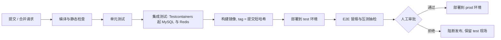

触发规则：feature、fix 分支的提交只跑编译与单元测试，保证秒级到分钟级反馈；合并请求进入 develop 触发完整流水线；main 分支的合并经人工审批后部署 prod。
质量门禁：编译失败、静态检查报错、单元或集成测试失败、覆盖率低于 11.4 的阈值、核心交易用例失败，任一命中即阻断流水线，不允许跳过测试直接发版。
部署方式：以镜像标签驱动，执行 docker compose pull 与 docker compose up -d 完成替换；数据库结构变更与代码变更分开执行，先结构后代码，且结构变更保持向后兼容。
回滚：保留最近若干可用镜像标签，回滚时把标签切回上一版本并只重建应用与入口容器，不触碰数据卷，目标 RTO ≤ 30 分钟（对齐《需求文档》7.3）。
分支与提交规范：main（可发布）、develop（集成）、feature/*、fix/*、hotfix/*；提交信息采用 type(scope): subject，与《需求文档》1.8 的 Git 规范要求一致。
过程留痕：流水线日志、镜像标签、部署记录与人工审批记录一并归档，作为《需求文档》1.8「过程可追溯」与 AI 辅助编程记录的证据链。

## 10.5 数据库备份与恢复（对齐需求 RTO/RPO）
备份目标直接对齐《需求文档》7.3：RTO ≤ 30 分钟、RPO ≤ 5 分钟。备份与恢复方案必须经过演练验证，不以「已配置」作为达标依据。

| 对象 | 方式 | 频率 | 保留 | 恢复目标 |
| --- | --- | --- | --- | --- |
| MySQL 全量 | mysqldump --single-transaction | 每日 03:00 | 7 天 | 支撑 RTO ≤ 30 分钟 |
| MySQL 增量 | binlog，ROW 格式 | 持续写入 | 7 天 | 支撑 RPO ≤ 5 分钟 |
| Redis | RDB 快照（可选） | 每日一次 | 3 天 | 会话与缓存可重建，允许丢失 |
| 上传目录 | 目录同步至备份卷 | 每日一次 | 7 天 | 与数据库备份同批次恢复 |

备份存放：备份文件与 binlog 存放于独立于应用容器的卷或对象存储，避免容器重建导致备份同时丢失。
恢复演练：每两周在 test 环境执行一次「全量 + binlog 恢复到指定时间点」的演练，记录实测 RTO 与 RPO，演练记录纳入《测试报告》。
权威数据边界：订单、支付、库存等权威数据只存在于 MySQL，Redis 仅承载会话与缓存，不作为权威数据源，避免引入不可恢复的单点（对齐 ADR-002）。
恢复后核对：恢复完成后先校验订单与库存恒等式、幂等表记录，确认无重复扣减与重复退款，再恢复对外服务。

## 10.6 一键启动与回滚方案
一键启动：docker compose up -d 完成建库、执行 DDL 与初始化数据、拉起全部服务。首次启动由初始化脚本写入角色、权限点、系统参数、基础商品与三类测试账号（管理员、运营、会员），满足《需求文档》1.8「初始化数据与测试账号可复现」。
一键验证：docker compose ps 检查容器健康状态，curl /healthz 检查入口，随后执行脚本化冒烟（登录 → 浏览商品 → 加购 → 下单 → 支付回调 → 查询订单）；三项全通过才判定部署成功。
一键停止：docker compose down 停止并删除容器但保留数据卷；清理数据卷的 down -v 只在本地环境使用。
回滚步骤：记录异常现象与当前版本号 → 将镜像标签切回上一版本 → 仅重建 app 与 nginx 容器 → 重新执行健康检查与冒烟 → 若为数据类问题，用修正脚本补偿而非回退表结构。
定时任务兜底：应用重启期间未执行的超时关单任务，会在恢复后按扫描条件自动补偿，不会因停机漏处理订单（对齐 ADR-005 与《需求文档》7.3 的最终一致保障）。
发布窗口：prod 发布安排在业务低峰时段，发布前后各触发一次数据库备份，发布记录与回滚结果写入《部署运维手册》。

## 10.7 交付物与文档汇总（测试 / 运维 / 文档）
第十、十一、十二章的产出汇总如下，作为本期「测试 + 运维 + 文档」职责的交付清单，各项在结项前统一归档并登记版本。

| 交付物 | 内容要点 | 对应章节 | 出具时点 |
| --- | --- | --- | --- |
| 部署运维手册 | 环境变量清单、一键启动与验证、备份恢复步骤、回滚操作、常见故障处置 | 十、十二 | 定稿后 |
| 测试报告 | 测试分层执行结果、核心交易用例结论、压测数据与库存核对结论、缺陷统计 | 十一 | 压测后 |
| 可观测性配置 | 日志格式与脱敏规则、指标看板清单、告警规则与通知渠道 | 十二 | 环境搭建后 |
| 演示视频 | 主交易闭环（浏览 → 加购 → 下单 → 支付 → 履约 → 售后 → 评价）与后台运营操作录屏 | 十一、需求 3.1 | 冻结后 |
| 文档汇总 | 需求文档、设计文档、数据库设计文档、OpenAPI 接口文档、部署与回滚说明的索引与版本 | 一、九 | 结项前归档 |

---

# 十一、测试策略【已填充 · 测试负责人】
本章对齐《需求文档》7.1 的量化指标与第 3 章的核心交易闭环，回答「测什么、怎么测、达到什么标准算通过」；性能与一致性验收以本章口径为准，结论汇入《测试报告》。

## 11.1 测试分层（单元 / 集成 / E2E）

| 层次 | 工具 | 覆盖对象 | 运行时机 | 通过标准 |
| --- | --- | --- | --- | --- |
| 单元测试 | JUnit 5 + Mockito，前端 Vitest | Service 领域规则、订单状态机迁移表、优惠试算、幂等键与工具类 | 每次提交 | 用例全绿，核心模块行覆盖 ≥ 80% |
| 集成测试 | Spring Boot Test + Testcontainers（MySQL 8 + Redis 7） | Mapper SQL、事务边界、会话与缓存、幂等表读写 | 合并请求到 develop | 用例全绿，事务回滚与并发分支被真实覆盖 |
| 接口测试 | MockMvc 或 RestAssured | 71 个接口的鉴权、参数校验、错误码与统一 Result 结构 | 合并请求到 develop | 权限矩阵与需求 2.2 逐条一致 |
| E2E 测试 | Playwright | C 端与 B 端主闭环的跨页面流程 | 部署到 test 之后 | 主闭环无阻塞性失败 |
| 性能测试 | k6 或 JMeter | 下单、支付回调、商品浏览与搜索 | 提测与发版前 | 达到 11.3 指标且库存恒等式成立 |

单元测试不启动 Spring 容器，只验证领域规则，保证提交级反馈在秒级完成。
集成测试使用 Testcontainers 拉起真实 MySQL 与 Redis，重点验证 ADR-004 的本地事务边界与 ADR-006 的三重幂等，避免用内存数据库替代而掩盖 SQL 行为差异。
接口测试逐条对照《需求文档》6.2 的接口规范与 2.2 的权限矩阵，越权访问与错误码是必测项。
E2E 覆盖两条关键路径：C 端「浏览 → 加购 → 下单 → 支付 → 售后 → 评价」，B 端「上架商品 → 发货处理 → 审核售后」，分别验证会员侧与运营侧可用性。
测试数据：测试账号、基础商品与券模板统一由初始化脚本预置，每次压测或回归前重建基线，保证结果可复现（对齐《需求文档》1.8）。

## 11.2 核心交易测试用例（对齐需求：零超卖、幂等、超时关单、竞态补偿）
下列用例覆盖《需求文档》第 3 章的核心交易闭环与本文档的 ADR 取舍，是发版强制项。

| 编号 | 场景 | 关键步骤与预期 | 对应设计 |
| --- | --- | --- | --- |
| TC-STOCK-01 | 并发下单零超卖 | 库存 100，并发 200 次各买 1：成功 100 单，其余返回 20003；结束后满足 总库存 = 可用 + 锁定 + 已售，无负库存 | ADR-003、5.1 |
| TC-STOCK-02 | 多商品下单部分失败整体回滚 | 订单含 A、B 两商品，B 库存不足：整单失败，A 的锁定库存无变化，无残留订单 | ADR-004、5.1 |
| TC-STOCK-03 | 支付确认扣减 | 支付回调成功后 locked 减少、sold 等量增加、总库存不变 | 5.2 |
| TC-IDEM-01 | 下单重复提交 | 同一 Idempotency-Key 串行与并发重复提交：只产生一个订单号，重复请求返回首次结果 | ADR-006、5.6 |
| TC-IDEM-02 | 支付回调重复 | 同一支付单号回调多次：订单只迁移一次到待发货，库存只扣减一次 | 5.2、5.6 |
| TC-IDEM-03 | 幂等结果重放 | 首次请求处理中再次提交返回 30004；处理完成后重放返回首次结果 | 5.6 |
| TC-TIME-01 | 超时关单与库存回滚 | 订单超过支付截止时间：定时任务关单，库存由锁定回退为可用，已核销的优惠券同步退回 | ADR-005、5.3 |
| TC-TIME-02 | 关单与支付回调竞态 | 先关单后回调：生成退款单，订单不复活；先回调后关单：关单条件更新影响行数为 0，自动跳过 | 5.3、5.4 |
| TC-COUPON-01 | 优惠券核销与退回 | 下单核销成功；取消或超时关单退回；重复退回影响行数为 0，不重复退券 | 7.4 |
| TC-ORDER-01 | 订单状态机非法流转 | 待支付直接流转到已完成：返回 30002，订单状态保持不变 | 5.5 |
| TC-AUTH-01 | 越权访问数据 | 会员 A 访问会员 B 的订单、地址、售后：统一返回 99001，不泄露资源是否存在 | 6.3、需求 7.2.1 |
| TC-AUTH-02 | 禁用即时失效 | 管理员禁用会员后，该会员已签发的令牌立即失效并返回 10002 | ADR-002、7.1.7 |

上述 12 条为发版强制项，未全部通过不得进入 prod 部署阶段。
竞态类用例通过缩短定时任务扫描间隔、调整支付截止时间制造竞争窗口，不依赖人工抢时序。
用例执行结果逐条记录实际结果与证据（请求号、traceId、数据库核对 SQL 输出），作为《测试报告》的原始数据。

## 11.3 性能压测（对齐需求 7.1：下单 P95、≥200 TPS）

| 场景 | 目标指标 | 通过条件 | 观察项 |
| --- | --- | --- | --- |
| 商品列表与详情 | P95 ≤ 300ms，吞吐 ≥ 500 QPS | 错误率 < 0.1% | 缓存命中率、慢 SQL |
| 商品搜索 | P95 ≤ 500ms | 错误率 < 0.1% | 关键词条件的索引命中情况 |
| 购物车操作 | P95 ≤ 300ms | 错误率 < 0.1% | 读写比与唯一键合并写入 |
| 提交订单 | P95 ≤ 800ms、P99 ≤ 1.5s、≥ 200 TPS | 零超卖、零负库存 | 库存行竞争、事务耗时 |
| 支付回调处理 | P95 ≤ 1s | 重复回调不重复扣减 | 幂等表写入与锁等待 |
| 订单查询 | P95 ≤ 500ms | 错误率 < 0.1% | 索引命中情况 |
| 混合场景 | 读写比 7:3，持续 10 分钟 | 指标劣化不超过 20%，无内存泄漏 | CPU、连接池、GC |

压测环境与 test 环境同规格同配置，压测前重建基线数据并关闭 DEBUG 日志，避免日志写放大干扰结果。
一致性校验优先于响应时间：压测结束后必须核对库存恒等式（总库存 = 可用 + 锁定 + 已售）、订单数与库存扣减总量一致、无负库存，任一项不成立即判定压测失败。
压测期间同步采集第十二章的接口指标与数据库指标，用于定位瓶颈，并作为压测报告的数据来源。
结论按《需求文档》7.1.1 的指标表逐条给出达标或不达标判定，不达标项必须附瓶颈定位与优化措施。

## 11.4 覆盖率要求与质量门禁
覆盖率要求：后端整体行覆盖率 ≥ 60%，订单、支付、库存、幂等四个核心交易模块行覆盖率 ≥ 80% 且关键分支全覆盖；前端行覆盖率 ≥ 50%。
门禁一：编译与静态检查必须通过，后端使用 Checkstyle 与 SpotBugs，前端使用 ESLint + Prettier（JavaScript/JSDoc，见 8.2）。
门禁二：单元、集成、接口测试用例全绿，且 11.2 的核心交易用例全部通过。
门禁三：覆盖率不得低于上述阈值，覆盖率相对上一版本下降视为构建失败。
门禁四：main 分支受保护，禁止直接推送，必须经合并请求与人工审批后合并。
门禁结果由流水线自动产出并归档，以机器判定代替人工确认，避免发版前临时放宽标准。

## 11.5 缺陷管理流程

| 级别 | 判定标准 | 响应要求 | 关闭条件 |
| --- | --- | --- | --- |
| P0 阻断 | 核心交易不可用，或出现超卖、重复扣款等资金与库存不一致 | 立即响应，当日修复 | 修复上线 + 回归用例通过 + 数据核对一致 |
| P1 严重 | 主流程不可用，或存在越权、认证失效等安全问题 | 2 小时内响应，次日内修复 | 修复上线 + 回归用例通过 |
| P2 一般 | 非核心功能异常，或存在可接受的替代路径 | 纳入当前迭代排期 | 修复验证通过 |
| P3 轻微 | 文案、样式、易用性类问题 | 纳入迭代待办 | 修复验证通过 |

缺陷必带信息：环境、复现步骤、请求号与 traceId、日志片段；缺少 traceId 的缺陷先补齐信息再指派，与第十二章的链路追踪配套使用。
流转路径：发现 → 登记 → 定级指派 → 修复 → 回归（引用 11.2 的用例编号）→ 关闭，全过程在缺陷看板留痕。
回归要求：每个修复必须补充或关联回归用例，防止同类问题复发。
发版联动：存在未关闭的 P0、P1 缺陷时禁止发布 prod。

## 11.6 测试报告
报告结构：测试范围与依据、环境与版本（镜像标签）、测试分层执行结果、核心交易用例逐条结论、压测数据与库存核对结论、缺陷统计与遗留问题、总体结论。
数据来源：流水线测试结果、压测原始数据、数据库核对 SQL 输出与缺陷看板导出，保证每条结论可追溯到原始证据。
出具时点：一次在提测后，一次在发版前；发版前出具的报告为最终交付版本。
与需求对应：逐条对照《需求文档》7.1 的性能指标、1.8 的可量化验收指标与 8.2 的关键决策，说明本期的达标情况与未达标原因。
遗留问题：无法在本期闭环的事项（如支付沙箱与真实支付的差异、跨流程最终一致的极端时序）写入报告的风险章节，并给出后续处理建议。
---

# 十二、可观测性设计【已填充 · 运维 / 后端】
本章对齐《需求文档》6.2.7（traceId 与日志）、7.3（可用性与最终一致）与 7.5（可观测性）；目标是用「结构化日志 + 关键指标」把订单、支付、库存、售后四条链路的异常在分钟级定位出来，同时为第十一章的压测与缺陷定位提供数据来源。

## 12.1 日志规范（级别、格式、脱敏、traceId）
输出格式：结构化 JSON 单行日志，固定字段 timestamp、level、service、traceId、userId、method、path、costMs、message，异常额外携带异常类型与堆栈；日志同时输出到容器标准输出由 Docker 收集，并落盘轮转保留 14 天。
级别约定：ERROR 用于需要人工介入的故障（支付回调失败、库存扣减失败、定时任务连续失败）；WARN 用于可自愈或已兜底的情况（条件更新影响行数为 0、重试成功、降级生效）；INFO 记录关键状态变更（订单状态迁移、库存锁定与扣减释放、退款、权限与配置变更）；DEBUG 仅用于 dev 环境。
traceId：由入口生成并贯穿全链路，日志中的 traceId 与响应体 Result.traceId 始终一致；定时任务与异步处理按批次生成独立 traceId，批内订单共享同一标识，详见 12.3。
脱敏要求：手机号中间四位掩码；密码、令牌、密钥与完整支付凭证一律不得写入日志；异常日志不打印完整请求体与响应体（对齐《需求文档》7.2.2）。
审计日志：库存调整、订单发货、售后审核、角色权限变更、系统配置修改等关键写操作落 t_operation_log，记录操作人、目标对象、变更前后值与 traceId，支撑《需求文档》7.2.4 的审计要求。
检索字段：订单号、支付单号、售后单号作为独立字段写入日志，避免只能依靠 traceId 单点排查。

## 12.2 指标采集（接口 QPS/RT、订单量、库存告警）
指标由 Spring Boot Actuator 结合 Micrometer 暴露 /actuator/prometheus（仅内网可达），Prometheus 定时抓取、Grafana 出图，容器与 JVM 资源指标一并接入。

| 类别 | 指标 | 来源 | 用途 |
| --- | --- | --- | --- |
| 接口 | 按 uri 与 status 的请求量、P95 与 P99 耗时、错误率 | Micrometer | 对齐需求 7.1 的性能指标，识别劣化接口 |
| 交易 | 下单成功与失败数、支付回调成功数、超时关单数、退款单数 | 业务埋点 | 交易健康度与对账依据 |
| 库存 | 库存不足拒绝次数、锁定库存总量、库存恒等式偏差 | 业务埋点 | 防超卖与账实一致性监控 |
| 定时任务 | 关单任务执行次数与耗时、处理订单数、连续失败次数 | 任务埋点 | 验证超时关单补偿机制可用（ADR-005） |
| 售后 | 待审核售后单数、退款中停留时长、退款失败数 | 业务埋点 | 发现退款积压，对齐 7.5 |
| 资源 | JVM 堆与 GC、数据库连接池活跃数、容器 CPU 与内存 | Actuator | 容量判断与瓶颈定位 |
| 缓存 | Redis 命中率、会话数、内存占用 | Redis | 缓存有效性与会话容量 |

看板划分：交易看板（订单量、成功率、接口耗时分位）、库存看板（锁定与已售、恒等式校验）、接口看板（QPS 与错误率排行）、资源看板（JVM 与容器资源）。
采集与保留：Prometheus 每 15 秒抓取一次，原始数据保留 15 天；压测期间可临时缩短抓取间隔，以取得更细粒度数据。
统计口径：所有耗时指标按分位统计，不使用平均值掩盖长尾（对齐《需求文档》7.1.1）。
埋点位置：业务指标在状态变更成功之后记录，避免把条件更新失败误计为成功。

## 12.3 链路追踪（traceId 透传与展示）
透传链路：客户端（浏览器、压测工具）→ Nginx 生成或透传 X-Trace-Id → 应用过滤器写入 MDC → Service 与 Mapper 日志携带同一 traceId → 响应头与 Result.traceId 回传前端。
跨组件一致：应用内部调用、定时任务与异步线程通过上下文传递 traceId，保证同一次交易在日志中能拼出完整时间线。
定时任务与批处理：每批次生成一个 traceId 并记录处理订单数，批次内单笔订单的异常可按订单号二次定位。
展示与检索：日志平台按 traceId 聚合展示完整调用链；告警通知与缺陷单必须携带 traceId，形成「告警 → 日志 → 落库数据」的定位路径。
范围说明：本期以 traceId 加结构化日志实现链路定位，不引入 APM 或分布式追踪中间件，与 ADR-007 的务实克制一致；若后续引入消息队列，traceId 随消息头透传（见 14.2）。

## 12.4 告警规则（库存不足、支付回调失败、定时任务异常）

| 告警项 | 触发条件 | 级别 | 处置建议 |
| --- | --- | --- | --- |
| 库存不一致 | 库存恒等式偏差不为 0，或出现负的可用、锁定库存 | P0 | 立即停止写入并人工介入，核对订单与库存流水 |
| 支付回调失败 | 5 分钟内失败次数 ≥ 5，或失败率 ≥ 1% | P1 | 检查沙箱连通与验签逻辑，触发对账补偿（见 5.4） |
| 定时任务异常 | 关单任务连续 3 次执行失败，或超过 2 分钟未执行 | P1 | 检查调度与数据库连接，恢复后确认订单是否补偿到位 |
| 退款积压 | 售后单在退款中停留超过 30 分钟 | P1 | 检查支付模块与重试队列，必要时人工介入 |
| 库存不足激增 | 20003 拒绝次数 5 分钟内环比上升超过 200% | P2 | 核对热销商品库存与补货计划 |
| 核心接口劣化 | 核心接口 5 分钟错误率 > 1%，或 P95 超过需求阈值 2 倍 | P1 | 排查实例状态、慢 SQL 与连接池 |
| 应用不可用 | /actuator/health 连续 3 次探测失败 | P0 | 重启容器或切流，必要时按 10.6 回滚 |
| 连接池耗尽 | 活跃连接数持续 5 分钟高于上限的 90% | P1 | 排查慢查询与连接泄漏 |

告警降噪：同源告警 10 分钟内聚合为一条；维护窗口与非核心功能（评价、统计）降级期间不触发告警，避免淹没真正的 P0（对齐《需求文档》7.3 的降级要求）。
通知与值守：P0 立即推送并电话通知，30 分钟内响应；P1 推送团队群，2 小时内响应；P2 与 P3 进入日常看板，不打扰值班。
告警即证据：每次告警的处置过程记录 traceId、影响范围与恢复动作，纳入《部署运维手册》的故障案例，供复盘与补充压测场景使用。
---

# 十三、开发计划与分工【主干 · 项目经理】

## 13.1 里程碑

| 阶段 | 交付物 | 责任 |
| --- | --- | --- |
| M1 需求与设计 | 需求文档、架构设计文档、数据库设计文档 | 全员 |
| M2 环境与骨架 | 工程脚手架、统一组件、数据库脚本 | 后端负责人 |
| M3 核心交易 | 下单/支付/库存/关单/幂等/售后 | 后端负责人 |
| M4 业务模块 | 用户/商品/购物车/营销/评价 | 模块组员 |
| M5 前端 | C 端与 B 端页面、联调 | 前端负责人 |
| M6 测试与部署 | 测试报告、部署运维、演示视频 | 测试/运维 |

## 13.2 分工矩阵（RACI 摘要）

| 模块 / 事项 | 负责(R) | 配合(C) |
| --- | --- | --- |
| 需求 / 架构 / 进度 / 数据库 | A（项目经理 / 后端负责人） | 全员 |
| 订单 / 支付 / 库存 / 事务 / 幂等 / 营销 | A | B、D |
| 用户 / RBAC / 安全 / 商品 / 购物车 / 售后 / 评价 | B（后端开发 / 安全） | A |
| 前端（C 端 + B 端） | C（前端负责人） | A、B |
| 测试 / 部署 / 监控 / 系统配置 / 日志 / 看板 / 文档 / 视频 | D（测试 / 运维 / 文档） | 全员 |

> 进度以两周为单位滚动更新；详细排期、RACI、范围优先级与验收清单见《项目分工与进度计划》。关键路径为「核心交易」与「前端联调」。
---

# 十四、风险与演进【主干】

## 14.1 主要风险

| 风险 | 影响 | 应对 |
| --- | --- | --- |
| 跨流程最终一致依赖定时任务 | 数据不一致 | 幂等 + 对账补偿 + 测试覆盖 |
| 支付沙箱为模拟 | 与真实支付差异 | 文档说明差异与假设 |
| 团队对 Java/Spring 栈不熟 | 影响开发进度与质量 | 提前培训、结对开发、以统一脚手架降低上手成本 |
| 前后端联调时间紧、接口字段易变 | 阻塞主闭环 | Day 2 冻结 OpenAPI；前端按契约 Mock 先行；变更必须同步 C/D |
| 模块边界松弛 | 退化为大泥球 | 依赖单向评审 + 代码规范 |

## 14.2 演进方向
- 引入 MQ（削峰、异步解耦）、Redis 延迟队列优化关单、模块拆分微服务、读写分离与分库分表、引入监控告警体系。

---

# 十五、审阅记录与修订（v0.2）【主干 · 后端负责人】

## 15.1 审阅结论

本次审阅覆盖所有组员填充章节。整体质量较高，事务边界、幂等、防超卖、错误处理与需求文档基本对齐。原存在的 **3 项 P0 已全部关闭**：鉴权与技术选型完成修订，数据库设计与前端架构文档均已产出；P1 问题均已修正或标记。

### P0（必须处理）

| 编号 | 问题 | 说明 / 处理建议 |
| --- | --- | --- |
| P0-1 | ~~鉴权实现偏离已定方案 B~~ **（已解决）** | **已按方案 B 定稿**：7.1、7.1.9 改为不透明随机 Token 存 Redis，删除 JWT、刷新令牌、签名密钥与密钥轮换；10.1/10.3 同步。 |
| P0-2 | ~~技术选型未定与 Java 假设冲突~~ **（已解决）** | **已定稿 Java 栈**：第二章回填选型表与统一技术基线，新增 ADR-009；第十~十二章无需改写。 |
| P0-3 | ~~文档完整性不足~~ **（已解决）** | 第九章与《数据库设计文档》已完成（20 张表 DDL、索引、初始化数据与校验 SQL）；第八章「前端架构设计」已由前端负责人补齐并整合，含工程结构、路由权限、状态管理、请求封装、页面接口映射与构建部署。 |

### P1（开发前修正）

| 编号 | 问题 | 处理 |
| --- | --- | --- |
| P1-1 | 错误码字典不完整且区段冲突 | 营销 50xxx、评价 60xxx、通用 99xxx 未登记；原 `40401` 与 40xxx 售后区段冲突。**本次已将 `40401` 统一改为 `99001`**，并在 15.4 给出统一字典，**已回填《需求文档》6.2.4**。 |
| P1-2 | 优惠券核销未按最终金额复验 | 7.4.3 仅依赖结算预览，存在「预览后券过期/金额变化」超门槛用券风险。**本次已补充下单事务内复验要求**。 |
| P1-3 | `t_category` 唯一键在逻辑删除下会冲突 | 原 `UK(name, deleted)` 会导致删除第二个同名分类时冲突。**本次已改为 `KEY(name)` + 应用层校验**。 |
| P1-4 | 权限缓存与「立即生效」矛盾 | 原表述「权限放宽最迟 30 分钟生效」与 6.2.5「立即生效」冲突。**本次已改为：变更主动删缓存，即时生效，TTL 仅兜底**。 |
| P1-5 | 跨文档字段差异未同步 | 售后新增 `pre_status`、`refund_no`；购物车改为物理删除无 `deleted`；幂等表唯一键应为 `(user_id, biz_type, idem_key)`。**《需求文档》已同步**，仍需同步《数据库设计文档》。 |
| P1-6 | 交叉引用错误 | 7.4.3「《需求文档》5.7 事务边界」不存在（需求第 5 章无 5.7）。**本次已改为「本文档 5.7」**。 |

### P2（建议完善）

- 退款回写：已统一为「同步发起 + 异步兜底」（7.5.3、7.5.6），解决原「异步回写」与「同步时序图」表述不一致。
- `t_idempotent` 唯一键：已统一为 `(user_id, biz_type, idem_key)`（需求 5.3.8/6.2.6 与本文 5.6 已同步）。
- 前端令牌存储：已确认本期存 localStorage（见 8.4），以支持刷新保持登录；需配合 XSS 防护，生产环境建议改为内存态 + HttpOnly Cookie 会话。

## 15.2 本次已修订项

1. 将原 Word（.docx）内容转为标准 Markdown，修正标题层级、Mermaid 代码块围栏、表格分隔线。
2. 通用错误码 `40401` → `99001`，避免与售后区段冲突。
3. 补充 7.6「评价」模块详细设计（原为空）。
4. 修正 P1-2、P1-3、P1-4、P1-6。
5. 更新章节类型标签与文档状态。
6. **按方案 B 定稿鉴权**：7.1.1/7.1.3/7.1.6/7.1.7/7.1.9 改为不透明随机 Token 存 Redis，删除 JWT、刷新令牌、签名密钥与密钥轮换；10.1/10.3 同步。
7. **技术选型定稿**：完成第二章选型表与统一技术基线，新增 ADR-009。
8. **数据库设计定稿**：产出《数据库设计文档》与 `docs/sql/schema.sql`、`docs/sql/init_data.sql`；第九章由骨架改为引用。
9. **前端架构定稿**：整合前端负责人第八章；统一 Node 18 LTS、C 端 Vant 4 / B 端 Element Plus、JavaScript + ESLint/Prettier，并修正页面与接口编号映射。
10. **退款回写定稿**：售后审核改为「同步发起 + 异步兜底」，更新 7.5.3、7.5.6 与决策记录。
11. 更新风险表与第十五章结论。

## 15.3 决策状态

| 决策 | 状态 | 结论 |
| --- | --- | --- |
| 鉴权方案 | ✅ 已定 | **方案 B**：不透明随机 Token 存 Redis（7.1、7.1.9） |
| 技术栈 | ✅ 已定 | **Java 17 + Spring Boot 3 + MySQL 8 + Redis 7 + Vue 3**（第二章、ADR-009） |
| 退款回写 | ✅ 已定 | **同步发起 + 异步兜底**：同步调退款，成功即回写；超时/失败转退款中，定时对账补偿（7.5.3、7.5.6） |

## 15.4 统一错误码字典（已回填需求 6.2.4）

| 区段 | 模块 | 已用示例 |
| --- | --- | --- |
| 0 | 成功 | — |
| 10xxx | 用户 / 鉴权 | 10002 未登录/失效；10003 无权限；10005 账号禁用；10006 手机号已注册；10007 凭据错误；10008 登录失败超限；10004 通用参数错误 |
| 20xxx | 商品 / 购物车 / 库存 | 20002 商品下架/不存在；20003 库存不足；20004 商品不存在；20005 分类下有商品；20006 分类名重复；20007 商品参数非法；20010 数量非法；20011 购物车已满 |
| 30xxx | 订单 / 支付 | 30002 状态不允许；30004 重复请求；30005 订单已关闭 |
| 40xxx | 售后 | 40002 状态不允许；40003 不满足售后条件；40004 重复退款；40005 退款失败 |
| 50xxx | 营销 | 50002 券不可用/已领完；50003 未达门槛；50004 重复领取；50005 券状态不允许；50006 券参数非法 |
| 60xxx | 评价 | 60001 评价不存在/无权；60002 重复评价；60003 订单或订单项不可评价 |
| 90xxx | 系统 | 90001 系统异常 |
| 99xxx | 通用 | 99001 资源不存在或无权访问（防枚举统一返回） |

## 15.5 待补充清单

| 事项 | 负责人 | 说明 |
| --- | --- | --- |
| 第八章 前端架构设计 | 前端负责人 | ✅ 已完成（工程结构、路由权限、状态管理、请求封装、页面接口映射、构建部署） |
| 第九章 数据库设计 | 数据库负责人 | ✅ 已完成（20 表 DDL、索引、初始化数据、迁移与校验 SQL） |
| 退款回写方式 | 支付模块负责人 | ✅ 已定（同步发起 + 异步兜底），7.5.3 / 7.5.6 已同步 |
| 需求文档同步 | 项目经理 | ✅ 已完成错误码、售后字段（pre_status/refund_no）、购物车物理删除、幂等唯一键的同步 |
| 技术选型定稿 + ADR-009 | 全员 | ✅ 已完成（第二章、ADR-009） |
| 鉴权方案决策 | 后端负责人 | ✅ 已按方案 B 定稿 |
