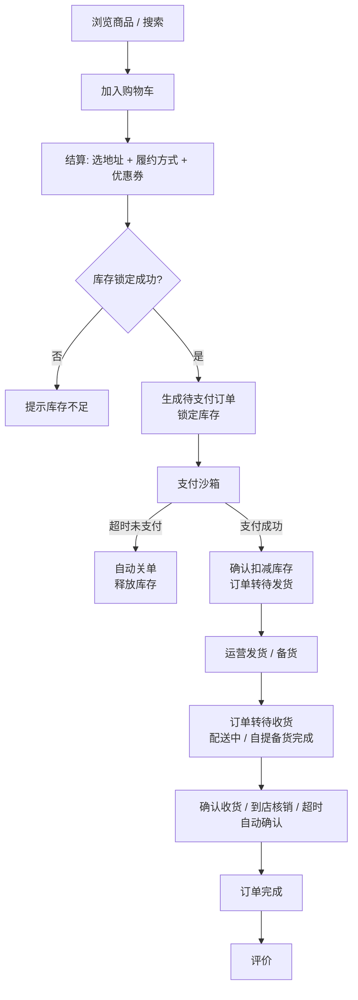
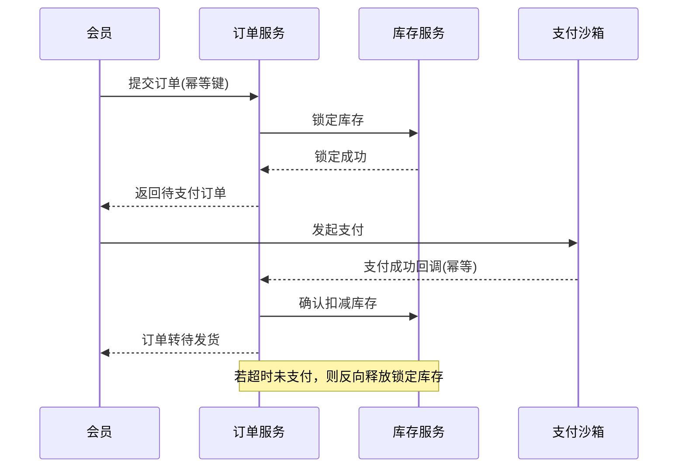
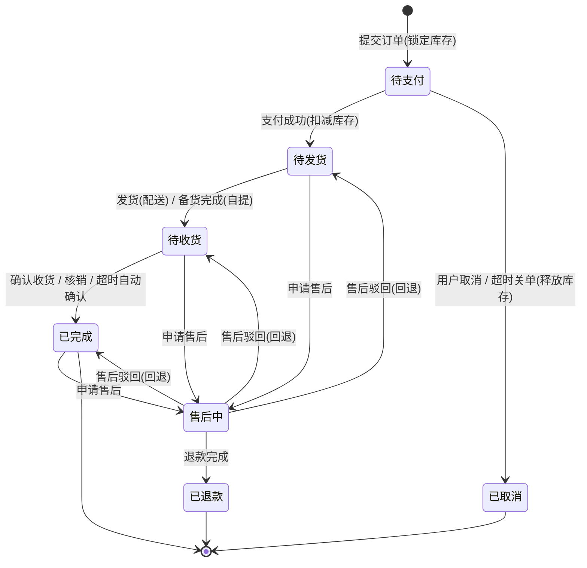
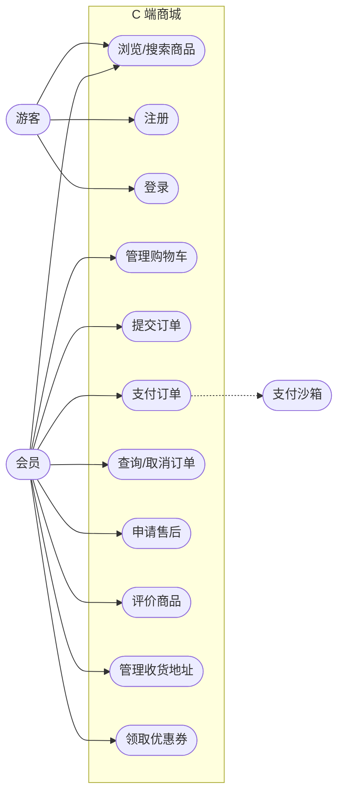
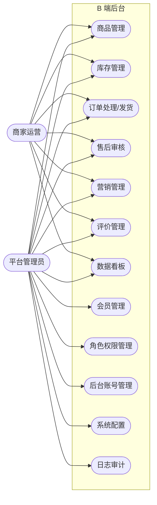
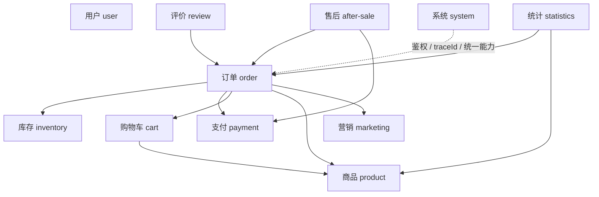
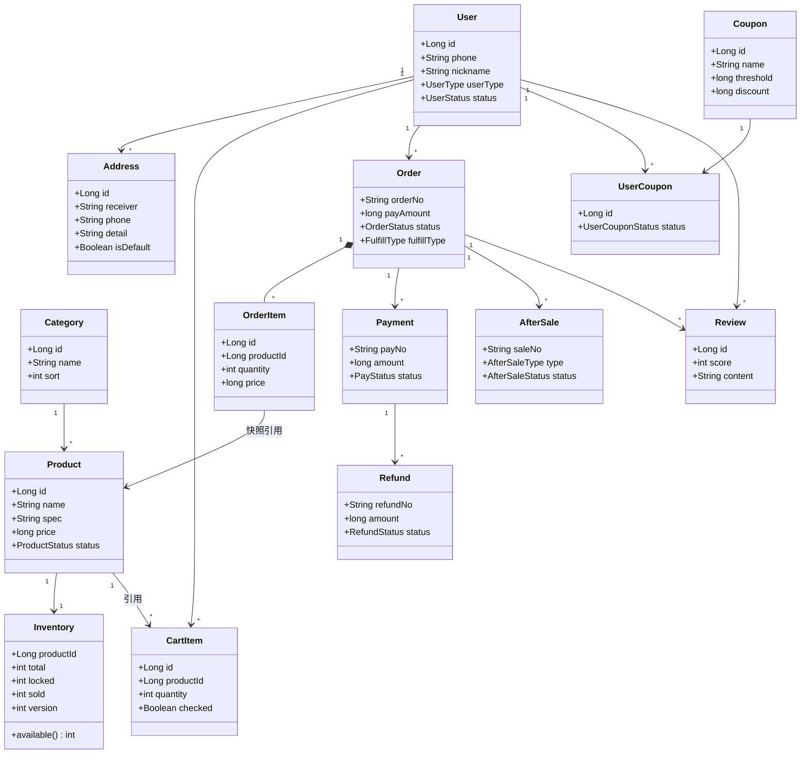
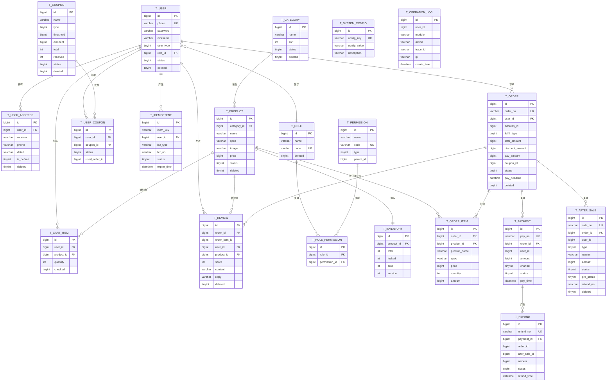

# 邻里鲜生社区超市商城系统 · 需求规格说明书

> 版本：v0.1（第 1 章）
> 编写：需求/架构/进度/核心交易负责人
> 状态：草稿

---

# 一、项目立项

## 1.1 商城名称

- **中文名**：邻里鲜生（社区超市商城系统）
- **英文名/代号**：Linli Fresh
- **一句话定位**：面向社区「最后一公里」的生鲜日用即时零售商城，支持**到店自提**与**到家配送**两种履约方式。
- **宣传语**：邻里鲜生，新鲜到家。

命名说明：以「邻里」突出社区近距离属性，以「鲜生」突出生鲜日百的核心品类，便于在后续模块（商品、库存、订单、履约）中形成统一的品牌语义。

## 1.2 项目背景

**业务背景**

1. 社区零售与「即时零售」需求快速增长，居民对「当天买、当天到」的生鲜日用消费习惯正在形成。
2. 传统社区小超存在明显短板：库存靠人工记账、线上无触达渠道、订单全人工处理，导致有货卖不出、缺货不知道、复购难留存。
3. 大型电商平台在生鲜最后 1 公里上体验不稳定（配送慢、损耗高、退换复杂），本地化社区商超反而具备天然优势。

**技术背景（本课程/实验背景）**

1. 本项目作为企业级应用开发实践的载体，需要完整经历需求分析、技术选型、架构设计、编码实现、测试验证与部署运维全流程。
2. 采用前后端分离与后端分层架构，统一 API 规范、统一鉴权、统一异常、统一分页、统一 traceId，避免 JSP/Servlet 式的大泥球开发。
3. 以核心交易链路（下单、支付、库存、事务、幂等）为技术难点主线，验证企业级数据一致性方案。

**项目定位**

系统为**单一商家**的社区超市自营商城（非多商家平台），聚焦把「商品 → 购物车 → 下单 → 支付 → 履约 → 售后 → 评价」的核心闭环做深做透，而非追求业务形态的广度。

## 1.3 目标用户

| 用户类型 | 说明 | 主要诉求 |
| --- | --- | --- |
| C 端消费者 | 社区及周边居民，注册成为会员后在线购物 | 快速找到想要的商品、价格透明、下单方便、履约可靠、售后有保障 |
| B 端商家/运营 | 超市运营人员，负责商品、库存、订单、活动、售后处理 | 商品快速上架、库存准确、订单高效处理、数据可查 |
| 平台管理员 | 负责系统与账号权限管理 | 用户/角色/权限可控、系统可运维、异常可追踪 |

> 说明：本系统为单商家自营，故「商家运营」与「平台管理员」可由同一组织内不同岗位承担；后续第 2 章将据此抽象为系统角色与权限矩阵。

## 1.4 用户画像

**画像 A：加班白领·小林（核心 C 端用户）**

- 年龄/身份：28 岁，互联网公司职员，独居或两口之家。
- 目标：下班前用手机下单，到家即可收货，省去超市排队时间。
- 行为习惯：通勤路上高频使用手机；对配送时效敏感；偏好即食、半成品、水果、日用快消。
- 对系统诉求：操作路径短、下单快、能实时看订单状态、支持常用地址与常用商品快速复购。

**画像 B：家庭主妇·王姐（价格与品质敏感型 C 端用户）**

- 年龄/身份：42 岁，负责家庭日常采购，三口之家。
- 目标：一次买齐全家的生鲜与日用，追求性价比与新鲜度。
- 行为习惯：会比对价格、关注促销与优惠券；习惯周末或固定时间集中采购。
- 对系统诉求：分类清晰、搜索准确、有优惠、支持购物车囤货、生鲜品质可退换。

**画像 C：运营专员·阿杰（B 端用户）**

- 年龄/身份：30 岁，超市运营岗，负责商品与订单日常运营。
- 目标：快速维护商品与库存，及时处理订单与售后，避免超卖与投诉。
- 行为习惯：工作日内高频处理后台任务；关注待处理订单和库存预警。
- 对系统诉求：商品/库存/订单后台操作高效、数据准确、**杜绝超卖**、对账清晰。

## 1.5 核心痛点

**C 端痛点**

1. 不知道附近店铺「有没有货、什么价」，白跑一趟。
2. 到店排队、结账耗时，尤其生鲜称重场景。
3. 线上下单后配送/自提进度不透明，无法追踪订单状态。
4. 生鲜品质不达标时退换货流程繁琐。
5. 缺少个性化复购入口，每次都要重新搜索。

**B 端痛点**

1. 库存靠人工记账，账实不符，**高峰期易超卖**（本项目的核心交易价值锚点）。
2. 订单全人工处理，易漏单、错单，履约效率低。
3. 缺少交易数据沉淀，无法支撑选品与促销决策。
4. 支付与订单状态依赖人工对账，异常订单难定位、难追溯。
5. 权限粗放，运营与管理员操作无隔离，存在误操作风险。

## 1.6 使用场景

**场景 S1：下班路上的即时下单（C 端）**

小林 18:00 下班，在通勤路上打开「邻里鲜生」，浏览「水果/熟食」分类加入购物车，选择「到家配送」并填写常用地址，选择支付方式完成支付，系统展示订单状态；到家后收到配送完成通知。

**场景 S2：家庭集中囤货（C 端）**

王姐周末在购物车中一次性加入生鲜、粮油、日用品，使用优惠券后提交订单并支付，选择「到店自提」，到店后凭订单码核销取货。

**场景 S3：超时未支付自动关单（C 端 + 系统）**

小林提交订单后未在有效期内完成支付（默认 30 分钟），系统自动关闭订单并**释放已锁定库存**；小林可在「我的订单」中看到订单已取消及原因，并支持重新下单。

**场景 S4：库存扣减与防超卖（系统）**

多名用户同时购买同一商品（如促销装鸡蛋），系统需保证「下单锁定 → 支付确认扣减 → 取消/超时回滚」全链路库存准确，绝不出现负库存或超卖。

**场景 S5：运营上架与订单处理（B 端）**

阿杰在后台新增商品、设置价格与库存，查看待发货订单并逐一处理发货；发现库存预警商品后及时补货。

**场景 S6：售后与评价（C 端 + B 端）**

王姐收到不新鲜的水果，提交售后申请并附图片；阿杰审核通过后执行退款/补发；王姐完成后对商品与服务进行评价。

## 1.7 项目边界（做什么、不做什么）

**本项目做（In Scope）**

- 用户注册/登录、鉴权与个人信息、收货地址管理。
- 商品分类、列表、详情、关键词搜索。
- 购物车增删改查与结算。
- 下单、**支付沙箱模拟**、**超时未支付自动关单 + 库存回滚**。
- 库存管理：下单锁定库存、支付扣减、取消/超时释放，保证不超卖。
- 订单履约：发货、完成、取消；订单状态机与状态流转可追溯。
- 售后：退款/退货申请与处理。
- 评价：商品评价与展示。
- 优惠：优惠券在结算与下单中的简单应用。
- 运营后台：商品、库存、订单、售后、用户的基础管理。
- 企业级基础能力：统一 Result、统一异常、统一分页、统一鉴权、统一 traceId、OpenAPI 文档。

**本项目不做（Out of Scope）**

- 真实支付通道对接：统一使用**支付沙箱/自研 mock**，不接真实资金。
- 真实物流系统对接：配送/自提为流程模拟，不对接第三方运力。
- 多商家入驻与结算分账：系统为单商家自营。
- 秒杀、限时抢购、拼团、直播、社交、自研 IM 等营销/互动形态。
- 个性化推荐算法与大数据分析平台。
- 多终端：本期仅做 Web 端，不做小程序/App 原生端。

**边界依据**：把团队精力集中在核心交易闭环与数据一致性上，控制业务广度以换取工程质量与可复现性。

## 1.8 项目目标

**业务目标**

1. 完整跑通「浏览 → 加购 → 下单 → 支付 → 履约 → 售后 → 评价」核心业务闭环，支持到店自提与到家配送。
2. 运营侧可独立完成商品、库存、订单、售后的日常管理。
3. 支持优惠券在交易链路中的落地，体现营销对交易的影响。

**技术目标（与核心交易职责强绑定）**

1. 前后端完全分离，后端按业务域分模块，模块内遵循 `Controller → Service → Mapper/Repository` 分层。
2. 统一规范落地：统一返回体、统一异常处理、统一分页、统一鉴权、统一日志 traceId、OpenAPI 文档。
3. 库存一致性：下单锁定、支付扣减、取消/超时回滚闭环，**在并发下单下不超卖、不出现负库存**。
4. 接口幂等：下单、支付、关单等关键接口支持幂等，防止重复提交与重复扣减。
5. 事务与最终一致：本地事务 + 超时关单/库存回滚的可靠补偿机制，关键状态变更可追溯。
6. 订单状态机：定义完整状态与合法流转，禁止非法状态跳转。

**工程目标**

1. Git 分支规范、代码规范、单元/集成/E2E 测试齐备。
2. Docker/Docker Compose 一键启动，Nginx 反向代理，环境分离，具备部署脚本与回滚方案。
3. 提供数据库脚本、初始化数据、测试账号与启动命令，保证结果可复现。
4. 完整记录 AI 辅助编程过程与关键决策，保证过程可追溯、可复现。

**可量化验收指标（初稿，后续第 7 章细化）**

- 核心接口在压测场景下库存零超卖、零负库存。
- 下单、支付接口在重复请求下结果幂等一致。
- 超时未支付订单在约定时限内自动关闭并完成库存回滚。
- 全链路请求具备 traceId，异常可定位。

---

# 二、角色与权限

## 2.1 角色定义

系统采用 **RBAC（基于角色的访问控制）** 模型：`用户 → 角色 → 权限点`。权限不以代码硬编码判断角色，而是抽象为「权限点」，由角色绑定权限点集合，鉴权时校验当前用户是否拥有对应权限点。本期角色共 **4 类**：

| 编号 | 角色 | 身份说明 | 使用端 |
| --- | --- | --- | --- |
| R1 | 游客 | 未登录访客，仅可浏览商品与注册/登录 | C 端前台 |
| R2 | 会员（消费者） | 已登录注册用户，交易闭环主体 | C 端前台 |
| R3 | 商家运营 | 超市业务岗，负责商品、库存、订单、售后、营销 | B 端运营后台 |
| R4 | 平台管理员 | 系统管理岗，负责账号、角色、系统配置与审计 | B 端管理后台 |

**角色关系说明**

- **管理员继承运营的全部业务权限**，在此之上额外拥有系统管理类权限（会员管理、角色权限、系统配置、日志审计）。
- **运营不具备任何系统管理类权限**，无法管理会员账号、角色与权限。
- 4 类角色之间为**互斥归属**：一个用户在同一时刻只具有一个主要角色；会员与后台岗位不混用账号。

**关于暂不单设的角色的说明**

本系统为单商家自营，配送为流程模拟（见 1.7），无独立运力主体，故**不单设「配送员」角色**；售后审核、评价回复等职责天然归属运营岗，故**不单设「客服」角色**。RBAC 采用角色与权限点解耦设计，后续若业务发展需要，可零成本扩展「配送员」「客服」等角色，无需改动业务代码。

**权限模型约定**

- 权限点编码采用 **`模块:资源:操作`** 的中等细粒度格式，例如：
  - `product:goods:create`（商品-新增）、`product:goods:update`（商品-编辑）
  - `trade:order:query`（订单-查询）、`trade:order:ship`（订单-发货）
  - `after:sale:audit`（售后-审核）、`system:role:manage`（角色-管理）
- 权限点可**映射**到菜单、按钮与后端 API，实现「前端隐藏 + 后端校验」双重控制。
- 鉴权采用「**功能权限 + 数据权限**」双维度：
  - **功能权限**：能否执行该操作。
  - **数据权限**：能操作**谁的数据**。会员仅能操作「本人」数据；运营与管理员可操作全量数据。

## 2.2 权限矩阵

图例：`✅` 允许；`⚠️` 允许但仅限本人数据；`❌` 不允许；`—` 不适用。

### 2.2.1 前台（C 端）权限矩阵

| 权限点 | 说明 | 游客 | 会员 |
| --- | --- | :-: | :-: |
| `user:account:register` | 注册 | ✅ | — |
| `user:account:login` | 登录 | ✅ | — |
| `user:profile:update` | 修改个人信息 | ❌ | ⚠️仅本人 |
| `product:goods:view` | 浏览/搜索商品 | ✅ | ✅ |
| `cart:item:manage` | 购物车增删改查 | ❌ | ⚠️仅本人 |
| `trade:order:create` | 下单 | ❌ | ⚠️仅本人 |
| `trade:payment:pay` | 支付（沙箱） | ❌ | ⚠️仅本人 |
| `trade:order:query` | 查询订单 | ❌ | ⚠️仅本人 |
| `trade:order:cancel` | 取消订单 | ❌ | ⚠️仅本人 |
| `after:sale:apply` | 申请售后 | ❌ | ⚠️仅本人 |
| `review:goods:create` | 评价商品 | ❌ | ⚠️仅本人 |
| `marketing:coupon:receive` | 领取优惠券 | ❌ | ✅ |
| `address:info:manage` | 收货地址管理 | ❌ | ⚠️仅本人 |

### 2.2.2 后台（B 端 / 管理端）权限矩阵

| 权限点 | 说明 | 运营 | 管理员 |
| --- | --- | :-: | :-: |
| `product:category:manage` | 商品分类管理 | ✅ | ✅ |
| `product:goods:manage` | 商品管理（增删改/上下架） | ✅ | ✅ |
| `stock:info:view` | 库存查看 | ✅ | ✅ |
| `stock:info:adjust` | 库存调整/补货 | ✅ | ✅ |
| `trade:order:query` | 订单查询（全量） | ✅ | ✅ |
| `trade:order:ship` | 订单发货 | ✅ | ✅ |
| `trade:order:close` | 订单关闭/处理异常 | ✅ | ✅ |
| `after:sale:audit` | 售后审核/处理退款 | ✅ | ✅ |
| `review:goods:reply` | 评价查看/回复 | ✅ | ✅ |
| `marketing:coupon:manage` | 优惠券管理 | ✅ | ✅ |
| `statistics:dashboard:view` | 数据看板 | ✅ | ✅ |
| `user:member:manage` | 会员管理（查询/禁用） | ❌ | ✅ |
| `system:role:manage` | 角色与权限管理 | ❌ | ✅ |
| `system:account:manage` | 后台账号管理 | ❌ | ✅ |
| `system:config:manage` | 系统参数配置 | ❌ | ✅ |
| `system:log:audit` | 日志审计 | ❌ | ✅ |

> 说明：管理员对业务权限（`product:*`、`stock:*`、`trade:*`、`after:*`、`review:*`、`marketing:*`、`statistics:*`）为**继承运营全部权限**；上表仅列出其**独有**的系统管理类权限，业务权限不再重复罗列。

## 2.3 角色用例说明

### R1 游客

- **主要用例**：浏览商品列表与详情、按关键词搜索、查看商品评价、注册、登录。
- **前置条件**：无。
- **关键约束**：不可加入购物车、不可下单、不可查看任何订单；访问受限页面时统一跳转登录。

### R2 会员（消费者）

- **主要用例**：
  1. **购物车**：添加/修改数量/删除商品、勾选结算。
  2. **下单**：选择收货地址与履约方式（到家配送 / 到店自提），使用优惠券提交订单。
  3. **支付**：调用支付沙箱完成支付，查看支付结果。
  4. **订单管理**：查询订单列表与详情、追踪订单状态、取消符合条件的订单。
  5. **售后**：对已支付/已完成订单申请退款或退货，查看处理进度。
  6. **评价**：对已完成订单的商品进行评价与晒单。
  7. **个人中心**：维护个人信息与收货地址、领取优惠券。
- **前置条件**：已登录。
- **关键约束**：
  - **数据权限仅限本人**：只能查看与操作自己的购物车、订单、售后、地址。
  - **取消订单限制**：仅可取消「未支付」或「已支付但未发货」的订单；已发货订单只能走售后流程。
  - **评价限制**：仅可对「已完成」订单评价，且每笔订单商品仅评一次。
  - 下单/支付受**幂等**保护，重复提交不产生重复订单或重复扣款（详见第 3 章核心交易）。

### R3 商家运营

- **主要用例**：
  1. **商品管理**：新增/编辑/上下架商品，维护分类、价格、规格与图片。
  2. **库存管理**：查看库存、调整库存、处理库存预警与补货。
  3. **订单管理**：查询全量订单、按条件筛选、对已支付订单执行发货、处理异常订单。
  4. **售后处理**：审核退款/退货申请，执行同意或驳回。
  5. **营销管理**：创建与维护优惠券。
  6. **评价管理**：查看与回复用户评价。
  7. **数据看板**：查看订单量、销售额、库存等经营指标。
- **前置条件**：以运营身份登录后台。
- **关键约束**：
  - **数据权限为全量业务数据**，但**不可管理会员账号**、不可配置角色权限与系统参数。
  - 库存调整、订单发货等写操作需记录操作日志，保证可追溯。
  - 发货操作与核心交易状态机联动，只能对合法状态的订单执行（详见第 3 章）。

### R4 平台管理员

- **主要用例**：
  1. 继承运营的全部业务用例。
  2. **会员管理**：查询会员、禁用/启用会员账号。
  3. **后台账号管理**：创建/维护运营等后台账号。
  4. **角色与权限管理**：维护角色、分配权限点。
  5. **系统配置**：维护系统参数（如订单超时关闭时长、支付沙箱开关等）。
  6. **日志审计**：查询关键操作日志与请求 traceId。
- **前置条件**：以管理员身份登录后台。
- **关键约束**：
  - 拥有系统最高权限，关键操作（删角色、改配置、禁用账号）必须留痕审计。
  - 管理员账号数量受控，初始化由数据库脚本预置（见工程目标）。

> 备注：各角色「用例」在第 4 章「功能需求」中会进一步细化为用例图与功能清单；本章聚焦角色与权限边界。

---

# 三、核心业务闭环

本章定义一笔交易从创建到完结的完整流转，是订单、支付、库存、幂等与事务设计的共同依据。约定：系统为**单商家自营**，履约方式分为**到家配送**与**到店自提**（自提复用「待收货」状态），支付统一走**支付沙箱**。

## 3.1 主业务流程

### 3.1.1 库存模型

系统采用电商标准的**库存三态模型**，所有库存变更均围绕以下三个维度展开：

| 维度 | 名称 | 含义 |
| --- | --- | --- |
| available | 可用库存 | 仍可对外销售的库存 |
| locked | 锁定库存 | 已下单未支付、被预占的库存 |
| sold | 已售库存 | 已支付、真正出库的库存 |

**核心公式：可售库存 = 总库存 − 已售库存 − 锁定库存**

三个关键动作：

| 动作 | 库存变化 | 触发时机 |
| --- | --- | --- |
| 锁定 | `available −N`、`locked +N` | 提交订单成功时（原子操作，失败即下单失败） |
| 确认扣减 | `locked −N`、`sold +N` | 支付成功时 |
| 释放回滚 | `locked −N`、`available +N` | 取消订单 / 超时关单时 |

> 采用「锁定」而非「下单即扣减」：未支付不占用真实库存，回滚语义清晰、可追溯，也是防超卖的正确姿势。

### 3.1.2 主流程（黄金链路）

`浏览商品 → 加入购物车 → 结算（选地址 + 履约方式 + 优惠券）→ 提交订单【锁定库存】→ 支付沙箱 → 支付成功【确认扣减库存】→ 运营发货 / 备货 → 到家收货 / 到店核销 → 确认收货 → 完成 → 评价`

| 步骤 | 操作者 | 订单状态 | 库存动作 | 说明 |
| :-: | --- | --- | --- | --- |
| 1 | 会员 | — | — | 浏览 / 搜索商品，加入购物车 |
| 2 | 会员 | — | — | 结算：选择收货地址、履约方式（配送 / 自提）、应用优惠券 |
| 3 | 会员 | 待支付 | **锁定** | 提交订单；锁定失败则下单失败并提示缺货 |
| 4 | 会员 | 待支付 | — | 通过支付沙箱发起支付（接口幂等） |
| 5 | 系统 | 待发货 | **确认扣减** | 支付成功回调，锁定库存转为已售（回调幂等） |
| 6 | 运营 | 待发货 | — | 到家配送：发货；到店自提：备货完成 |
| 7 | 会员 | 待收货 | — | 到家：收货；到店：核销取货 |
| 8 | 会员 / 系统 | 已完成 | — | 确认收货；或发货后 7 天系统自动确认收货 |
| 9 | 会员 | 已完成 | — | 对已完成订单的商品进行评价 |

## 3.2 支线流程

### 3.2.1 超时未支付自动关单 + 库存回滚

- **触发**：订单处于「待支付」且超过支付有效期（默认 **30 分钟**，系统可配置）。
- **流程**：定时任务扫描超时待支付订单 → 校验订单仍为「待支付」→ 置为「已取消」→ 释放锁定库存（`locked −N`、`available +N`）。
- **要点**：关单前必须校验状态，避免与支付并发；释放库存需幂等，重复执行不产生负库存。

### 3.2.2 用户主动取消订单

- **触发**：会员在「待支付」状态主动取消。
- **流程**：校验订单归属与状态 → 取消订单 → 释放锁定库存。
- **约束**：仅「待支付」可取消；已支付未发货只能走售后（见 3.2.6）。
- **要点**：重复取消结果一致，库存不重复释放。

### 3.2.3 库存不足导致下单失败

- **触发**：提交订单时可用库存不足以锁定。
- **流程**：锁定失败 → 不生成订单 → 返回明确缺货提示。
- **要点**：锁定为原子操作，直接基于可用库存判断，规避「先查后扣」的并发超卖。

### 3.2.4 重复提交 / 重复支付回调 → 幂等

- **触发**：重复点击下单、网络重试、支付网关重复回调。
- **流程**：下单以「幂等键」（用户 ID + 客户端 token）去重，重复提交返回同一订单；支付回调以「支付单号 / 交易号」去重，重复回调不重复扣减库存。
- **要点**：下单、支付、关单三类关键接口均需幂等（详见第 7 章）。

### 3.2.5 支付成功 与 超时关单 的竞态 → 退款补偿（设计亮点）

- **场景**：订单已被超时关单并释放库存后，支付沙箱才返回「支付成功」。
- **流程**：系统识别「已关闭订单收到支付成功」→ 不复活订单 → 自动发起退款（沙箱）→ 记录补偿日志。
- **要点**：以「支付单」为一致性锚点，保证**资金与订单最终一致**——要么订单有效且已扣减库存，要么订单关闭且资金已退回，绝不出现「既关单又扣款」。

### 3.2.6 售后退款 / 退货流程

- **触发**：会员对「待发货 / 待收货 / 已完成」订单发起售后。
- **流程**：提交售后单 → 运营审核 → 同意则退款（沙箱），订单进「售后中」→ 退款完成置「已退款」；驳回则回退至申请前状态。
- **类型**：未发货退款、已收货退货退款。
- **要点**：售后以**独立售后单**承载，订单仅标记「售后中」；退款需幂等，防止重复退款。

### 3.2.7 到店自提核销流程

- **触发**：会员订单选择「到店自提」并完成支付。
- **流程**：运营备货完成（订单置「待收货」）→ 会员到店 → 核销订单码 → 订单置「已完成」。
- **说明**：到店自提**复用「待收货」状态**，仅履约方式不同（见 3.4）。

## 3.3 业务流程图

### 3.3.1 主流程



### 3.3.2 下单支付时序



## 3.4 订单状态流转

### 3.4.1 状态定义

| 状态 | 编码 | 含义 |
| --- | --- | --- |
| 待支付 | PENDING_PAYMENT | 订单已创建、库存已锁定，等待支付 |
| 待发货 | PAID | 已支付、库存已扣减，等待运营发货 / 备货 |
| 待收货 | DELIVERING | 已发货（配送中）或备货完成（待自提） |
| 已完成 | COMPLETED | 已收货 / 已核销，交易完成 |
| 已取消 | CANCELLED | 未支付时被取消或超时关单，库存已释放 |
| 售后中 | AFTER_SALE | 售后处理中 |
| 已退款 | REFUNDED | 售后同意并完成退款 |

### 3.4.2 状态流转表

| 序号 | 触发事件 | 前置状态 | 后置状态 | 库存动作 | 事务 / 幂等要点 |
| :-: | --- | --- | --- | --- | --- |
| 1 | 提交订单 | — | 待支付 | 锁定 | 锁定原子操作；下单幂等 |
| 2 | 支付成功 | 待支付 | 待发货 | 确认扣减 | 回调幂等；与关单互斥 |
| 3 | 用户取消 / 超时关单 | 待支付 | 已取消 | 释放回滚 | 校验状态；释放幂等 |
| 4 | 发货 / 备货完成 | 待发货 | 待收货 | — | 仅合法状态可发货 |
| 5 | 确认收货 / 核销 / 超时自动确认 | 待收货 | 已完成 | — | 7 天自动确认由定时任务触发 |
| 6 | 申请售后 | 待发货 / 待收货 / 已完成 | 售后中 | — | 售后单独立承载 |
| 7 | 退款完成 | 售后中 | 已退款 | — | 退款幂等 |
| 8 | 售后驳回 | 售后中 | 回退至申请前状态 | — | 记录状态流转日志 |

### 3.4.3 状态机图



> 说明：订单状态只能按上表合法流转，禁止跨状态跳转；所有状态变更均记录操作日志与 traceId，保证可追溯。

---

# 四、功能需求

本章把角色与业务闭环落成可开发的功能单元，是领域模型与 API 设计的直接输入。

## 4.1 用例图

采用 Mermaid 近似表达 UML 用例图，按使用端拆为 **C 端**与 **B 端**两张。

### 4.1.1 C 端用例图（游客 + 会员 + 支付沙箱）



### 4.1.2 B 端用例图（运营 + 管理员）



> 说明：管理员继承运营的全部业务用例，图中同时连向 UB1~UB7；UB8~UB12 为管理员独有。

## 4.2 功能清单

优先级：**P0 = 核心交易闭环必备**（本期重点）；**P1 = 支撑功能**；**P2 = 增强功能**。

| 模块 | 编号 | 功能名称 | 功能描述 | 使用角色 | 优先级 |
| --- | --- | --- | --- | --- | :-: |
| 用户 | USER-01 | 注册 | 游客注册成为会员 | 游客 | P0 |
| 用户 | USER-02 | 登录 | 账号登录并获取令牌 | 游客、运营、管理员 | P0 |
| 用户 | USER-03 | 退出登录 | 注销当前登录态 | 全部登录用户 | P1 |
| 用户 | USER-04 | 个人信息 | 查看/修改个人资料 | 会员 | P1 |
| 用户 | USER-05 | 收货地址管理 | 地址增删改查、设为默认 | 会员 | P0 |
| 用户 | USER-06 | 会员管理 | 查询、禁用/启用会员 | 管理员 | P1 |
| 商品 | PROD-01 | 分类浏览 | 按分类查看商品 | 游客、会员 | P0 |
| 商品 | PROD-02 | 商品列表/详情 | 查看商品列表与详情 | 游客、会员 | P0 |
| 商品 | PROD-03 | 商品搜索 | 按关键词搜索商品 | 游客、会员 | P0 |
| 商品 | PROD-04 | 分类管理 | 商品分类增删改 | 运营、管理员 | P1 |
| 商品 | PROD-05 | 商品管理 | 商品新增/编辑/上下架 | 运营、管理员 | P0 |
| 购物车 | CART-01 | 加入购物车 | 将商品加入购物车 | 会员 | P0 |
| 购物车 | CART-02 | 购物车操作 | 修改数量、删除、勾选 | 会员 | P0 |
| 购物车 | CART-03 | 查看购物车 | 查看购物车清单与小计 | 会员 | P0 |
| 购物车 | CART-04 | 清空购物车 | 一键清空购物车 | 会员 | P1 |
| 库存 | STOCK-01 | 库存查看 | 查看商品库存 | 运营、管理员 | P1 |
| 库存 | STOCK-02 | 库存调整 | 库存调整与补货 | 运营、管理员 | P1 |
| 库存 | STOCK-03 | 库存锁定 | 下单时锁库存（原子） | 系统 | P0 |
| 库存 | STOCK-04 | 库存确认扣减 | 支付成功确认扣减 | 系统 | P0 |
| 库存 | STOCK-05 | 库存释放 | 取消/超时释放锁定库存 | 系统 | P0 |
| 库存 | STOCK-06 | 库存预警 | 低库存预警提示 | 运营 | P2 |
| 订单 | ORDER-01 | 提交订单 | 锁库存、生成待支付订单（幂等） | 会员 | P0 |
| 订单 | ORDER-02 | 结算 | 选地址、履约方式、用优惠券 | 会员 | P0 |
| 订单 | ORDER-03 | 订单查询 | 订单列表与详情、状态追踪 | 会员、运营、管理员 | P0 |
| 订单 | ORDER-04 | 取消订单 | 取消待支付订单并释放库存 | 会员 | P0 |
| 订单 | ORDER-05 | 超时自动关单 | 超时未支付自动关闭并回滚库存 | 系统 | P0 |
| 订单 | ORDER-06 | 发货/备货 | 运营发货或备货完成 | 运营、管理员 | P0 |
| 订单 | ORDER-07 | 确认收货 | 确认收货；7 天超时自动确认 | 会员、系统 | P0 |
| 订单 | ORDER-08 | 到店自提核销 | 核销订单码完成取证 | 会员、运营 | P1 |
| 订单 | ORDER-09 | 状态流转日志 | 记录订单状态变更与 traceId | 系统 | P0 |
| 支付 | PAY-01 | 发起支付 | 通过支付沙箱发起支付 | 会员 | P0 |
| 支付 | PAY-02 | 支付结果查询 | 查询支付结果 | 会员、系统 | P0 |
| 支付 | PAY-03 | 支付回调 | 处理支付成功回调（幂等） | 系统 | P0 |
| 支付 | PAY-04 | 竞态退款补偿 | 已关单收到支付成功时自动退款 | 系统 | P1 |
| 支付 | PAY-05 | 退款处理 | 售后退款（沙箱） | 运营、系统 | P0 |
| 售后 | AS-01 | 申请售后 | 提交退款/退货申请 | 会员 | P0 |
| 售后 | AS-02 | 售后进度查询 | 查看售后处理进度 | 会员 | P1 |
| 售后 | AS-03 | 售后审核 | 同意/驳回售后申请 | 运营、管理员 | P0 |
| 营销 | MKT-01 | 优惠券管理 | 创建与维护优惠券 | 运营、管理员 | P1 |
| 营销 | MKT-02 | 领取优惠券 | 会员领取优惠券 | 会员 | P1 |
| 营销 | MKT-03 | 优惠券核销 | 下单时抵扣核销 | 系统 | P1 |
| 评价 | REV-01 | 商品评价 | 已完成订单商品评价与晒单 | 会员 | P1 |
| 评价 | REV-02 | 评价查看 | 查看商品评价 | 游客、会员 | P1 |
| 评价 | REV-03 | 评价管理 | 查看/回复评价 | 运营、管理员 | P1 |
| 系统 | SYS-01 | 后台账号管理 | 创建/维护后台账号 | 管理员 | P1 |
| 系统 | SYS-02 | 角色管理 | 角色增删改 | 管理员 | P1 |
| 系统 | SYS-03 | 权限分配 | 为角色分配权限点 | 管理员 | P1 |
| 系统 | SYS-04 | 系统配置 | 维护系统参数（超时时长等） | 管理员 | P1 |
| 系统 | SYS-05 | 日志审计 | 查询操作日志与 traceId | 管理员 | P1 |
| 系统 | SYS-06 | 统一鉴权 | 登录态与权限点校验 | 系统 | P0 |
| 系统 | SYS-07 | 统一基础设施 | Result、异常、分页、traceId | 系统 | P0 |
| 统计 | STAT-01 | 经营看板 | 订单量、销售额、库存等指标 | 运营、管理员 | P1 |
| 统计 | STAT-02 | 销售统计 | 按时间/商品维度统计 | 运营、管理员 | P2 |

> 合计 53 项功能，其中 P0 共 29 项，构成核心交易闭环的最小可用集。

## 4.3 模块划分

### 4.3.1 模块划分原则

- **按业务域划分**：高内聚、低耦合，一个模块对应一个业务域，避免按技术层横向切分。
- **模块内分层**：每个模块内部统一遵循 `Controller → Service → Mapper/Repository`。
- **依赖单向**：上层编排下层，禁止循环依赖；**库存与支付是被订单编排的下游能力**，不反向依赖订单。
- **横切能力下沉**：鉴权、Result、异常、分页、traceId 由系统模块统一提供。

### 4.3.2 模块清单

| 模块 | 英文名 | 职责 | 核心实体 |
| --- | --- | --- | --- |
| 用户 | user | 注册登录、鉴权、个人信息、收货地址 | 用户、地址 |
| 商品 | product | 分类、商品、搜索、上下架 | 分类、商品 |
| 购物车 | cart | 加购、改数量、勾选、清空 | 购物车项 |
| 库存 | inventory | 三态库存、锁定/扣减/释放、调整 | 库存 |
| 订单 | order | 下单、状态机、取消、发货、收货、关单 | 订单、订单项 |
| 支付 | payment | 支付单、沙箱支付、回调、退款 | 支付单、退款单 |
| 售后 | after-sale | 售后申请、审核、退款处理 | 售后单 |
| 营销 | marketing | 优惠券创建、领取、核销 | 优惠券、领券记录 |
| 评价 | review | 评价、晒单、回复 | 评价 |
| 系统 | system | 角色权限、后台账号、配置、日志、统一基础设施 | 角色、权限、配置 |
| 统计 | statistics | 经营数据看板（聚合查询） | — |

### 4.3.3 模块依赖关系



> 说明：箭头方向为「调用方 → 被调用方」。`system` 为横切能力，被各模块使用（虚线）。支付回调、库存扣减等对订单的反馈，统一由**订单模块编排**，不形成 `order ↔ payment`、`order ↔ inventory` 的循环依赖。

---

# 五、领域模型与数据需求

本章分三层：**领域模型（概念层）→ ER 图（物理层）→ 核心实体字段（建库依据）**。核心交易实体（订单、订单项、支付单、退款单、售后单、库存）为本章重点。

**通用约定**

- 表名统一 `t_` 前缀，避免与 SQL 保留字冲突（如 `order`、`user`）。
- 主键统一 `id BIGINT` 自增；订单、支付、退款、售后另设**独立业务单号**（`order_no` 等）唯一。
- 金额统一以**分**为单位存储，类型 `BIGINT`，避免浮点误差。
- 核心表统一 `create_time`、`update_time`、`deleted`（逻辑删除）。
- 库存表使用 `version`（乐观锁）支撑并发扣减（详见第 7 章）。

## 5.1 领域模型

采用 DDD 视角，按**聚合（Aggregate）**组织领域对象，聚合根负责维护聚合内一致性。共 8 个聚合：



**聚合划分**

| 聚合根 | 聚合内对象 | 一致性边界 |
| --- | --- | --- |
| User 用户 | Address、CartItem | 用户与其地址、购物车项 |
| Product 商品 | — | 商品只读，被引用 |
| Inventory 库存 | — | 独立聚合，三态库存 |
| Order 订单 | OrderItem | **核心交易聚合**，强一致 |
| Payment 支付 | Refund | 支付与退款 |
| AfterSale 售后 | — | 售后独立聚合 |
| Coupon 优惠券 | UserCoupon | 券定义与领取记录 |
| Review 评价 | — | 评价 |

> **核心原则**：**一次本地事务只修改一个聚合**。订单、库存、支付属于不同聚合，跨聚合一致性通过领域事件 / 补偿实现，而非一个大事务（详见第 7 章）。
>
> 说明：`CartItem` 归属用户聚合在概念上成立，但物理实现为独立表 `t_cart_item`（见 5.2），避免用户聚合过大。

## 5.2 ER 图初稿



> 说明：`T_ORDER ↔ T_PAYMENT` 为 1:N（一笔订单可能存在多次支付尝试）；`T_PAYMENT ↔ T_REFUND` 为 1:N（一次支付可产生多次退款）。`T_ROLE_PERMISSION`、`T_USER_COUPON` 为 N:N 关系的中间表。`T_IDEMPOTENT` 的唯一键为 `(user_id, biz_type, idem_key)`。

## 5.3 核心实体说明

### 5.3.1 t_order 订单表

| 字段 | 类型 | 说明 | 约束 |
| --- | --- | --- | --- |
| id | BIGINT | 主键 | PK，自增 |
| order_no | VARCHAR(32) | 订单号 | UK，业务单号 |
| user_id | BIGINT | 会员 ID | 索引 |
| address_id | BIGINT | 收货地址 ID | 配送必填，自提可空 |
| fulfill_type | TINYINT | 履约方式：1 配送、2 自提 | 非空 |
| total_amount | BIGINT | 商品总额（分） | 非空 |
| discount_amount | BIGINT | 优惠金额（分） | 默认 0 |
| pay_amount | BIGINT | 应付金额（分） | 非空 |
| coupon_id | BIGINT | 使用的优惠券 ID | 可空 |
| status | TINYINT | 订单状态（见 3.4） | 索引，非空 |
| pay_deadline | DATETIME | 支付截止时间 | 关单依据 |
| remark | VARCHAR(255) | 备注 | 可空 |
| create_time | DATETIME | 创建时间 | 非空 |
| update_time | DATETIME | 更新时间 | 非空 |
| deleted | TINYINT | 逻辑删除 | 默认 0 |

### 5.3.2 t_order_item 订单项表

| 字段 | 类型 | 说明 | 约束 |
| --- | --- | --- | --- |
| id | BIGINT | 主键 | PK |
| order_id | BIGINT | 订单 ID | 索引 |
| product_id | BIGINT | 商品 ID | 索引 |
| product_name | VARCHAR(128) | 商品名快照 | 非空 |
| spec | VARCHAR(128) | 规格快照 | 可空 |
| price | BIGINT | 成交单价（分，快照） | 非空 |
| quantity | INT | 数量 | 非空 |
| amount | BIGINT | 小计（分） | 非空 |

> 订单项保存商品**快照**，保证商品改价/下架后历史订单不受影响。

### 5.3.3 t_payment 支付单表

| 字段 | 类型 | 说明 | 约束 |
| --- | --- | --- | --- |
| id | BIGINT | 主键 | PK |
| pay_no | VARCHAR(32) | 支付单号 | UK，幂等键 |
| order_id | BIGINT | 订单 ID | 索引 |
| user_id | BIGINT | 会员 ID | 索引 |
| amount | BIGINT | 支付金额（分） | 非空 |
| channel | TINYINT | 支付渠道（沙箱） | 非空 |
| status | TINYINT | 0 待支付、1 支付中、2 成功、3 失败、4 已关闭 | 索引 |
| pay_time | DATETIME | 支付成功时间 | 可空 |
| create_time | DATETIME | 创建时间 | 非空 |
| update_time | DATETIME | 更新时间 | 非空 |

### 5.3.4 t_refund 退款单表

| 字段 | 类型 | 说明 | 约束 |
| --- | --- | --- | --- |
| id | BIGINT | 主键 | PK |
| refund_no | VARCHAR(32) | 退款单号 | UK，幂等键 |
| payment_id | BIGINT | 支付单 ID | 索引 |
| order_id | BIGINT | 订单 ID | 索引 |
| after_sale_id | BIGINT | 关联售后单 ID | 可空 |
| amount | BIGINT | 退款金额（分） | 非空 |
| status | TINYINT | 0 退款中、1 成功、2 失败 | 索引 |
| refund_time | DATETIME | 退款成功时间 | 可空 |
| create_time | DATETIME | 创建时间 | 非空 |
| update_time | DATETIME | 更新时间 | 非空 |

### 5.3.5 t_after_sale 售后单表

| 字段 | 类型 | 说明 | 约束 |
| --- | --- | --- | --- |
| id | BIGINT | 主键 | PK |
| sale_no | VARCHAR(32) | 售后单号 | UK |
| order_id | BIGINT | 订单 ID | 索引 |
| user_id | BIGINT | 会员 ID | 索引 |
| type | TINYINT | 1 退款、2 退货退款 | 非空 |
| reason | VARCHAR(255) | 申请原因 | 非空 |
| amount | BIGINT | 申请退款金额（分） | 非空 |
| status | TINYINT | 0 待审核、1 已同意、2 已驳回、3 退款中、4 已完成 | 索引 |
| pre_status | TINYINT | 申请前的订单状态（驳回时回退依据） | 非空 |
| refund_no | VARCHAR(32) | 关联退款单号 | 可空 |
| audit_time | DATETIME | 审核时间 | 可空 |
| remark | VARCHAR(255) | 处理备注 | 可空 |
| create_time | DATETIME | 创建时间 | 非空 |
| update_time | DATETIME | 更新时间 | 非空 |
| deleted | TINYINT | 逻辑删除 | 默认 0 |

### 5.3.6 t_inventory 库存表（并发关键）

| 字段 | 类型 | 说明 | 约束 |
| --- | --- | --- | --- |
| id | BIGINT | 主键 | PK |
| product_id | BIGINT | 商品 ID | UK（一商品一库存） |
| total | INT | 总库存 | 非空 |
| locked | INT | 锁定库存 | 默认 0 |
| sold | INT | 已售库存 | 默认 0 |
| version | INT | 乐观锁版本号 | 默认 0 |
| update_time | DATETIME | 更新时间 | 非空 |

> **可售库存 = total − locked − sold**（不落库，实时计算）。锁定/扣减/释放均通过 `version` 乐观锁保证并发安全，杜绝超卖（详见第 7 章）。

### 5.3.7 t_product 商品表（单层商品）

| 字段 | 类型 | 说明 | 约束 |
| --- | --- | --- | --- |
| id | BIGINT | 主键 | PK |
| category_id | BIGINT | 分类 ID | 索引 |
| name | VARCHAR(128) | 商品名称 | 非空 |
| spec | VARCHAR(128) | 规格（如 500g/瓶） | 可空 |
| image | VARCHAR(255) | 主图 URL | 可空 |
| price | BIGINT | 售价（分） | 非空 |
| status | TINYINT | 1 上架、0 下架 | 索引 |
| create_time / update_time | DATETIME | 时间戳 | 非空 |
| deleted | TINYINT | 逻辑删除 | 默认 0 |

### 5.3.8 其余核心实体（字段摘要）

| 表 | 关键字段 | 说明 |
| --- | --- | --- |
| t_user | id、phone(UK)、password、nickname、user_type(1 会员/2 运营/3 管理员)、role_id、status、deleted | 前后台**合用一张表**，`user_type` 区分 |
| t_user_address | id、user_id、receiver、phone、detail、is_default、deleted | 收货地址 |
| t_cart_item | id、user_id、product_id、quantity、checked | 购物车项；**物理删除**（个人临时数据，无审计价值，避免逻辑删除与唯一键冲突） |
| t_coupon | id、name、type、threshold(门槛,分)、discount(面额,分)、total、received、start_time、end_time、status | 优惠券定义 |
| t_user_coupon | id、user_id、coupon_id、status、used_order_id、receive_time、use_time | 领券记录，下单核销 |
| t_review | id、order_id、order_item_id、user_id、product_id、score、content、images、reply、deleted | 评价与回复 |
| t_role / t_permission / t_role_permission | id、name、code(UK) | RBAC 角色与权限点及关联 |
| t_system_config | id、config_key(UK)、config_value | 系统参数（超时时长、沙箱开关等） |
| t_operation_log | id、user_id、module、action、trace_id、ip、create_time | 操作审计日志 |
| t_idempotent | id、user_id、biz_type、idem_key、biz_no、status、create_time、expire_time | 幂等去重记录；唯一键为 `(user_id, biz_type, idem_key)`（详见 6.2.6） |

---

# 六、接口需求

本章定义前后端唯一契约。前端独立工程，仅通过本章 JSON 接口与后端交互。基础路径 `/api/v1`，后台接口统一前缀 `/api/v1/admin`。

## 6.1 API 清单初稿

字段说明：**幂等**列为关键写接口是否要求幂等（客户端携带 `Idempotency-Key` 请求头）。

### 6.1.1 认证与用户

| 编号 | 方法 | 路径 | 说明 | 角色 | 幂等 |
| --- | :-: | --- | --- | --- | :-: |
| AUTH-01 | POST | `/auth/register` | 注册 | 游客 | — |
| AUTH-02 | POST | `/auth/login` | 登录 | 游客/运营/管理员 | — |
| AUTH-03 | POST | `/auth/logout` | 注销 | 登录用户 | ✅ |
| USER-01 | GET | `/users/me` | 当前用户信息 | 会员 | — |
| USER-02 | PUT | `/users/me` | 修改个人信息 | 会员 | — |
| USER-03 | GET | `/users/me/addresses` | 收货地址列表 | 会员 | — |
| USER-04 | POST | `/users/me/addresses` | 新增收货地址 | 会员 | — |
| USER-05 | PUT | `/users/me/addresses/{id}` | 修改收货地址 | 会员 | — |
| USER-06 | DELETE | `/users/me/addresses/{id}` | 删除收货地址 | 会员 | — |

### 6.1.2 商品、购物车、营销

| 编号 | 方法 | 路径 | 说明 | 角色 | 幂等 |
| --- | :-: | --- | --- | --- | :-: |
| PROD-01 | GET | `/categories` | 分类列表 | 公开 | — |
| PROD-02 | GET | `/products` | 商品列表（分页/分类/关键词） | 公开 | — |
| PROD-03 | GET | `/products/{id}` | 商品详情 | 公开 | — |
| CART-01 | GET | `/cart` | 购物车列表 | 会员 | — |
| CART-02 | POST | `/cart/items` | 加入购物车 | 会员 | — |
| CART-03 | PUT | `/cart/items/{id}` | 修改数量/勾选 | 会员 | — |
| CART-04 | DELETE | `/cart/items/{id}` | 删除购物车项 | 会员 | — |
| CART-05 | DELETE | `/cart/items` | 清空购物车 | 会员 | — |
| MKT-01 | GET | `/coupons` | 可领优惠券列表 | 会员 | — |
| MKT-02 | POST | `/coupons/{id}/receive` | 领取优惠券 | 会员 | ✅ |
| MKT-03 | GET | `/users/me/coupons` | 我的优惠券 | 会员 | — |

### 6.1.3 订单、支付、售后、评价（核心交易）

| 编号 | 方法 | 路径 | 说明 | 角色 | 幂等 |
| --- | :-: | --- | --- | --- | :-: |
| ORDER-01 | POST | `/orders/preview` | 结算预览（算金额/优惠） | 会员 | — |
| ORDER-02 | POST | `/orders` | 提交订单（锁定库存） | 会员 | ✅ |
| ORDER-03 | GET | `/orders` | 订单列表 | 会员 | — |
| ORDER-04 | GET | `/orders/{orderNo}` | 订单详情 | 会员 | — |
| ORDER-05 | POST | `/orders/{orderNo}/cancel` | 取消订单（释放库存） | 会员 | ✅ |
| ORDER-06 | POST | `/orders/{orderNo}/confirm` | 确认收货 | 会员 | ✅ |
| ORDER-07 | POST | `/orders/{orderNo}/pickup` | 到店自提核销 | 会员/运营 | ✅ |
| PAY-01 | POST | `/payments` | 发起支付（沙箱） | 会员 | ✅ |
| PAY-02 | GET | `/payments/{payNo}` | 支付结果查询 | 会员 | — |
| PAY-03 | POST | `/payments/callback` | 支付回调（沙箱） | 支付沙箱 | ✅ |
| AS-01 | POST | `/after-sales` | 申请售后 | 会员 | ✅ |
| AS-02 | GET | `/after-sales` | 售后列表 | 会员 | — |
| AS-03 | GET | `/after-sales/{saleNo}` | 售后详情 | 会员 | — |
| REV-01 | POST | `/reviews` | 发表评价 | 会员 | — |
| REV-02 | GET | `/products/{id}/reviews` | 商品评价列表 | 公开 | — |

### 6.1.4 后台：商品 / 库存 / 订单

| 编号 | 方法 | 路径 | 说明 | 角色 | 幂等 |
| --- | :-: | --- | --- | --- | :-: |
| AD-PROD-01 | GET | `/admin/categories` | 分类列表 | 运营 | — |
| AD-PROD-02 | POST | `/admin/categories` | 新增分类 | 运营 | — |
| AD-PROD-03 | PUT | `/admin/categories/{id}` | 修改分类 | 运营 | — |
| AD-PROD-04 | DELETE | `/admin/categories/{id}` | 删除分类 | 运营 | — |
| AD-PROD-05 | GET | `/admin/products` | 商品列表 | 运营 | — |
| AD-PROD-06 | POST | `/admin/products` | 新增商品 | 运营 | — |
| AD-PROD-07 | PUT | `/admin/products/{id}` | 修改商品 | 运营 | — |
| AD-PROD-08 | PUT | `/admin/products/{id}/status` | 上架/下架 | 运营 | — |
| AD-PROD-09 | DELETE | `/admin/products/{id}` | 删除商品 | 运营 | — |
| AD-STOCK-01 | GET | `/admin/inventories` | 库存列表 | 运营 | — |
| AD-STOCK-02 | PUT | `/admin/inventories/{productId}` | 调整库存 | 运营 | ✅ |
| AD-ORDER-01 | GET | `/admin/orders` | 订单列表 | 运营 | — |
| AD-ORDER-02 | GET | `/admin/orders/{orderNo}` | 订单详情 | 运营 | — |
| AD-ORDER-03 | POST | `/admin/orders/{orderNo}/ship` | 发货/备货完成 | 运营 | ✅ |
| AD-ORDER-04 | POST | `/admin/orders/{orderNo}/close` | 关闭订单 | 运营 | ✅ |

### 6.1.5 后台：售后 / 营销 / 评价

| 编号 | 方法 | 路径 | 说明 | 角色 | 幂等 |
| --- | :-: | --- | --- | --- | :-: |
| AD-AS-01 | GET | `/admin/after-sales` | 售后列表 | 运营 | — |
| AD-AS-02 | POST | `/admin/after-sales/{saleNo}/audit` | 售后审核（同意/驳回） | 运营 | ✅ |
| AD-MKT-01 | GET | `/admin/coupons` | 优惠券列表 | 运营 | — |
| AD-MKT-02 | POST | `/admin/coupons` | 创建优惠券 | 运营 | — |
| AD-MKT-03 | PUT | `/admin/coupons/{id}` | 修改优惠券 | 运营 | — |
| AD-MKT-04 | DELETE | `/admin/coupons/{id}` | 删除优惠券 | 运营 | — |
| AD-REV-01 | GET | `/admin/reviews` | 评价列表 | 运营 | — |
| AD-REV-02 | POST | `/admin/reviews/{id}/reply` | 回复评价 | 运营 | — |

### 6.1.6 后台：会员 / 系统 / 统计

| 编号 | 方法 | 路径 | 说明 | 角色 | 幂等 |
| --- | :-: | --- | --- | --- | :-: |
| AD-USER-01 | GET | `/admin/members` | 会员列表 | 管理员 | — |
| AD-USER-02 | PUT | `/admin/members/{id}/status` | 禁用/启用会员 | 管理员 | ✅ |
| AD-SYS-01 | GET | `/admin/accounts` | 后台账号列表 | 管理员 | — |
| AD-SYS-02 | POST | `/admin/accounts` | 新建后台账号 | 管理员 | — |
| AD-SYS-03 | PUT | `/admin/accounts/{id}/status` | 启用/禁用账号 | 管理员 | — |
| AD-SYS-04 | GET | `/admin/roles` | 角色列表 | 管理员 | — |
| AD-SYS-05 | POST | `/admin/roles` | 新建角色 | 管理员 | — |
| AD-SYS-06 | PUT | `/admin/roles/{id}/permissions` | 分配权限点 | 管理员 | ✅ |
| AD-SYS-07 | GET | `/admin/permissions` | 权限点列表 | 管理员 | — |
| AD-SYS-08 | GET | `/admin/configs` | 系统配置查询 | 管理员 | — |
| AD-SYS-09 | PUT | `/admin/configs/{key}` | 修改系统配置 | 管理员 | — |
| AD-SYS-10 | GET | `/admin/logs` | 日志审计 | 管理员 | — |
| AD-STAT-01 | GET | `/admin/statistics/dashboard` | 经营看板 | 运营/管理员 | — |

> 合计 71 个接口。核心交易接口（`ORDER-02`、`ORDER-05`、`PAY-01`、`PAY-03`、`AS-01`、`AD-ORDER-03`、`AD-AS-02`）均要求幂等。

## 6.2 接口规范

### 6.2.1 命名与路径规范

- 资源用**复数名词**：`/orders`、`/products`。
- 无法用名词表达的动作，用「子资源 + POST」：`/orders/{orderNo}/cancel`。
- C 端与后台分前缀：`/api/v1/**`、`/api/v1/admin/**`，与第 2 章权限矩阵一一对应。
- 路径中订单用业务单号 `orderNo`、支付用 `payNo`、售后用 `saleNo`，不暴露自增主键。

### 6.2.2 统一返回体 `Result<T>`

```json
{
  "code": 0,
  "message": "OK",
  "data": {},
  "traceId": "3f9a1c7b",
  "timestamp": 1730000000000
}
```

| 字段 | 类型 | 说明 |
| --- | --- | --- |
| code | int | 业务码，`0` 表示成功，非 0 为错误码 |
| message | string | 提示信息 |
| data | object | 业务数据，可为 null |
| traceId | string | 链路追踪 ID |
| timestamp | long | 服务器时间戳（毫秒） |

### 6.2.3 统一分页 `PageResult<T>`

- **请求参数**：`pageNum`（页码，从 1 开始）、`pageSize`（每页条数，默认 10，上限 100）。
- **响应结构**（位于 `data`）：

```json
{ "list": [], "total": 128, "pageNum": 1, "pageSize": 10 }
```

### 6.2.4 统一错误码

| 区段 | 含义 | 示例 |
| --- | --- | --- |
| 0 | 成功 | — |
| 10xxx | 用户 / 鉴权 | `10002` 未登录或登录失效；`10003` 无操作权限；`10005` 账号已被禁用；`10006` 手机号已注册；`10007` 凭据错误；`10008` 登录失败超限 |
| 20xxx | 商品 / 购物车 / 库存 | `20002` 商品已下架；`20003` 库存不足；`20004` 商品不存在；`20005` 分类下存在商品；`20006` 分类名重复；`20007` 商品参数非法；`20010` 数量非法；`20011` 购物车已满 |
| 30xxx | 订单 / 支付 | `30002` 订单状态不允许该操作；`30004` 重复请求；`30005` 订单已关闭 |
| 40xxx | 售后 | `40002` 售后状态不允许；`40003` 不满足售后条件；`40004` 重复退款；`40005` 退款失败 |
| 50xxx | 营销 | `50002` 券不可用或已领完；`50003` 未达门槛；`50004` 重复领取；`50005` 券状态不允许；`50006` 券参数非法 |
| 60xxx | 评价 | `60001` 评价不存在或无权；`60002` 重复评价；`60003` 订单或订单项不可评价 |
| 90xxx | 系统 | `90001` 系统异常 |
| 99xxx | 通用 | `99001` 资源不存在或无权访问（防资源枚举统一返回） |

### 6.2.5 统一鉴权（方案 B：Token 存 Redis）

- **登录**：校验通过后生成随机 Token，写入 Redis：`auth:session:{token} → {userId, userType, roleId}`，并设置 TTL（默认 2 小时，滑动续期）；同时登记到 `auth:user:{userId}:sessions`，便于按用户批量撤销。
- **请求**：携带请求头 `Authorization: Bearer <token>`；网关/拦截器查 Redis，不存在或过期返回 `10002`。
- **注销 / 禁用 / 踢下线**：删除该 Token；禁用会员时按用户维度批量清除其所有 Token，**即时生效**。
- **权限校验**：由 Token 解析出用户角色，再基于第 2 章权限点校验（权限点走缓存），方法上以注解声明，如 `@RequirePermission("trade:order:create")`。
- **权限不写入 Token**：角色权限变更后立即生效，避免旧 Token 携带过期权限。

### 6.2.6 统一幂等

- **机制**：关键写接口要求客户端携带 `Idempotency-Key` 请求头；服务端以「用户 + 接口 + Key」为唯一约束，记录于幂等表 `t_idempotent`，重复请求直接返回首次结果。
- **幂等表 `t_idempotent`**（补充至第 5 章数据模型）：

| 字段 | 类型 | 说明 |
| --- | --- | --- |
| id | BIGINT | 主键 |
| idem_key | VARCHAR(64) | 幂等键；与 `user_id`、`biz_type` 组成唯一键 `(user_id, biz_type, idem_key)` |
| user_id | BIGINT | 用户 ID |
| biz_type | VARCHAR(32) | 业务类型（下单/支付/退款等） |
| biz_no | VARCHAR(32) | 生成的业务单号 |
| status | TINYINT | 处理状态 |
| create_time | DATETIME | 创建时间 |
| expire_time | DATETIME | 过期时间 |

- **双重保障**：幂等表防重复提交，业务表唯一键（`order_no`、`pay_no`、`refund_no`）防重复落库；支付回调以 `payNo` 天然幂等。

### 6.2.7 traceId 与日志

- 请求头 `X-Trace-Id` 由网关生成或透传，注入 MDC，贯穿全链路日志与 `Result.traceId`。
- 关键状态变更（订单、支付、库存、售后）必须记录操作日志。

### 6.2.8 其他约定

- **时间**：ISO-8601（`yyyy-MM-ddTHH:mm:ss`），时区 `Asia/Shanghai`。
- **金额**：整型，单位**分**。
- **HTTP 状态码**：传输层与业务层分离，业务失败仍返回 HTTP 200 + 业务错误码；鉴权失败可返回 401。
- **API 文档**：基于 OpenAPI(Swagger)，路径 `/api/v1/doc`，注解与代码同步。
- **版本管理**：路径版本 `/api/v1`，向后兼容变更不升版本。

---

# 七、非功能需求

本章所有条目均要求**可度量、可验证**，并**与技术选型解耦**（具体中间件、框架见技术选型文档），只描述「要求」与「策略」。

## 7.1 性能需求

### 7.1.1 量化指标

统一以 **P95 / P99** 衡量，不以平均值掩盖长尾。

| 场景 | 指标 |
| --- | --- |
| 商品列表 / 详情 | P95 ≤ 300ms |
| 商品搜索 | P95 ≤ 500ms |
| 购物车操作 | P95 ≤ 300ms |
| **提交订单** | P95 ≤ 800ms，P99 ≤ 1.5s |
| 支付回调处理 | P95 ≤ 1s |
| 订单查询 | P95 ≤ 500ms |
| **下单峰值并发** | ≥ 200 TPS，且**库存零超卖、零负库存** |
| 商品浏览吞吐 | ≥ 500 QPS |

### 7.1.2 性能策略

- **缓存**：商品、分类、权限点等读多写少数据走缓存，降低数据库压力。
- **索引**：订单号、支付单号、用户 + 状态等高频查询字段建立索引。
- **分页**：统一分页并限制单页上限（100），避免大结果集。
- **并发控制**：热点库存以乐观锁 / 分布式锁保证扣减原子性，杜绝超卖。
- **异步化**：非关键路径（通知、统计）异步处理，避免拖慢主交易链路。

## 7.2 安全需求

### 7.2.1 认证与授权

- 登录态采用 Token 存储于服务端 Redis（方案 B），支持即时注销与禁用失效。
- 所有后台接口基于**权限点**校验，遵循**最小权限原则**；管理员继承运营业务权限并叠加系统权限。
- **数据权限**：会员只能访问与操作本人数据（订单、地址、售后、购物车），防止越权（IDOR）。

### 7.2.2 数据安全

- 密码采用 **BCrypt 加盐哈希**存储，禁止明文或可逆加密。
- 敏感信息（手机号等）展示脱敏；日志中**不得记录密码、Token、完整卡号等敏感数据**。
- 数据库账号最小权限，生产配置与代码分离。

### 7.2.3 攻击防护

| 风险 | 防护策略 |
| --- | --- |
| SQL 注入 | 参数化查询 / ORM，禁止字符串拼接 SQL |
| XSS | 输入校验、输出转义、前端安全策略 |
| CSRF | 前后端分离 + Token 放请求头，不使用 Cookie 携带凭证 |
| 重放 / 重复提交 | 关键接口幂等（`Idempotency-Key`） |
| 暴力破解 | 登录失败次数限制 / 验证码 |

### 7.2.4 支付与接口安全

- 支付沙箱回调**验签**，校验金额与订单号；回调幂等。
- 传输层启用 HTTPS。
- 关键写操作记录审计日志（含 traceId）。

## 7.3 可用性需求

- **可用性目标**：核心交易月度可用性 ≥ **99.5%**。
- **无单点**：应用服务多实例部署，会话共享 Redis；任一实例故障不影响整体。
- **容错与降级**：具备限流、超时、重试、熔断能力；非核心功能（评价、统计）可降级，保障核心交易可用。
- **数据备份与恢复**：数据库定时备份，目标 **RTO ≤ 30min、RPO ≤ 5min**。
- **最终一致保障**：超时关单、7 天自动确认等定时任务，在任务宕机恢复后能**补偿执行**（对账 + 补偿），保证订单与库存、资金最终一致。

## 7.4 可扩展性需求

- **水平扩展**：应用无状态，依赖共享缓存/数据库即可横向扩容。
- **模块化**：按业务域划分模块、依赖单向，为将来拆分服务预留边界。
- **接口演进**：API 采用 `/api/v1` 版本管理，向后兼容变更不升版本。
- **配置化**：支付有效期、自动确认时长等以系统参数配置，调整无需改代码。
- **数据扩展**：数据模型为分库分表预留（如订单按时间/用户分片），缓存与消息能力可独立扩展。

## 7.5 可维护性需求

- **代码规范与分层**：模块内统一 `Controller → Service → Mapper`，遵循团队代码规范与 Git 分支规范。
- **统一基础设施**：Result 返回、统一异常、统一分页、统一鉴权、统一 traceId 日志、OpenAPI 文档。
- **文档齐全**：需求文档、设计文档、测试报告、OpenAPI 接口文档、部署与回滚说明。
- **测试体系**：单元测试、集成测试、E2E 测试，关键交易链路（下单/支付/库存/售后）测试覆盖率达标。
- **可观测性**：结构化日志 + 关键指标 + traceId 全链路追踪，异常可快速定位。
- **交付与运维**：Docker/Docker Compose 一键启动、Nginx 反向代理、环境分离、CI/CD 与回滚方案，提供数据库脚本、初始化数据与测试账号。
- **过程可追溯**：完整记录 AI 辅助编程过程（工具/模型版本、Prompt、生成内容、采纳/拒绝理由、人工修改、测试验证）及关键决策，保证结果可复现。

---

# 八、总结

## 8.1 需求概览

本系统定位为**单商家自营、支持到家配送与到店自提、聚焦核心交易闭环**的社区超市商城「邻里鲜生」。需求文档共 7 章，形成从「立项 → 角色权限 → 业务闭环 → 功能 → 数据 → 接口 → 非功能」的完整链条，可作为开发、测试与验收的统一依据。

## 8.2 关键决策一览

| 维度 | 决策 |
| --- | --- |
| 业务形态 | 单商家自营；到家配送 + 到店自提（自提复用「待收货」）；不做秒杀/拼团/直播 |
| 支付 | 统一支付沙箱模拟，不接真实资金 |
| 库存 | 三态模型（可用/锁定/已售），锁定 → 扣减 → 释放，`version` 乐观锁防超卖 |
| 异常一致性 | 超时未支付自动关单 + 库存回滚；支付成功与关单竞态走退款补偿 |
| 售后 | 独立售后单承载，订单仅标记「售后中」 |
| 角色权限 | 4 角色 RBAC（游客/会员/运营/管理员），权限点中等细粒度，管理员继承运营 |
| 数据模型 | 单层商品；前后台合用 `t_user`；自增主键 + 独立业务单号；金额以「分」存 `BIGINT`；核心表软删除 |
| 鉴权 | 方案 B：Token 存 Redis，支持即时注销与禁用 |
| 接口 | RESTful `/api/v1`，统一 `Result`、分页、错误码、`Idempotency-Key` 幂等、traceId |
| 非功能 | 下单 P95 ≤ 800ms、≥200 TPS 零超卖；核心交易可用性 ≥ 99.5% |

## 8.3 与实验目标的对应

| 实验目的 | 本文件落点 |
| --- | --- |
| 需求分析与业务建模 | 第 1、3 章（用户画像、业务闭环）、第 3.4 订单状态机 |
| 技术选型与环境 | 第 7 章给出非功能约束，供选型文档引用 |
| 前后端分离与分层、统一 API | 第 4.3 模块划分、第 6 章接口规范 |
| 核心业务闭环与数据一致性 | 第 3 章（库存三态、超时回滚、竞态补偿）、第 5.3.6 库存、第 6.2.6 幂等 |
| 安全、性能与可靠性 | 第 7 章 |
| AI 编程与决策记录 | 第 1.8、第 7.5 提出过程留痕与可复现要求 |
| 工程化交付与部署运维 | 第 7.5 可维护性需求 |
| 团队协作与文档表达 | 本需求文档本身即为交付物之一 |

## 8.4 核心交易职责的落点（重点）

本文件为「订单、支付、库存、事务、幂等」职责预留了完整的设计锚点：

- **订单状态机**（3.4）：7 状态、8 条合法流转，禁止跨状态跳转。
- **库存一致性**（3.1.1、5.3.6）：三态模型 + 乐观锁，锁定/扣减/释放闭环，杜绝超卖与负库存。
- **幂等**（3.2.4、6.2.6）：`Idempotency-Key` + 幂等表 + 业务唯一键三重保障。
- **事务与最终一致**（3.2.5、7.3）：本地事务改单聚合，跨聚合用补偿，定时任务保证超时关单与自动确认可兜底。
- **竞态处理**（3.2.5）：支付成功 vs 超时关单的退款补偿，保证资金与订单最终一致。

## 8.5 边界、取舍与风险

- **取舍**：控制业务广度（不做秒杀、多商家、真实支付物流），换取核心交易链路的深度与工程质量。
- **风险 1**：跨聚合最终一致依赖定时任务与补偿，需在设计与测试中重点验证（对账、补偿幂等）。
- **风险 2**：支付沙箱为模拟实现，真实支付的回调时序、签名与对账差异需在报告中说明。
- **风险 3**：单商家规模下 RBAC 与分库分表为「预留设计」，避免过度实现，报告中需说明「为什么现在不做」。

## 8.6 后续工作

依据本需求文档，下一步交付物：

1. 《架构设计文档》：技术选型、分层、部署拓扑、关键决策记录（ADR）。
2. 《数据库设计文档》：DDL 脚本、初始化数据、测试账号。
3. 《测试报告》：性能压测（零超卖）、幂等与并发用例、E2E 结果。
4. 《部署运维手册》：Docker Compose 一键启动、Nginx、CI/CD、回滚方案。
5. AI 辅助编程全过程记录。

> 文档状态：第 1~8 章完成。

# 附录：术语表

| 术语 | 说明 |
| --- | --- |
| 三态库存 | 可用 / 锁定 / 已售三个库存维度，可售 = 总 − 已售 − 锁定 |
| 锁定库存 | 下单成功但未支付时预占的库存 |
| 幂等 | 同一请求重复执行结果一致，不产生重复业务效果 |
| 聚合 | DDD 中由聚合根维护一致性的一组领域对象 |
| 补偿 | 通过反向操作/对账修复不一致，实现最终一致 |
| traceId | 贯穿一次请求全链路的追踪标识 |

---

> 全文完。第 1~8 章构成《邻里鲜生社区超市商城系统需求规格说明书》完整初稿。
