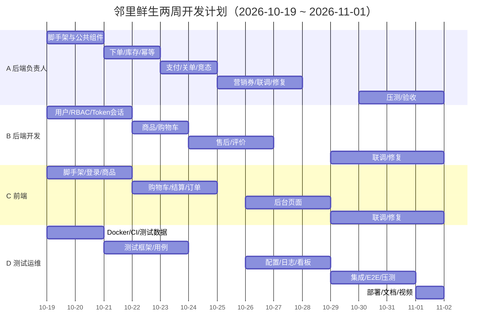

# 邻里鲜生社区超市商城系统 · 项目分工与进度计划

> 版本：v1.0
> 周期：2 周（2026-10-19 周一 ~ 2026-11-01 周日）
> 依据：《需求规格说明书》《设计文档》《数据库设计文档》
> 编制：项目经理 / 后端负责人

---

# 一、项目目标与交付物

## 1.1 总目标

2 周内完成「邻里鲜生」核心交易闭环的可运行系统，并具备可复现部署、测试报告与演示视频。

**主闭环**：浏览 → 加购 → 下单（锁库存）→ 支付沙箱 → 发货/备货 → 收货/核销 → 售后 → 评价。

## 1.2 最终交付物

| 交付物 | 负责人 | 截止 |
| --- | --- | --- |
| 需求 / 设计 / 数据库设计文档 | A | Day 1（已完成） |
| 可运行后端（API + 核心交易） | A、B | Day 11 |
| 可运行前端（C 端 + B 端） | C | Day 11 |
| 数据库脚本与初始化数据 | A | Day 1（已完成） |
| Docker Compose 一键启动 | D | Day 13 |
| 测试报告（含性能与一致性结论） | D | Day 13 |
| 部署运维手册 / 回滚方案 | D | Day 13 |
| 演示视频（≤ 15 分钟） | D + 全员 | Day 14 |
| 答辩材料与分工说明 | A | Day 14 |

---

# 二、团队分工（RACI）

## 2.1 角色

| 代号 | 角色 | 负责范围 |
| --- | --- | --- |
| A | 项目经理 + 后端负责人 + 数据库 | 需求、架构、进度、核心交易（订单/支付/库存/事务/幂等）、营销（优惠券）、数据库 |
| B | 后端开发 + 安全 | 用户、RBAC、Token 会话、商品、购物车、售后、评价、安全 |
| C | 前端负责人 | C 端商城、B 端后台、请求封装、路由与按钮权限、联调 |
| D | 测试 + 运维 + 文档 | 测试、Docker、CI/CD、监控、系统配置/日志/看板、文档、视频 |

> **重要更正**：B 的鉴权实现为**方案 B（随机 Token 存 Redis）**，不是 JWT。依据设计文档 7.1.9 与 ADR-002。

## 2.2 模块归属

| 后端模块 | 负责人 | 主要交付 |
| --- | --- | --- |
| 用户 / 鉴权 | B | 注册登录、Token 会话、注销、地址、会员管理 |
| RBAC / 权限 | B | 角色、权限点、分配、`@RequirePermission` |
| 商品 / 分类 | B | 分类与商品 CRUD、上下架、搜索、缓存 |
| 购物车 | B | 加购合并、数量/勾选/删除/清空 |
| 库存 | A | 三态库存、锁定/扣减/释放、调整 |
| 订单 | A | 下单、状态机、取消、发货、收货、关单 |
| 支付 / 退款 | A | 支付单、沙箱回调、退款、竞态补偿 |
| 售后 | B（调 A 的订单/退款接口） | 申请、审核、进度、退款编排 |
| 营销（优惠券） | A | 发券、领取、试算、核销、退回 |
| 评价 | B | 发表、查看、回复 |
| 系统配置 / 日志 | D | 参数配置、操作日志查询 |
| 数据看板 | D | 订单量、销售额、库存等聚合 |

## 2.3 RACI 摘要

> R = 负责执行，A = 最终拍板，C = 需协作，I = 知会。

| 事项 | A | B | C | D |
| --- | :-: | :-: | :-: | :-: |
| 需求 / 架构 / 进度 | A/R | C | C | C |
| 数据库设计与变更 | A/R | C | I | C |
| 核心交易（订单/支付/库存/幂等） | A/R | C | I | C |
| 用户 / RBAC / 安全 | A（拍板） | R | C | C |
| 商品 / 购物车 / 售后 / 评价 | A（评审） | R | C | C |
| 前端页面与联调 | A（评审） | C | R | C |
| 营销（优惠券） | R | C | C | I |
| 系统配置 / 日志 / 看板 | A（评审） | C | C | R |
| 测试 | A（验收） | C | C | R |
| 部署 / CI/CD / 监控 | A（架构） | C | C | R |
| 文档汇总 / 视频 | A（审核） | C | C | R |

---

# 三、范围优先级（两周必须做取舍）

> 两周周期紧张，以下优先级用于「做不完时先砍什么」，避免最后全面延期。

## 3.1 P0（必须在 Day 11 前完成）

- 用户注册/登录/注销，**方案 B Token 会话**，RBAC 权限点校验。
- 商品分类/列表/详情/搜索。
- 购物车增删改查与结算。
- 下单（锁库存）+ 支付沙箱 + 支付回调幂等。
- 超时未支付自动关单 + 库存/优惠券回滚。
- 支付成功 vs 关单竞态退款补偿。
- 订单状态机、订单查询、发货、确认收货。
- 基础售后（申请 + 审核 + 退款）。
- C 端主闭环页面 + B 端商品/订单/售后页面。
- Docker Compose 一键启动、核心交易测试用例、测试报告。

## 3.2 P1（Day 12-13，P0 稳定后做）

- 优惠券完整流程（发券/领取/试算/核销/退回）。
- 评价（发表/查看/回复）。
- 系统配置、操作日志、数据看板。
- 会员管理、角色权限管理页面。
- 缓存优化、监控指标与告警。

## 3.3 P2（可砍）

- 高级统计报表、完整日志审计 UI。
- 商品图片上传（先用 URL 占位）。
- 全文索引、复杂搜索排序。
- 多地址/默认地址的高级交互。

> **砍功能原则**：先砍 P2，再砍 P1 的展示层，**绝不砍 P0 的库存一致性、幂等与超时关单**。

---

# 四、模块边界与内部接口

## 4.1 A 提供给 B 的内部接口（Day 3 前冻结）

| 接口 | 用途 | 调用方 |
| --- | --- | --- |
| `OrderQueryService.getByNo(orderNo, userId)` | 售后校验订单归属与状态 | 售后 |
| `OrderStateMachine.transition(orderNo, from, to)` | 售后中/已退款流转 | 售后 |
| `PaymentRefundService.refund(orderNo, amount, afterSaleId)` | 发起沙箱退款（幂等） | 售后 |
| `InventoryService.lock/deduct/release` | 库存操作 | 订单、管理端 |

## 4.2 契约冻结

- **Day 2 前**：A 输出核心交易 OpenAPI（下单/支付/订单/售后），B 输出用户/商品/购物车/售后 OpenAPI。
- C 基于 OpenAPI + Mock 先行开发，不等后端。
- 契约变更必须通知 C 与 D，并更新文档。

## 4.3 数据库变更

- 所有 DDL/索引变更由 **A 审批**，通过新增迁移脚本执行，禁止直接改已发布脚本。
- B/D 需要新字段时，提前一天提交变更说明。

---

# 五、两周进度计划

## 5.1 甘特图

## 5.2 第一周（Day 1-7，10/19-10/25）

| 时间 | A | B | C | D | 出口标准 |
| --- | --- | --- | --- | --- | --- |
| D1 周一 | 启动会；冻结接口与分工；检查 DDL | 领取任务；确认 Token 方案 B | 确认页面清单与接口 | 确认环境/CI 方案 | 分工与契约确认 |
| D2 周二 | 后端脚手架、Result/异常/分页/traceId | 用户表/登录骨架 | 前端脚手架、请求封装、登录页 | Docker Compose 骨架 | 前后端能启动 |
| D3 周三 | 库存三态 + 下单锁库存 + 幂等 | 登录/注销/Token 会话 + RBAC 骨架 | 登录、商品列表/详情 | MySQL/Redis 容器 + 测试数据 | 能登录、能看商品 |
| D4 周四 | 支付单/沙箱回调/库存扣减 | 商品/分类 CRUD、购物车 | 购物车、结算页 | 集成测试框架 + 用例初稿 | 购物车可结算 |
| D5 周五 | 超时关单 + 状态机 + 订单查询 | 购物车完善、售后骨架 | 订单列表/详情 | 接口测试、缺陷看板 | 下单→支付→待发货 |
| D6 周六 | 竞态退款补偿 + 幂等加固 | 售后申请/审核（接 A 接口） | C 端主流程页面完善 | E2E 首条链路 | 主闭环首次跑通 |
| D7 周日 | 第一周联调、修复、评审 | 第一周联调、修复 | 第一周联调、修复 | 回归 + 周报 | 核心链路可用 |

**第一周里程碑**：登录 → 浏览 → 加购 → 下单 → 支付 → 发货 → 收货可用。

## 5.3 第二周（Day 8-14，10/26-11/01）

| 时间 | A | B | C | D | 出口标准 |
| --- | --- | --- | --- | --- | --- |
| D8 周一 | 优惠券试算/核销/退回 | 售后完善、评价 | 后台商品/订单页面 | 系统配置/日志接口 | 券可在下单中使用 |
| D9 周二 | 券与订单事务联调 | 评价回复、权限完善 | 售后/评价/后台页面 | 看板聚合查询 | P1 模块接口完成 |
| D10 周三 | 全链路联调、性能初测 | 全链路联调、修复 | 全链路联调、修复 | 集成测试补齐 | 主闭环 + 后台可用 |
| D11 周四 | 缺陷修复、索引/慢 SQL | 缺陷修复 | 缺陷修复、样式统一 | E2E 全量回归 | **P0 冻结** |
| D12 周五 | 压测与库存一致性核对 | 安全自查、越权测试 | 前端性能与兼容性 | 压测、缺陷复测 | 零超卖、指标达标 |
| D13 周六 | 代码评审、文档校对 | 代码评审 | 联调问题收尾 | 部署、备份演练、测试报告、运维手册 | 一键启动成功 |
| D14 周日 | 验收、答辩材料 | 演示准备 | 演示准备 | 演示视频、文档汇总 | 可演示、可复现 |

**第二周里程碑**：P0 全部通过；压测零超卖；一键启动；测试报告与视频交付。

---

# 六、协作机制

## 6.1 每日站会（15 分钟）

- 昨天完成、今天计划、当前阻塞。
- 阻塞超过半天必须在群里升级，不得闷头卡住。

## 6.2 代码与分支

- 分支：`main`（可发布）、`develop`（集成）、`feature/*`、`fix/*`。
- 合并请求至少 1 人评审；核心交易代码由 A 评审。
- 提交信息：`type(scope): subject`，例如 `feat(order): add stock lock on submit`。
- 禁止直接推 `main`；禁止提交密钥与本地配置。

## 6.3 接口与联调

- OpenAPI 为唯一契约；契约变更必须同步 C/D。
- 前后端联调以 test 环境为准，D 维护测试数据。
- 联调问题记录在缺陷看板，标注接口、请求号与 traceId。

## 6.4 完成定义（DoD）

一个任务算完成，必须同时满足：

1. 代码已合并到 `develop`。
2. 接口/页面自测通过，错误码符合规范。
3. 单元测试或接口测试覆盖关键分支。
4. 文档/OpenAPI 已同步。
5. 无 P0/P1 缺陷遗留。

---

# 七、验收清单

## 7.1 核心交易（A）

- [ ] 并发下单零超卖，库存恒等式成立（总 = 可用 + 锁定 + 已售）。
- [ ] 同一 `Idempotency-Key` 重复下单只产生一个订单。
- [ ] 支付回调重复不重复扣减库存。
- [ ] 超时未支付自动关单，库存与优惠券回滚。
- [ ] 支付成功与关单竞态触发退款补偿，不出现「既关单又扣款」。
- [ ] 订单非法状态流转返回 `30002`。

## 7.2 用户与安全（B）

- [ ] 注册/登录/注销可用，登录失败锁定生效。
- [ ] 注销、禁用会员后 Token 立即失效。
- [ ] 权限矩阵逐条通过，越权返回 `10003`/`99001`。
- [ ] 会员只能访问本人数据。
- [ ] 商品/购物车/售后/评价接口符合 OpenAPI。

## 7.3 前端（C）

- [ ] C 端主闭环可完整操作。
- [ ] B 端商品、订单、售后、会员、权限页面可用。
- [ ] 路由守卫与按钮级权限生效。
- [ ] 统一错误提示、Token 注入、traceId 透传正常。

## 7.4 测试与运维（D）

- [ ] 单元/集成/接口/E2E 用例执行完成。
- [ ] 压测达到需求 7.1 指标，库存核对通过。
- [ ] Docker Compose 一键启动，冒烟脚本通过。
- [ ] 备份恢复演练完成，RTO/RPO 有记录。
- [ ] 测试报告、部署运维手册、回滚方案、演示视频交付。

---

# 八、风险与应对

| 风险 | 影响 | 应对 |
| --- | --- | --- |
| 两周周期紧、范围大 | 延期 | 严格执行 P0/P1/P2；D11 冻结 P0；先砍 P2 |
| B 模块多（用户/商品/购物车/售后/评价） | B 成为瓶颈 | A 提前交付内部接口；D 分担测试；必要时把评价降为 P1 |
| A 同时承担 PM/架构/核心交易 | 核心交易被事务性工作挤占 | 上午站会+评审限时；核心交易优先，文档复用现有成果 |
| 前端依赖后端接口 | 联调阻塞 | Day 2 冻结 OpenAPI，C 用 Mock 先行 |
| 数据库变更失控 | 返工/数据不一致 | 所有 DDL 由 A 审批，迁移脚本版本化 |
| 支付沙箱与真实支付差异 | 答辩被质疑 | 文档明确假设与差异，演示强调沙箱 |
| 竞态/幂等测试难复现 | 验收风险 | D 用缩短扫描间隔、并发脚本制造竞争窗口 |
| Day 13 集中部署 | 环境问题暴露晚 | D 从 Day 2 起持续维护 Compose 与 CI |

---

# 九、关键时间点（Checkpoint）

| 时间 | 检查点 | 不通过的处理 |
| --- | --- | --- |
| D2 结束 | 前后端能启动、OpenAPI 冻结 | 当天加班补齐，否则 D3 阻塞 |
| D7 结束 | 主闭环首次跑通 | D8 集中修复，暂停 P1 开发 |
| D11 结束 | **P0 冻结** | 砍 P1 展示层，保核心交易 |
| D13 结束 | 一键启动 + 测试报告 | D14 只做演示与文档，不再改核心代码 |
| D14 | 最终验收 | 保留回滚版本与演示录屏 |

---

> 附：本计划与《需求规格说明书》《设计文档》《数据库设计文档》配套使用；进度以每日站会滚动更新，任何范围调整需 A 确认并记录。
